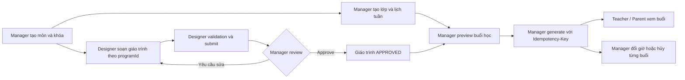
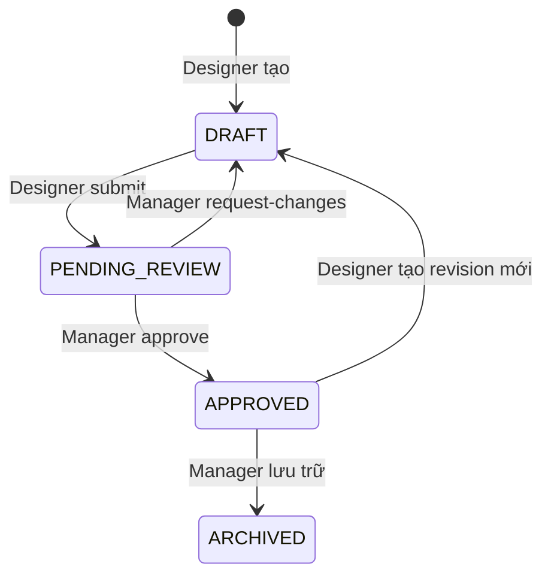

# API và luồng vận hành đào tạo

Cập nhật: 08/10/2026. Tài liệu này mô tả **API đang có trong repo backend** cho danh mục môn, khóa học, lớp, giáo trình, lịch tuần và buổi học. Trạng thái triển khai tổng thể nằm trong [FEATURE_PROCESS.md](FEATURE_PROCESS.md). Các ví dụ dùng ID minh họa; thay bằng ID trả về từ API trước đó.

## Quy ước chung

- Base path: `/api/v1`. Các route bên dưới đều nối vào base path này.
- Gửi `Authorization: Bearer <accessToken>` cho các route được bảo vệ. Lấy token qua `POST /api/v1/auth/login`.
- Response thành công có dạng `{ "success": true, "data": ... }`. Response lỗi có dạng `{ "success": false, "error": { "code": "...", "message": "...", "requestId": "..." } }`.
- Ngày nhập ở dạng `YYYY-MM-DD`; ngày giờ đổi buổi ở UTC ISO, ví dụ `2026-11-04T11:00:00.000Z`. `weekday` là ISO weekday: thứ Hai `1`, Chủ nhật `7`; giờ lịch tuần là `HH:mm` theo giờ địa phương của lớp.
- `Idempotency-Key` là header bắt buộc cho import commit, sinh lịch, đổi giờ và hủy buổi. Khi retry cùng thao tác, giữ nguyên key **và** payload; dùng key mới cho thao tác mới.
- Các body và query bị kiểm tra DTO; field lạ sẽ bị từ chối. Swagger, nếu được bật ở môi trường chạy, nằm tại `/api/docs`.

Luồng chạy chính:



Thứ tự đề xuất khi nối FE: tạo Subject → Program → Class và lịch tuần; Designer tạo Unit, bài học và bài kiểm tra → validation → submit; Manager review/approve → preview sinh lịch → generate; sau đó xem và quản lý từng buổi. Đăng ký học viên có thể chạy sau khi lớp có lịch tuần và được mở đăng ký.

## 1. Danh mục môn và khóa học

| Phương thức và đường dẫn                                         | Quyền                             | Ý nghĩa / dữ liệu chính                                                                                             |
| ---------------------------------------------------------------- | --------------------------------- | ------------------------------------------------------------------------------------------------------------------- |
| `GET /subjects?search=`                                          | Manager, Staff, Teacher, Designer | Danh sách môn, gồm `isActive` và số khóa đang dùng.                                                                 |
| `GET /subjects/:id`                                              | Như trên                          | Chi tiết môn và các khóa liên quan.                                                                                 |
| `POST /subjects`                                                 | Manager                           | Tạo môn: `{ "code": "MATH", "name": "Toán" }`. `code` được chuẩn hóa thành chữ hoa.                                 |
| `PATCH /subjects/:id`                                            | Manager                           | Sửa `code`, `name`, `isActive`. Không đổi tên khi đã có giáo trình liên quan.                                       |
| `DELETE /subjects/:id`                                           | Manager                           | Xóa khi chưa có khóa; nếu đã được dùng thì chuyển `isActive=false`.                                                 |
| `GET /programs?search=&subjectId=&grade=&isActive=&page=&limit=` | Manager, Staff, Teacher, Designer | Danh sách khóa học.                                                                                                 |
| `GET /programs/:id`                                              | Như trên                          | Chi tiết khóa, môn, lớp và các phiên bản giáo trình.                                                                |
| `POST /programs`                                                 | Manager                           | Tạo khóa: `{ "name": "Toán 7", "subjectId": "...", "grade": 7 }`. Có thể dùng `subject` chuỗi cho client cũ.        |
| `PATCH /programs/:id`                                            | Manager                           | Sửa `name`, `subjectId`/`subject`, `grade`, `isActive`. Không đổi môn/khối khi khóa đã có lớp, bài hoặc giáo trình. |
| `DELETE /programs/:id`                                           | Manager                           | Xóa khi chưa dùng; nếu đã dùng thì chuyển `isActive=false`.                                                         |

`programId` là khóa nối toàn bộ luồng sau: mỗi giáo trình thuộc **một khóa học cụ thể**. Manager duyệt giáo trình ở cấp khóa, chưa gắn với lớp; khi sinh buổi mới chọn lớp của đúng `programId`.

## 2. Lớp và lịch học cố định hằng tuần

| Phương thức và đường dẫn | Quyền | Ý nghĩa / dữ liệu chính |
| --- | --- | --- |
| `GET /classes` | Manager, Staff, Teacher, Parent | Danh sách; lọc bằng `programId`, `subject`, `grade`, `search`, `studentId`, `isOpen`, `isActive`, `page`, `limit`. Teacher chỉ thấy lớp mình dạy. |
| `GET /classes/:id?at=&page=&limit=` | Manager, Staff, Teacher được phân công | Chi tiết lớp và roster có hiệu lực tại `at` (mặc định hiện tại). Response có `rosterAt` và `scheduleLocked`; transfer tương lai chỉ đổi roster từ đúng thời điểm hiệu lực. |
| `POST /classes` | Manager | Tạo lớp: `programId`, `name`, `capacity`, `monthlyFee`, tùy chọn `teacherId`; ban đầu đóng đăng ký. |
| `PATCH /classes/:id` | Manager | Sửa lớp, phân giáo viên, `isOpen`, `isActive`. Muốn `isOpen=true` phải có lịch tuần và lớp đang hoạt động. |
| `DELETE /classes/:id` | Manager | Xóa lớp chưa có dữ liệu phụ thuộc; lớp đã được dùng nên chuyển `isActive=false` qua PATCH sau khi xử lý dữ liệu liên quan. |
| `GET /classes/:id/schedules` | Manager, Staff, Teacher được phân công | Xem các khung lịch tuần. Parent dùng `GET /me/students/:id/schedule`. |
| `PUT /classes/:id/schedules` | Manager | Thay toàn bộ bằng `{ "schedules": [{ "weekday": 2, "startTime": "18:00", "endTime": "20:00" }] }`. `POST` cùng đường dẫn là alias cũ. |
| `PATCH /classes/:id/schedules/:scheduleId` | Manager | Sửa một khung giờ với đủ `weekday`, `startTime`, `endTime`. |
| `DELETE /classes/:id/schedules/:scheduleId` | Manager | Xóa một khung giờ. |

Lịch tuần là khuôn để sinh buổi học. PUT/POST/PATCH/DELETE lịch tuần đều dùng chung kiểm tra khóa khi lớp có ghi danh chưa kết thúc, placement chuyển vào của ghi danh chưa kết thúc, bất kỳ buổi đã sinh hoặc Teacher đã xác nhận lịch. `scheduleLocked` phản ánh các điều kiện này; mở khóa xác nhận không bỏ qua khóa do dữ liệu học vụ.

## 3. Soạn, gửi và duyệt giáo trình

`CURRICULUM_DESIGNER` chỉ sửa giáo trình mình tạo khi còn `DRAFT`. `MANAGER` xem và duyệt. `TEACHER` chỉ xem giáo trình đã duyệt của khóa có lớp mình được phân công.

| Phương thức và đường dẫn (đều có tiền tố `/academic`) | Quyền                                 | Ý nghĩa / dữ liệu chính                                                                                                                |
| ----------------------------------------------------- | ------------------------------------- | -------------------------------------------------------------------------------------------------------------------------------------- |
| `POST /curriculum-units`                              | Designer                              | Tạo nháp: `programId`, `title`, `fromDate`, `toDate` (tối đa 366 ngày).                                                                |
| `GET /curriculum-units`                               | Designer, Manager, Teacher            | Lọc `programId`, `grade`, `subject`, `status`, `search`; đặt `paginated=true&page=1&limit=20` để nhận `{ items, page, limit, total }`. |
| `GET /curriculum-units/:id`                           | Như trên, theo quyền sở hữu/phân công | Chi tiết gồm bài học và bài kiểm tra tháng.                                                                                            |
| `PATCH /curriculum-units/:id`                         | Designer sở hữu nháp                  | Sửa `title`, `fromDate`, `toDate`; nên gửi `expectedRevision`.                                                                         |
| `POST /curriculum-units/:id/lessons`                  | Designer sở hữu nháp                  | Thêm bài: `title`, `content`, `sequence`, tùy chọn `expectedRevision`.                                                                 |
| `PATCH /curriculum-units/:id/lessons/:lessonId`       | Designer sở hữu nháp                  | Sửa bài với các field như thêm bài.                                                                                                    |
| `DELETE /curriculum-units/:id/lessons/:lessonId`      | Designer sở hữu nháp                  | Xóa bài/kiểm tra chưa có dữ liệu phụ thuộc; bài thường được đánh lại số thứ tự.                                                        |
| `PUT /curriculum-units/:id/lesson-order`              | Designer sở hữu nháp                  | `{ "orderedLessonIds": ["...", "..."], "expectedRevision": 1 }`; mảng phải chứa đủ mỗi bài thường đúng một lần.                        |
| `POST /curriculum-units/:id/monthly-tests`            | Designer sở hữu nháp                  | Tạo hoặc thay bài kiểm tra tháng: `monthKey` dạng `YYYY-MM`, `title`, `content`, tùy chọn `expectedRevision`.                          |
| `POST /curriculum-units/:id/validation`               | Người được xem giáo trình             | Trả `ready`, `errors`, `revision`, số bài thường và bài kiểm tra.                                                                      |
| `POST /curriculum-units/:id/submit`                   | Designer sở hữu nháp                  | Kiểm tra cấu trúc rồi chuyển `DRAFT → PENDING_REVIEW`.                                                                                 |
| `POST /curriculum-units/:id/request-changes`          | Manager                               | `{ "reason": "..." }`; chuyển `PENDING_REVIEW → DRAFT`, lưu ghi chú.                                                                   |
| `POST /curriculum-units/:id/approve`                  | Manager                               | Chuyển `PENDING_REVIEW → APPROVED`; duyệt cả bài học/kiểm tra.                                                                         |
| `POST /curriculum-units/:id/revisions`                | Designer sở hữu bản đã duyệt          | Sao chép bản `APPROVED` thành phiên bản `DRAFT` mới.                                                                                   |
| `DELETE /curriculum-units/:id`                        | Designer hoặc Manager theo trạng thái | Xóa nháp chưa có tham chiếu; Manager lưu trữ bản đã duyệt thành `ARCHIVED`.                                                            |

Luồng trạng thái:



Mũi tên revision tạo **bản ghi mới**, không sửa bản `APPROVED`. Việc duyệt không tự động đưa giáo trình vào từng lớp; Manager áp dụng bản đã duyệt khi gọi API sinh lịch của lớp. Trước khi submit, phải có ít nhất một bài thường, các `sequence` liên tiếp từ `1`; bài kiểm tra tháng phải nằm trong khoảng ngày của giáo trình. Khi sinh lịch, mỗi tháng có buổi học cần bài kiểm tra cho buổi cuối tháng và đủ bài thường cho các buổi còn lại.

Ví dụ chuỗi thao tác chính:

```http
POST /api/v1/academic/curriculum-units
Authorization: Bearer <designer-token>
Content-Type: application/json

{"programId":"<programId>","title":"Học phần tháng 11","fromDate":"2026-11-01","toDate":"2026-11-30"}
```

Lấy `data.id` và `data.revision` từ response, thêm bài/kiểm tra, gọi `validation`, sau đó `submit`. Manager xem danh sách với `status=PENDING_REVIEW`, mở chi tiết và gọi `approve` hoặc `request-changes`.

## 4. Nhập bài từ CSV

| Phương thức và đường dẫn (tiền tố `/academic`) | Quyền                | Cách dùng                                                                                                                                             |
| ---------------------------------------------- | -------------------- | ----------------------------------------------------------------------------------------------------------------------------------------------------- |
| `POST /curriculum-units/:id/import-preview`    | Designer sở hữu nháp | `multipart/form-data`: file field tên `file`, field `mode=APPEND` hoặc `REPLACE`. Trả `previewId`, `expectedRevision`, `expiresAt`, từng dòng và lỗi. |
| `POST /curriculum-units/:id/import-commit`     | Designer sở hữu nháp | Header `Idempotency-Key`; JSON gồm `previewId`, `expectedRevision`, `mode`, `rows` đúng như preview.                                                  |

Header CSV bắt buộc có `kind,sequence,title,content,monthKey` (có thể đổi thứ tự cột). `kind` là `LESSON` hoặc `MONTHLY_TEST`. Bài thường dùng `sequence` bắt đầu từ 1; bài kiểm tra dùng `monthKey` như `2026-11`. File UTF-8, tối đa 5 MiB và 1.000 dòng dữ liệu; hỗ trợ BOM, dấu tiếng Việt, ô được quote và nội dung nhiều dòng. Số cột mỗi dòng phải khớp header.

```csv
kind,sequence,title,content,monthKey
LESSON,1,"Tập hợp, số",Nội dung bài 1,
LESSON,2,Số tự nhiên,Nội dung bài 2,
MONTHLY_TEST,,Kiểm tra tháng 11,Đề kiểm tra,2026-11
```

Chỉ commit khi preview không có lỗi và chưa hết hạn. Bản nháp không được thay đổi revision giữa preview và commit. `REPLACE` bị chặn nếu bài cũ đã có buổi học, phản hồi hoặc revision tham chiếu.

## 5. Xem trước và sinh buổi học cho lớp

| Phương thức và đường dẫn (tiền tố `/academic`) | Quyền | Cách dùng |
| --- | --- | --- |
| `POST /classes/:id/session-preview` | Manager | Body `curriculumUnitId`, `fromDate`, `toDate`; trả `previewId`, `expiresAt`, tổng buổi, các buổi dự kiến và xung đột. |
| `POST /classes/:id/session-generations` | Manager | Body như preview, có thể kèm `previewId`; **bắt buộc** `Idempotency-Key`. Sinh toàn bộ buổi trong transaction và ghi đợt sinh. |
| `GET /classes/:id/session-generations` | Manager, Staff, Teacher được phân công | Lịch sử các đợt sinh của lớp. |
| `GET /session-generations/:id` | Manager, Staff, Teacher được phân công | Chi tiết một đợt sinh. |
| `GET /scheduled-sessions?studentId=&classId=&fromDate=&toDate=&page=&limit=` | Manager, Staff, Teacher, Parent | Danh sách buổi; Teacher chỉ thấy buổi mình dạy. Parent có thể chọn một con, nhận cả lịch theo placement, buổi học bù khác lớp và lịch sử hợp lệ; mỗi buổi có `participations` cùng liên kết source/target makeup. |
| `GET /scheduled-sessions/:id?studentId=` | Manager, Staff, Teacher, Parent | Chi tiết buổi; Parent phải chọn `studentId` của con mình, chỉ nhận dữ liệu tham gia của con đó. |

Ví dụ sinh lịch:

```http
POST /api/v1/academic/classes/<classId>/session-preview
Authorization: Bearer <manager-token>
Content-Type: application/json

{"curriculumUnitId":"<approvedUnitId>","fromDate":"2026-11-01","toDate":"2026-11-30"}
```

Nếu preview không có xung đột, gửi lại cùng khoảng ngày và `previewId`:

```http
POST /api/v1/academic/classes/<classId>/session-generations
Authorization: Bearer <manager-token>
Idempotency-Key: class-nov-2026-v1
Content-Type: application/json

{"curriculumUnitId":"<approvedUnitId>","fromDate":"2026-11-01","toDate":"2026-11-30","previewId":"<previewId>"}
```

Backend yêu cầu bản giáo trình `APPROVED`, cùng `programId` với lớp, khóa/môn hoạt động, giáo viên hoạt động, lịch tuần và đủ bài. Nó kiểm tra lại xung đột lớp/giáo viên lúc generate. Hiện tại `previewId` là **tùy chọn** để tương thích client cũ; nếu gửi, token phải còn hạn và khớp snapshot. FE mới nên luôn gửi để phát hiện thay đổi từ lúc preview. Sau khi đã sinh buổi, lịch tuần không thể sửa qua các API lịch thường.

## 6. Đổi giờ và hủy từng buổi

| Phương thức và đường dẫn (tiền tố `/academic`) | Quyền   | Cách dùng                                                                                                      |
| ---------------------------------------------- | ------- | -------------------------------------------------------------------------------------------------------------- |
| `POST /sessions/:id/reschedule-preview`        | Manager | Body `startsAt`, `endsAt`, `reason`, `expectedRevision`; kiểm tra khả năng đổi giờ.                            |
| `POST /sessions/:id/reschedule`                | Manager | Cùng body preview, thêm `Idempotency-Key`; giữ nguyên session ID, tăng revision, ghi audit.                    |
| `POST /sessions/:id/cancel`                    | Manager | `{ "reason": "...", "expectedRevision": 1 }`, thêm `Idempotency-Key`; chuyển buổi sang `CANCELLED`, ghi audit. |

Chỉ xử lý buổi `SCHEDULED` ở tương lai. Khi đổi giờ, backend kiểm tra xung đột lớp/giáo viên, thứ tự bài và các dữ liệu học viên liên quan. Khi hủy, booking học bù, điểm danh đã ghi hoặc đơn nghỉ đang hiệu lực phải được xử lý trước. Lấy `revision` mới từ chi tiết buổi trước mỗi thao tác; nếu có người khác đã sửa, tải lại buổi và preview lại.

```http
POST /api/v1/academic/sessions/<sessionId>/reschedule
Authorization: Bearer <manager-token>
Idempotency-Key: move-session-001
Content-Type: application/json

{"startsAt":"2026-11-04T11:00:00.000Z","endsAt":"2026-11-04T13:00:00.000Z","reason":"Đổi phòng học","expectedRevision":1}
```

## 7. Nối với ghi danh và màn phụ huynh

Sau khi Manager tạo lớp và lịch tuần, đặt `isOpen=true` qua `PATCH /classes/:id` để Staff có thể ghi danh. `POST /registrations` tạo đơn; `POST /registrations/:id/confirm-payment` xác nhận thanh toán ngoại tuyến và tạo enrollment/placement. Hai thao tác này dùng `Idempotency-Key`. Parent có thể xem `GET /me/students/:id/schedule` (lịch tuần cố định) và `GET /academic/scheduled-sessions` hoặc chi tiết buổi (lịch đã sinh). Lịch tuần và lịch buổi là hai dữ liệu khác nhau: đổi/hủy một buổi không sửa khuôn lịch tuần.

`GET /academic/scheduled-sessions` nhận `studentId` khi Parent muốn xem một con. API giữ buổi lịch sử của enrollment đã kết thúc, nhưng không cấp quyền xem buổi mới từ thời điểm kết thúc. Học bù ở lớp khác placement được trả qua participant của đúng con; response không chứa participant của học sinh khác.

## 8. Nghỉ học, học bù, chuyển lớp và học lại

| Phương thức và đường dẫn (tiền tố `/academic`) | Quyền ghi | Cách dùng |
| --- | --- | --- |
| `POST /leaves` | Parent hoặc Staff | Parent tạo yêu cầu chờ duyệt; Staff ghi thay và được duyệt trong cùng transaction. Với `SINGLE_ABSENCE`, backend tự tạo participant thường nếu roster chưa được chuẩn bị. |
| `POST /leaves/:id/decide` | Staff | Duyệt hoặc từ chối yêu cầu đang chờ. |
| `POST /leaves/:id/cancel` | Staff | Hủy yêu cầu còn có thể thay đổi. |
| `POST /makeups` | Staff | Đặt học bù sau khi kiểm tra kỳ học, leave, trùng lịch và sức chứa. |
| `POST /makeups/:id/cancel` | Staff | Hủy booking chưa hoàn thành. Có thể đặt lại cùng target; booking cũ vẫn giữ trạng thái `CANCELLED`. |
| `POST /enrollments/:id/transfer` | Staff | Chuyển lớp theo `effectiveAt`, giữ nguyên enrollment và lịch sử lớp gốc. |
| `POST /enrollments/:id/end` | Staff | Kết thúc một enrollment. |
| `POST /students/:id/end-study` | Staff | Kết thúc các enrollment và chuyển hồ sơ học sinh sang `INACTIVE`. |
| `POST /students/:id/reactivate` | Staff | Body `{ "reason": "..." }`; chuyển lại hồ sơ cũ sang `ACTIVE`, ghi audit, không phục hồi enrollment cũ hoặc tự tạo enrollment mới. |

Chỉ Teacher được phân công mới được gọi `POST /sessions/:id/roster` và `POST /sessions/:id/finalize-attendance`. Actor của mọi command lấy từ JWT; Manager có thể dùng các API đọc được công bố nhưng không được gọi thay các command vận hành của Staff hoặc Teacher.

## Contract vận hành bổ sung (12/10/2026)

- `GET /academic/classes/:id/attendance-summary` và `GET /academic/me/students/:id/attendance` dùng chung công thức `(present + madeUp) / required`; buổi nghỉ có phép không vào mẫu số.
- `POST /academic/leaves/:id/end-early` giữ lịch sử đã nghỉ và chỉ mở lại các buổi tương lai. `POST /academic/makeups/:id/reschedule` đổi chỗ học bù trong một transaction.
- `GET /academic/email-deliveries` và `POST /academic/email-deliveries/:id/retry` dành cho Manager/Staff. Worker retry email pending với backoff và giới hạn số lần thử.
- `PATCH /auth/me`, `POST /auth/change-password`, `/auth/forgot-password`, `/auth/reset-password` cung cấp self-service profile/password; reset thu hồi các phiên cũ.
- `GET /audit-logs` dành cho Manager, có bộ lọc actor/entity/action/thời gian.

## Contract BE handoff (13/10/2026)

Các đường dẫn dưới đây tương đối với `/api/v1`; endpoint chuyên cần và email có thêm tiền tố `/academic`.

| API | Thay đổi contract |
| --- | --- |
| `POST /classes/:id/teacher-assignments` | Đổi giáo viên theo `effectiveAt`. Trước thời điểm đó giáo viên cũ vẫn phụ trách; các buổi `SCHEDULED` từ thời điểm đó được phân cho giáo viên mới. Gửi lại `teacherId` hiện tại để hủy phân công chờ. Trùng lịch trả `TEACHER_SCHEDULE_CONFLICT`. |
| `GET /classes/:id` | Trả `pendingTeacher` và `pendingTeacherFrom` khi có phân công chờ, cùng `room` và roster theo placement. |
| `GET /classes` | Trả `room`, `rosterCount` hiện tại và, khi có `startDate`/`packageMonths`, `availableSeats` tính theo placement trong kỳ. `_count.enrollments` vẫn là tổng theo lớp gốc. |
| `POST /academic/leaves/:id/end-early` | `effectiveDate` phải là `YYYY-MM-DD`, không trước ngày hiện tại theo UTC+7; ngày sai trả `400 INVALID_EFFECTIVE_DATE`. Chỉ mở lại buổi trong kỳ nghỉ đang kết thúc. |
| `GET /academic/classes/:id/attendance-summary` | Ngày `YYYY-MM-DD` bao trùm cả ngày UTC+7; Teacher có thể lọc `studentId`. Response thêm `students[]` gồm `studentId`, `fullName`, `counts`, `attendancePercent`. `UNMARKED` ở buổi đã hoàn tất tính vắng. |
| `POST /auth/change-password` | Sai mật khẩu hiện tại trả `400 AUTH_CURRENT_PASSWORD_INVALID`, không thu hồi phiên. |
| `POST /auth/reset-password` | Token chỉ dùng một lần; đặt lại thành công thu hồi phiên và các reset token khác, ghi audit `PASSWORD_RESET`. |
| `POST /account-invitations/:id/resend` | Manager xoay token của lời mời chưa dùng, gia hạn 48 giờ và xếp email mới vào outbox. Response không chứa token. |
| `POST /teacher-invitations`, `/manager-invitations` | Chỉ response tạo mới có `acceptanceToken` một lần; không API nào trả `tokenHash`. Danh sách lời mời có `acceptedUser` công khai. |
| `POST /teachers` | Trả `410 TEACHER_INVITATION_REQUIRED`; dùng quy trình mời → nhận → duyệt. |
| `GET /managers` | Chỉ kiểm role `MANAGER`, không trả `permissions`. Endpoint `PATCH /managers/:id/permissions` đã bỏ. |
| `POST /academic/email-deliveries/:id/retry` | SMTP lỗi trả `502 EMAIL_DELIVERY_FAILED` sau khi lưu lần thử. Danh sách delivery không trả payload chứa link/token. |

Email điểm danh, nghỉ học, học bù, chuyển lớp, kết thúc học, lời mời, xác minh/reset, thanh toán, thông báo và nhắc học phí được xếp vào outbox. API tạo sự kiện xác nhận đã xếp hàng; trạng thái gửi thực tế xem qua `GET /academic/email-deliveries`. Worker dùng lease 60 giây và `maxAttempts` của từng event; nếu process chết đúng lúc SMTP nhận email thì email có thể được gửi lại.

Migration `20261013000000_outbox_lease` thêm lease cho worker; `20261013001000_pending_class_teacher` thêm phân công giáo viên chờ hiệu lực. Cần chạy `prisma migrate deploy` trước khi chạy code mới. Cấu hình `WEB_ORIGIN` là gốc URL của Web dùng trong link nhận lời mời và đặt lại mật khẩu; nếu không đặt, BE dùng origin đầu tiên trong `CORS_ORIGINS`.
