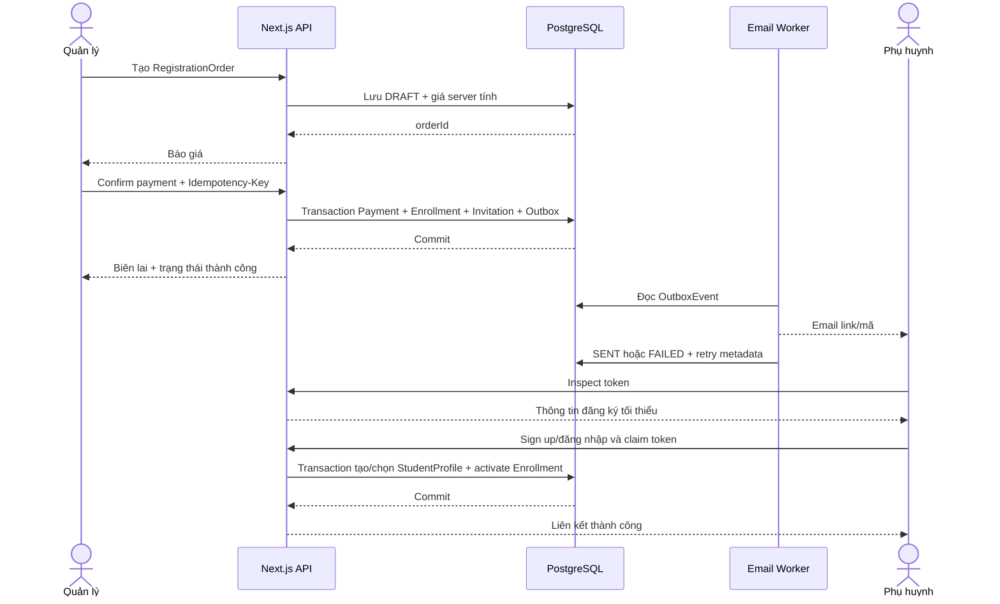

# EduGrade Backend Flow — Đăng ký, thanh toán và liên kết học sinh

## 1. Mục tiêu

Tài liệu này mô tả một luồng Backend hoàn chỉnh cho EduGrade bằng **Next.js App Router**:

```text
Quản lý tạo đăng ký
→ xác nhận đã nhận đủ tiền
→ tạo Payment + Enrollment
→ tạo mã/link liên kết dùng một lần
→ gửi email và sinh biên lai
→ phụ huynh tạo hoặc dùng lại tài khoản
→ liên kết Enrollment vào đúng hồ sơ học sinh
```

Đây là luồng nền tảng vì nó đồng thời xử lý ba trường hợp:

1. Con đầu tiên, phụ huynh chưa có tài khoản.
2. Thêm con mới vào tài khoản phụ huynh đã tồn tại.
3. Học sinh đã có hồ sơ đăng ký thêm môn/lớp.

## 2. Phạm vi và nguyên tắc

- Hệ thống chỉ có một trung tâm.
- Chỉ `MANAGER` được tạo đăng ký và xác nhận thanh toán.
- Phụ huynh không thanh toán hoặc tự đăng ký online.
- `ParentAccount` là tài khoản đăng nhập; học sinh không có tài khoản riêng.
- Một phụ huynh có thể quản lý nhiều `StudentProfile`.
- Một học sinh có thể có nhiều `Enrollment`.
- Chỉ sau khi quản lý xác nhận đã nhận đủ tiền mới được tạo `Payment`, `Enrollment` và mã liên kết.
- Mỗi giao dịch chỉ được xác nhận một lần.
- Mã liên kết dùng một lần, hết hạn sau 7 ngày.
- Email lỗi không được rollback dữ liệu thanh toán hoặc đăng ký.
- Email trong mã liên kết phải khớp tài khoản phụ huynh nhận liên kết.
- Enrollment ở trạng thái `PENDING_LINK` vẫn giữ một chỗ trong lớp để tránh bán vượt sĩ số.

## 3. Stack đề xuất

- Next.js App Router + TypeScript.
- Route Handlers trong `app/api`.
- PostgreSQL.
- Prisma ORM.
- Auth bằng session/JWT lưu trong cookie `HttpOnly`, `Secure`, `SameSite=Lax`.
- Mật khẩu hash bằng Argon2id hoặc bcrypt với cost phù hợp.
- Zod để kiểm tra request body.
- Transactional Outbox cho email.
- Worker riêng xử lý hàng đợi email; không gửi email trực tiếp trong database transaction.

Các Route Handler liên quan tới Prisma, hash mật khẩu và transaction phải chạy Node.js runtime:

```ts
export const runtime = "nodejs";
```

## 4. Mô hình dữ liệu cốt lõi

```mermaid
erDiagram
    User ||--o| ParentProfile : owns
    ParentProfile ||--o{ StudentProfile : manages
    StudentProfile ||--o{ Enrollment : has
    Class ||--o{ Enrollment : receives
    Program ||--o{ Class : defines
    RegistrationOrder ||--o| Payment : produces
    RegistrationOrder ||--o| Enrollment : produces
    RegistrationOrder ||--o{ LinkInvitation : issues
    Enrollment }o--o| StudentProfile : linked_to
    OutboxEvent }o--|| RegistrationOrder : notifies_about
    AuditLog }o--|| User : performed_by
```

### 4.1 User

```text
id
email                  unique, luôn normalize lowercase + trim
passwordHash           nullable trước khi tài khoản được tạo hoàn chỉnh
role                   MANAGER | TEACHER | PARENT
status                 ACTIVE | DISABLED
createdAt
updatedAt
```

### 4.2 ParentProfile

```text
id
userId                 unique
phone                  chỉ dùng để liên hệ
createdAt
updatedAt
```

### 4.3 StudentProfile

```text
id
parentProfileId
fullName
grade                  6 | 7 | 8 | 9
dateOfBirth            nullable
status                 ACTIVE | INACTIVE
createdAt
updatedAt
```

### 4.4 RegistrationOrder

Lưu dữ liệu đăng ký trước khi có Payment/Enrollment. Bản ghi này cũng giữ thông tin con mới trước khi `StudentProfile` tồn tại.

```text
id
type                   FIRST_CHILD | NEW_CHILD | EXISTING_STUDENT_NEW_SUBJECT
parentEmail
parentPhone
studentFullName        snapshot phục vụ con mới, biên lai và email
studentGrade
targetStudentId        nullable; bắt buộc với EXISTING_STUDENT_NEW_SUBJECT
classId
packageMonths          integer 1..12
quotedAmount
currency               mặc định VND
status                 DRAFT | PAYMENT_CONFIRMED | LINKED | CANCELLED
createdByManagerId
confirmedAt            nullable
linkedAt               nullable
createdAt
updatedAt
```

### 4.5 Payment

```text
id
registrationOrderId    unique
amount
currency
status                 CONFIRMED
confirmedByManagerId
confirmedAt
receiptNumber          unique
createdAt
```

Không cần trạng thái `PENDING` nếu hệ thống chỉ ghi Payment sau khi quản lý bấm xác nhận.

### 4.6 Enrollment

```text
id
registrationOrderId    unique
studentProfileId       nullable trong thời gian chờ liên kết
classId
packageMonths
status                 PENDING_LINK | ACTIVE | ENDED
startDate              nullable cho tới khi chính sách ngày bắt đầu được chốt
endDate                nullable
activatedAt            nullable
endedAt                nullable
createdAt
updatedAt
```

Với học sinh cũ, `studentProfileId` có thể được gắn sẵn nhưng Enrollment vẫn giữ `PENDING_LINK` cho đến khi phụ huynh xác nhận mã.

### 4.7 LinkInvitation

```text
id
registrationOrderId
tokenHash              unique; không lưu token thô
expectedParentEmail
status                 ACTIVE | USED | EXPIRED | REVOKED
expiresAt              createdAt + 7 ngày
usedAt                 nullable
usedByUserId           nullable
createdAt
```

Token thô chỉ xuất hiện lúc tạo link, sau đó chỉ lưu SHA-256 hash trong database.

### 4.8 OutboxEvent

```text
id
eventType              REGISTRATION_CONFIRMED | LINK_REISSUED | ...
aggregateId            RegistrationOrder ID
payload                JSON
status                 PENDING | PROCESSING | SENT | FAILED
attemptCount
nextAttemptAt
lastError              nullable
createdAt
sentAt                 nullable
```

### 4.9 AuditLog

```text
id
actorUserId
action                 PAYMENT_CONFIRMED | LINK_USED | LINK_REISSUED | ...
entityType
entityId
beforeData             JSON nullable
afterData              JSON nullable
ipAddress
userAgent
createdAt
```

## 5. State machine

### RegistrationOrder

```text
DRAFT
  └── confirm payment → PAYMENT_CONFIRMED
                              └── claim link → LINKED

DRAFT → CANCELLED
```

Không cho phép `PAYMENT_CONFIRMED → DRAFT` hoặc xác nhận lần hai.

### Enrollment

```text
PENDING_LINK
    └── claim link thành công → ACTIVE
                                   └── nghỉ môn/nghỉ hẳn → ENDED
```

### LinkInvitation

```text
ACTIVE
  ├── dùng thành công → USED
  ├── quá 7 ngày      → EXPIRED
  └── cấp mã mới      → REVOKED
```

Chỉ một invitation `ACTIVE` được tồn tại cho một RegistrationOrder tại một thời điểm.

## 6. API endpoints

### 6.1 Quản lý tạo bản nháp đăng ký

```http
POST /api/manager/registration-orders
Authorization: MANAGER session
Content-Type: application/json
```

Ví dụ request:

```json
{
  "type": "FIRST_CHILD",
  "parentEmail": "parent@example.com",
  "parentPhone": "0901234567",
  "student": {
    "fullName": "Nguyễn Văn An",
    "grade": 8
  },
  "classId": "class_123",
  "packageMonths": 3
}
```

Backend thực hiện:

1. Kiểm tra role `MANAGER`.
2. Normalize email.
3. Kiểm tra `packageMonths` trong khoảng 1–12.
4. Kiểm tra lớp tồn tại, đang mở và phù hợp khối/môn.
5. Phân biệt đúng ba loại đăng ký:
   - `FIRST_CHILD`: email chưa có ParentAccount.
   - `NEW_CHILD`: email đã có ParentAccount, chưa cần `targetStudentId`.
   - `EXISTING_STUDENT_NEW_SUBJECT`: `targetStudentId` phải thuộc đúng parent email.
6. Kiểm tra học sinh chưa có Enrollment còn hiệu lực trùng lớp/môn theo chính sách.
7. Tính học phí ở server; không tin `amount` do client gửi lên.
8. Tạo `RegistrationOrder(DRAFT)`.

Response:

```json
{
  "id": "order_123",
  "status": "DRAFT",
  "quotedAmount": 3000000,
  "currency": "VND"
}
```

### 6.2 Quản lý xác nhận thanh toán

```http
POST /api/manager/registration-orders/:orderId/confirm-payment
Authorization: MANAGER session
Idempotency-Key: <uuid>
```

Đây là transaction quan trọng nhất.

```text
BEGIN TRANSACTION
  1. Lock/đọc RegistrationOrder.
  2. Nếu đã PAYMENT_CONFIRMED:
       - cùng Idempotency-Key → trả kết quả cũ;
       - key khác → trả 409 PAYMENT_ALREADY_CONFIRMED.
  3. Tính lại học phí bằng dữ liệu hiện tại.
  4. Kiểm tra lớp còn chỗ.
  5. Tạo Payment(CONFIRMED).
  6. Tạo Enrollment(PENDING_LINK).
  7. Sinh token ngẫu nhiên tối thiểu 256 bit.
  8. Lưu SHA-256(token) vào LinkInvitation.
  9. Đổi RegistrationOrder → PAYMENT_CONFIRMED.
 10. Tạo AuditLog(PAYMENT_CONFIRMED).
 11. Tạo OutboxEvent(REGISTRATION_CONFIRMED).
COMMIT
```

Sau commit, API trả thông tin biên lai. Worker gửi email độc lập.

```json
{
  "orderId": "order_123",
  "paymentId": "payment_123",
  "enrollmentId": "enrollment_123",
  "receiptNumber": "EG-20260915-000001",
  "status": "PAYMENT_CONFIRMED",
  "emailQueued": true
}
```

Ràng buộc database bắt buộc:

```text
UNIQUE Payment.registrationOrderId
UNIQUE Enrollment.registrationOrderId
UNIQUE Payment.receiptNumber
UNIQUE LinkInvitation.tokenHash
```

Các unique constraint là lớp bảo vệ cuối cùng nếu người dùng double-click hoặc hai request chạy đồng thời.

### 6.3 Xem thông tin mã liên kết

```http
POST /api/link-invitations/inspect
Content-Type: application/json
```

```json
{
  "token": "raw-token-from-email"
}
```

Chỉ trả dữ liệu tối thiểu:

```json
{
  "valid": true,
  "mode": "CREATE_ACCOUNT",
  "maskedEmail": "p***@example.com",
  "studentName": "Nguyễn Văn An",
  "subjectName": "Toán",
  "className": "Toán 8A",
  "expiresAt": "2026-09-22T10:00:00.000Z"
}
```

Không trả token hash, Payment nội bộ hoặc dữ liệu đầy đủ của phụ huynh.

### 6.4 Dùng mã cho phụ huynh chưa có tài khoản

```http
POST /api/link-invitations/claim-and-sign-up
Content-Type: application/json
```

```json
{
  "token": "raw-token-from-email",
  "password": "strong-password",
  "displayName": "Nguyễn Thị B"
}
```

Email không cho client nhập lại; backend lấy email cố định từ invitation.

Trong một transaction:

```text
1. Hash token và lock invitation.
2. Kiểm tra ACTIVE, chưa dùng, chưa hết hạn.
3. Kiểm tra parent email chưa có tài khoản.
4. Tạo User(role=PARENT) và ParentProfile.
5. Tạo StudentProfile từ snapshot trong RegistrationOrder.
6. Gắn Enrollment.studentProfileId.
7. Đổi Enrollment → ACTIVE.
8. Đổi RegistrationOrder → LINKED.
9. Đổi invitation → USED, lưu usedAt và usedByUserId.
10. Ghi AuditLog(LINK_USED).
11. Tạo session đăng nhập cho phụ huynh.
```

Nếu email đã có tài khoản do race condition, trả `409 ACCOUNT_ALREADY_EXISTS` và yêu cầu đăng nhập để claim, không tạo tài khoản thứ hai.

### 6.5 Dùng mã với tài khoản phụ huynh đã tồn tại

```http
POST /api/link-invitations/claim
Authorization: PARENT session
Content-Type: application/json
```

```json
{
  "token": "raw-token-from-email"
}
```

Kiểm tra bắt buộc:

```text
session.user.email === invitation.expectedParentEmail
```

Sau đó xử lý theo loại đăng ký:

- `NEW_CHILD`: tạo `StudentProfile` mới dưới ParentProfile đang đăng nhập rồi gắn Enrollment.
- `EXISTING_STUDENT_NEW_SUBJECT`: không tạo hồ sơ mới; xác nhận `targetStudentId` thuộc phụ huynh đang đăng nhập rồi kích hoạt Enrollment.
- `FIRST_CHILD` nhưng tài khoản đã tồn tại: xử lý như thêm con mới nếu email khớp, nhằm an toàn trước race condition.

Cuối transaction, invitation thành `USED`, order thành `LINKED`, enrollment thành `ACTIVE`.

### 6.6 Cấp lại mã đã hết hạn

```http
POST /api/manager/registration-orders/:orderId/reissue-link
Authorization: MANAGER session
```

Trong transaction:

1. Chỉ cho phép order `PAYMENT_CONFIRMED` và chưa `LINKED`.
2. Revoke mọi invitation `ACTIVE` cũ.
3. Tạo invitation mới, hạn 7 ngày.
4. Ghi audit log.
5. Tạo outbox event gửi email mới.

Việc cấp lại mã không tạo thêm Payment hoặc Enrollment.

### 6.7 Xem/in biên lai

```http
GET /api/manager/payments/:paymentId/receipt
Authorization: MANAGER session
```

API trả dữ liệu hoặc PDF biên lai. Nút **In** nằm ở frontend và gọi chức năng in của trình duyệt; không tích hợp máy in vào backend.

## 7. Sequence diagram



## 8. Cấu trúc source Next.js đề xuất

```text
src/
├── app/
│   └── api/
│       ├── manager/
│       │   └── registration-orders/
│       │       ├── route.ts
│       │       └── [orderId]/
│       │           ├── confirm-payment/route.ts
│       │           └── reissue-link/route.ts
│       ├── link-invitations/
│       │   ├── inspect/route.ts
│       │   ├── claim/route.ts
│       │   └── claim-and-sign-up/route.ts
│       └── manager/payments/[paymentId]/receipt/route.ts
├── modules/
│   ├── auth/
│   │   ├── auth.service.ts
│   │   ├── password.service.ts
│   │   └── authorization.ts
│   ├── registration/
│   │   ├── registration.schema.ts
│   │   ├── registration.service.ts
│   │   ├── payment-confirmation.service.ts
│   │   └── link-claim.service.ts
│   ├── pricing/
│   │   └── pricing.service.ts
│   ├── enrollment/
│   │   └── enrollment.service.ts
│   ├── notification/
│   │   ├── outbox.service.ts
│   │   ├── email.worker.ts
│   │   └── templates/
│   └── audit/
│       └── audit.service.ts
├── lib/
│   ├── db.ts
│   ├── errors.ts
│   ├── idempotency.ts
│   └── crypto-token.ts
└── generated/
    └── prisma/

prisma/
├── schema.prisma
└── migrations/
```

Route Handler chỉ nên làm bốn việc:

1. Đọc request.
2. Xác thực và phân quyền.
3. Validate dữ liệu.
4. Gọi service rồi chuyển kết quả thành HTTP response.

Không đặt transaction hoặc nghiệp vụ lớn trực tiếp trong `route.ts`.

## 9. Luồng gửi email

Email xác nhận gồm:

- Tên học sinh.
- Môn, lớp và lịch học.
- Số tiền đã xác nhận.
- Số biên lai.
- Link/mã liên kết.
- Thời điểm mã hết hạn.

Worker xử lý:

```text
PENDING
→ PROCESSING
→ gửi thành công → SENT
→ gửi lỗi → FAILED + attemptCount + nextAttemptAt
→ đến thời gian retry → PROCESSING
```

Retry đề xuất: exponential backoff, ví dụ 1 phút, 5 phút, 30 phút, 2 giờ, 12 giờ. Sau số lần tối đa, giữ `FAILED` để quản lý có thể bấm gửi lại.

Không log token thô, mật khẩu hoặc toàn bộ nội dung email chứa dữ liệu nhạy cảm.

## 10. Bảo mật

- Tất cả endpoint `/api/manager/**` phải kiểm tra role ở server, không chỉ ẩn nút ở frontend.
- Parent claim phải kiểm tra email tài khoản đúng với `expectedParentEmail`.
- Với học sinh cũ, phải kiểm tra `StudentProfile.parentProfileId` thuộc đúng parent đang đăng nhập.
- Token phải được sinh bằng CSPRNG, có entropy tối thiểu 256 bit.
- Database chỉ lưu hash của token.
- Claim và confirm-payment phải chạy transaction để chống race condition.
- Rate limit endpoint inspect/claim theo IP và token fingerprint.
- Trả lỗi chung cho token không tồn tại/hết hạn để hạn chế dò token.
- Cookie đăng nhập phải `HttpOnly`, `Secure` ở production và có thời hạn hợp lý.
- Các thao tác thanh toán, cấp mã, dùng mã phải có audit log.
- Không đưa PII, token hoặc password vào application log.

## 11. Mã lỗi chuẩn

```text
400 VALIDATION_ERROR
401 UNAUTHENTICATED
403 FORBIDDEN
404 RESOURCE_NOT_FOUND
409 PAYMENT_ALREADY_CONFIRMED
409 CLASS_CAPACITY_FULL
409 DUPLICATE_ACTIVE_ENROLLMENT
409 ACCOUNT_ALREADY_EXISTS
409 INVITATION_ALREADY_USED
410 INVITATION_EXPIRED
422 REGISTRATION_TYPE_MISMATCH
500 INTERNAL_ERROR
```

Response lỗi thống nhất:

```json
{
  "error": {
    "code": "INVITATION_EXPIRED",
    "message": "Mã liên kết đã hết hạn.",
    "requestId": "req_123"
  }
}
```

## 12. Idempotency và xử lý đồng thời

### Confirm payment

- Frontend tạo UUID cho `Idempotency-Key`.
- Backend lưu key cùng kết quả response.
- Gửi lại cùng key trả đúng kết quả cũ.
- Unique constraint trên `Payment.registrationOrderId` và `Enrollment.registrationOrderId` chống tạo trùng ở tầng database.

### Claim token

- Hai request claim đồng thời chỉ một request được chuyển invitation từ `ACTIVE` sang `USED`.
- Request còn lại nhận `409 INVITATION_ALREADY_USED`.
- Không được tạo hai StudentProfile do double-click.

### Capacity

- Kiểm tra và giữ chỗ phải nằm trong transaction xác nhận thanh toán.
- Sĩ số được tính từ Enrollment `PENDING_LINK` và `ACTIVE`.
- Nếu mã hết hạn, chỗ vẫn được giữ vì tiền đã xác nhận; chỉ quản lý mới được hủy đăng ký theo chính sách riêng.

## 13. Acceptance tests bắt buộc

### Trường hợp 1: Con đầu tiên

- Email chưa tồn tại.
- Confirm payment tạo đúng một Payment, Enrollment và invitation.
- Phụ huynh đặt mật khẩu bằng invitation.
- Hệ thống tạo ParentAccount + StudentProfile.
- Enrollment được gắn đúng profile và chuyển `ACTIVE`.
- Dùng lại token bị từ chối.

### Trường hợp 2: Thêm con mới

- Email đã có tài khoản phụ huynh.
- Người chưa đăng nhập không được claim theo luồng tài khoản cũ.
- Tài khoản email khác không được claim.
- Tài khoản đúng email tạo thêm đúng một StudentProfile.
- Các hồ sơ con cũ không bị thay đổi.

### Trường hợp 3: Con cũ học thêm môn

- `targetStudentId` phải thuộc đúng phụ huynh.
- Không tạo StudentProfile mới.
- Tạo Enrollment mới gắn đúng hồ sơ con.
- Chặn Enrollment trùng còn hiệu lực.

### Thanh toán

- `packageMonths = 0` hoặc `13` bị từ chối.
- Client sửa số tiền không làm thay đổi giá server tính.
- Double-click xác nhận không tạo hai Payment.
- Hai request đồng thời không bán vượt sĩ số lớp.

### Mã liên kết

- Mã hết hạn sau 7 ngày.
- Mã chỉ dùng một lần.
- Cấp mã mới làm mã cũ mất hiệu lực.
- Token thô không xuất hiện trong database hoặc log.

### Email

- Gửi email thất bại vẫn giữ Payment và Enrollment.
- Outbox lưu trạng thái lỗi và số lần thử.
- Retry thành công chuyển event sang `SENT` mà không gửi trùng Payment/Enrollment.

## 14. Những quyết định cần chốt trước khi code production

1. Công thức học phí theo môn/lớp/tháng và quy tắc làm tròn.
2. Ngày bắt đầu/kết thúc Enrollment: từ ngày thanh toán, ngày liên kết hay buổi học đầu tiên.
3. Có cho phép hoàn/hủy sau khi đã xác nhận thanh toán hay không.
4. Khi quản lý nhập sai email, quy trình sửa email và cấp lại mã thế nào.
5. Thông tin tối thiểu bắt buộc của StudentProfile ngoài tên và khối.
6. Một phụ huynh có được đổi email đăng nhập sau khi đã liên kết hay không.

Các điểm trên nên trở thành cấu hình/quy tắc rõ ràng; không nên để Route Handler tự suy đoán.

## 15. Definition of Done

Luồng được coi là hoàn thành khi:

- Ba trường hợp đăng ký đều chạy đúng.
- Payment không thể bị ghi nhận trùng.
- Enrollment không thể liên kết nhầm phụ huynh hoặc hồ sơ con.
- Token một lần và hạn 7 ngày hoạt động đúng.
- Email có retry và lỗi email không ảnh hưởng dữ liệu chính.
- Biên lai xem/in được.
- Mọi thao tác nhạy cảm có audit log.
- Có integration test cho transaction, authorization, idempotency và race condition.
- API có error format thống nhất.
- Không có mật khẩu, token thô hoặc dữ liệu trẻ em nhạy cảm trong log.
