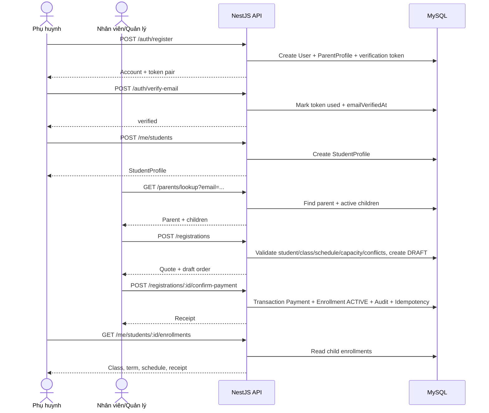

# EduGrade Backend Workflow — Phụ huynh tạo hồ sơ con và đăng ký tại trung tâm

## 1. Mục tiêu

Tài liệu này mô tả workflow backend mặc định cho luồng đăng ký học tại trung tâm:

```text
Phụ huynh tạo tài khoản
→ xác minh email
→ tạo hồ sơ con
→ đến trung tâm
→ nhân viên/quản lý tìm phụ huynh bằng email
→ chọn con, môn, lớp và ngày bắt đầu
→ xác nhận đã thu đủ học phí offline
→ tạo Payment + Enrollment ACTIVE
→ phụ huynh xem lớp, lịch học và biên lai
```

Luồng cũ dùng mã/link liên kết sau thanh toán không còn là luồng đăng ký mặc định. Các bảng cũ như `LinkInvitation` và trạng thái cũ vẫn được giữ để không phá dữ liệu đã tồn tại, nhưng workflow mới không gửi hoặc claim link sau thanh toán.

## 2. Phạm vi

- Một trung tâm, khối 6-9, tiền VND.
- Web và mobile dùng chung REST API `/api/v1`.
- Phụ huynh tự đăng ký tài khoản bằng email và mật khẩu.
- Phụ huynh phải xác minh email trước khi tạo hồ sơ con hoặc được đăng ký học.
- Một tài khoản phụ huynh có nhiều hồ sơ con.
- Nhân viên `STAFF` và quản lý `MANAGER` được tạo đăng ký và xác nhận thu tiền.
- Phụ huynh chỉ xem và quản lý dữ liệu của con mình.
- Giáo viên không được xác nhận thu tiền.
- Thanh toán offline chỉ ghi nhận khi đã thu đủ tiền.
- Trả góp, hoàn tiền, gia hạn và đổi lớp không thuộc phiên bản này.
- Soạn giáo trình và sinh buổi học theo lịch tuần được mô tả trong `CURRICULUM_SCHEDULING_API.md`.

## 3. Role

```text
STAFF
  - Tra cứu phụ huynh bằng email.
  - Tạo bản nháp đăng ký cho con đã có hồ sơ.
  - Xác nhận thu đủ học phí offline.
  - Xem biên lai đăng ký.

MANAGER
  - Có toàn quyền của STAFF.
  - Quản lý chương trình theo khối/môn.
  - Quản lý lớp, sĩ số, học phí tháng, trạng thái mở đăng ký.
  - Quản lý lịch học cố định hằng tuần của lớp.
  - Duyệt học phần đã đủ bài và sinh buổi học theo lịch tuần.

PARENT
  - Đăng ký tài khoản, xác minh email.
  - Tạo, xem và cập nhật hồ sơ con của chính mình.
  - Xem lớp, thời hạn học, lịch học và biên lai của con.

TEACHER
  - Phục vụ các nghiệp vụ học vụ hiện có.
  - Không được tạo đăng ký hoặc xác nhận thu tiền.

CURRICULUM_DESIGNER
  - Tạo học phần dùng chung theo môn/khối, bài học và nội dung kiểm tra tháng.
```

## 4. Luồng nghiệp vụ chính

### 4.1 Phụ huynh tạo tài khoản và hồ sơ con

```text
1. Phụ huynh gọi POST /api/v1/auth/register.
2. Backend normalize email bằng trim + lowercase.
3. Backend tạo User(role=PARENT), ParentProfile và email verification token.
4. Backend gửi token xác minh qua SMTP nếu đã cấu hình.
5. Phụ huynh gọi POST /api/v1/auth/verify-email.
6. Sau khi email đã xác minh, phụ huynh tạo hồ sơ con bằng POST /api/v1/me/students.
```

Ràng buộc:

- Email là duy nhất.
- Token xác minh chỉ lưu dạng SHA-256 hash.
- Token xác minh có hạn dùng và chỉ dùng một lần.
- Nếu SMTP chưa cấu hình, backend không giả vờ gửi email; API trả trạng thái `sent: false`.
- Hồ sơ con gồm `fullName`, `grade`, `dateOfBirth` tùy chọn.
- Chặn đổi khối khi con còn kỳ học hiện tại hoặc sắp tới.

### 4.2 Nhân viên tra cứu phụ huynh tại quầy

```text
1. Phụ huynh đến trung tâm.
2. STAFF/MANAGER nhập chính xác email.
3. Backend trả thông tin phụ huynh, trạng thái tài khoản, trạng thái xác minh email và danh sách con active.
```

Endpoint:

```http
GET /api/v1/parents/lookup?email=parent@example.com
Authorization: Bearer <STAFF_OR_MANAGER_ACCESS_TOKEN>
```

Nếu không tìm thấy tài khoản, email chưa xác minh hoặc chưa có hồ sơ con, nhân viên hướng dẫn phụ huynh hoàn thành các bước đó trước rồi tiếp tục.

### 4.3 Quản lý chương trình, lớp và lịch cố định

`MANAGER` tạo chương trình theo khối/môn:

```http
POST /api/v1/programs
```

Ví dụ:

```json
{
  "name": "Toán 8",
  "subject": "Toán",
  "grade": 8
}
```

`MANAGER` tạo lớp:

```http
POST /api/v1/classes
```

Ví dụ:

```json
{
  "programId": "program_id",
  "name": "Toán 8A",
  "teacherId": "teacher_id",
  "capacity": 20,
  "monthlyFee": 500000
}
```

`MANAGER` cấu hình lịch tuần cố định:

```http
POST /api/v1/classes/:id/schedules
```

Ví dụ:

```json
{
  "schedules": [
    {
      "weekday": 2,
      "startTime": "18:00",
      "endTime": "20:00"
    },
    {
      "weekday": 5,
      "startTime": "18:00",
      "endTime": "20:00"
    }
  ]
}
```

Quy tắc:

- `weekday` dùng ISO weekday: thứ hai là `1`, chủ nhật là `7`.
- Một lớp có thể có nhiều khung giờ hằng tuần.
- Các khung giờ trong cùng lớp không được chồng lấn.
- Lớp phải có ít nhất một khung giờ trước khi mở đăng ký.
- Chặn sửa lịch khi lớp có enrollment chưa kết thúc.
- Lịch học của phụ huynh được tính từ lịch tuần của lớp trong khoảng enrollment; không tạo bài học/buổi học chi tiết trong phiên bản này.

### 4.4 Nhân viên chọn lớp và lập đăng ký

STAFF/MANAGER tạo bản nháp đăng ký:

```http
POST /api/v1/registrations
Authorization: Bearer <STAFF_OR_MANAGER_ACCESS_TOKEN>
```

Ví dụ:

```json
{
  "targetStudentId": "student_id",
  "classId": "class_id",
  "startDate": "2026-10-05",
  "packageMonths": 3
}
```

Backend thực hiện:

1. Kiểm tra người thao tác là `STAFF` hoặc `MANAGER`.
2. Kiểm tra học sinh tồn tại, đang active và thuộc phụ huynh active đã xác minh email.
3. Kiểm tra lớp tồn tại, đang mở, có lịch cố định.
4. Kiểm tra lớp đúng khối với hồ sơ con.
5. Kiểm tra ngày bắt đầu từ hôm nay trở đi.
6. Kiểm tra ngày bắt đầu trùng một ngày học của lớp.
7. Tính `endDate = startDate + packageMonths` theo tháng dương lịch.
8. Kiểm tra còn chỗ trong lớp trong kỳ học.
9. Chặn đăng ký trùng lớp trong cùng thời gian.
10. Chặn trùng giờ với các lớp khác của học sinh trong kỳ học.
11. Tính học phí bằng `monthlyFee * packageMonths`.
12. Lưu snapshot email phụ huynh, tên con, khối, học phí, startDate và endDate vào `RegistrationOrder(DRAFT)`.

Quy tắc ngày:

- `packageMonths` từ 1 đến 12.
- Khoảng học là `[startDate, endDate)`, không bao gồm ngày hết hạn.
- Nếu tháng đích thiếu ngày tương ứng thì dùng ngày cuối tháng.
- Ví dụ: bắt đầu `2026-01-31`, gói 1 tháng thì hết hạn `2026-02-28`.

### 4.5 Xác nhận thu tiền offline

STAFF/MANAGER xác nhận đã thu đủ tiền:

```http
POST /api/v1/registrations/:id/confirm-payment
Authorization: Bearer <STAFF_OR_MANAGER_ACCESS_TOKEN>
Idempotency-Key: <uuid>
```

Ví dụ body:

```json
{
  "receiptNumber": "RCPT-001"
}
```

Đây là transaction quan trọng nhất:

```text
BEGIN TRANSACTION
  1. Lock RegistrationOrder.
  2. Nếu cùng Idempotency-Key đã xử lý, trả kết quả cũ.
  3. Kiểm tra order còn DRAFT.
  4. Lock học sinh và lớp.
  5. Kiểm tra lại toàn bộ invariant: phụ huynh verified, học sinh active, lớp mở, đúng khối, có lịch, còn chỗ, không trùng lớp, không trùng giờ.
  6. Tạo Payment(CONFIRMED).
  7. Tạo Enrollment(ACTIVE).
  8. Tạo EnrollmentPlacement cho lớp.
  9. Cập nhật RegistrationOrder -> COMPLETED.
 10. Ghi AuditLog(REGISTRATION_CONFIRM_PAYMENT).
 11. Lưu IdempotencyRecord.
COMMIT
```

Sau commit, phụ huynh thấy lớp ngay trong hồ sơ con. Nếu `startDate` ở tương lai, frontend hiển thị nhãn `Sắp học`; nếu đã tới kỳ học, hiển thị `Đang học`.

Không có bước gửi link hoặc claim link trong luồng mới.

## 5. Mô hình dữ liệu chính

### User

```text
id
email                  unique, trim + lowercase
passwordHash
displayName
role                   STAFF | MANAGER | TEACHER | CURRICULUM_DESIGNER | PARENT
status                 ACTIVE | DISABLED
emailVerifiedAt        nullable
createdAt
updatedAt
```

### EmailVerificationToken

```text
id
userId
tokenHash              unique, SHA-256(token thô)
expiresAt
usedAt                 nullable
createdAt
```

### ParentProfile

```text
id
userId                 unique
phone
createdAt
updatedAt
```

### StudentProfile

```text
id
parentProfileId
fullName
grade                  6 | 7 | 8 | 9
dateOfBirth            nullable
status                 ACTIVE | INACTIVE
createdAt
updatedAt
```

### Program

```text
id
name
subject
grade                  6 | 7 | 8 | 9
createdAt
updatedAt
```

### Class

```text
id
programId
name
teacherId              nullable
capacity
isOpen
monthlyFee
createdAt
updatedAt
```

### ClassWeeklySchedule

```text
id
classId
weekday                1..7, ISO weekday
startTime              HH:mm
endTime                HH:mm
createdAt
updatedAt
```

### RegistrationOrder

```text
id
type                   EXISTING_STUDENT_NEW_SUBJECT cho luồng mới
parentEmail            snapshot
parentPhone            snapshot nullable
studentFullName        snapshot
studentGrade           snapshot
targetStudentId        bắt buộc trong luồng mới
classId
packageMonths          1..12
quotedAmount           monthlyFee snapshot * packageMonths
currency               VND
startDate
endDate
status                 DRAFT | COMPLETED | PAYMENT_CONFIRMED | LINKED | CANCELLED
createdByManagerId     STAFF hoặc MANAGER thực hiện
confirmedAt
linkedAt
createdAt
updatedAt
```

`PAYMENT_CONFIRMED` và `LINKED` được giữ cho dữ liệu/luồng cũ. Luồng mới dùng `DRAFT -> COMPLETED`.

### Payment

```text
id
registrationOrderId    unique
amount
currency
status                 CONFIRMED
confirmedByManagerId
confirmedAt
receiptNumber          unique
createdAt
```

### Enrollment

```text
id
registrationOrderId    unique
studentProfileId
classId
packageMonths
status                 ACTIVE | ENDED | PENDING_LINK
startDate
endDate
activatedAt
endedAt
createdAt
updatedAt
```

`PENDING_LINK` được giữ cho dữ liệu/luồng cũ. Luồng mới tạo enrollment `ACTIVE` ngay khi xác nhận đã thu đủ tiền.

### IdempotencyRecord

```text
id
scope
key
registrationOrderId
response
createdAt
```

Dùng cho `confirm-payment` để double-click hoặc retry không tạo thêm payment/enrollment.

### AuditLog

```text
id
actorUserId
action                 REGISTRATION_CONFIRM_PAYMENT | ...
entityType
entityId
beforeData
afterData
ipAddress
userAgent
createdAt
```

## 6. State machine

### RegistrationOrder

```text
DRAFT
  ├── confirm payment -> COMPLETED
  └── cancel          -> CANCELLED
```

Không cho phép xác nhận lại bằng key khác sau khi đã completed.

### Enrollment

```text
ACTIVE
  └── end study/end enrollment -> ENDED
```

Nếu `startDate` ở tương lai, enrollment vẫn là `ACTIVE` nhưng frontend hiển thị `Sắp học`.

## 7. API hợp đồng chính

### Auth

```http
POST /api/v1/auth/register
POST /api/v1/auth/verify-email
POST /api/v1/auth/resend-verification
POST /api/v1/auth/login
POST /api/v1/auth/refresh
POST /api/v1/auth/logout
GET  /api/v1/auth/me
```

### Hồ sơ con

```http
GET   /api/v1/me/students
POST  /api/v1/me/students
PATCH /api/v1/me/students/:id
GET   /api/v1/me/students/:id/enrollments
GET   /api/v1/me/students/:id/schedule
```

### Tra cứu tại quầy

```http
GET /api/v1/parents/lookup?email=parent@example.com
```

Chỉ `STAFF` và `MANAGER`.

### Chương trình, lớp và lịch

```http
GET   /api/v1/programs
POST  /api/v1/programs
GET   /api/v1/classes
POST  /api/v1/classes
PATCH /api/v1/classes/:id
POST  /api/v1/classes/:id/schedules
```

### Đăng ký và thu tiền

```http
POST /api/v1/registrations
GET  /api/v1/registrations/:id
POST /api/v1/registrations/:id/cancel
POST /api/v1/registrations/:id/confirm-payment
GET  /api/v1/registrations/:id/receipt
```

## 8. Sequence diagram



## 9. Error code đề xuất

```text
400 VALIDATION_ERROR
401 AUTH_UNAUTHORIZED
403 FORBIDDEN
404 PARENT_NOT_FOUND
404 STUDENT_NOT_FOUND
404 CLASS_NOT_FOUND
404 REGISTRATION_NOT_FOUND
409 PARENT_EMAIL_UNVERIFIED
409 STUDENT_INACTIVE
409 PARENT_DISABLED
409 CLASS_CLOSED
409 CLASS_NEEDS_SCHEDULE
409 CLASS_GRADE_MISMATCH
409 INVALID_START_DATE
409 CLASS_FULL
409 DUPLICATE_CLASS_REGISTRATION
409 STUDENT_SCHEDULE_CONFLICT
409 REGISTRATION_NOT_DRAFT
409 IDEMPOTENCY_KEY_REQUIRED
500 INTERNAL_ERROR
```

Response lỗi theo chuẩn chung:

```json
{
  "success": false,
  "error": {
    "code": "STUDENT_SCHEDULE_CONFLICT",
    "message": "Student already has another class at this time",
    "requestId": "req_123"
  }
}
```

## 10. Bảo mật và nhất quán dữ liệu

- Backend luôn kiểm tra role; frontend ẩn nút không đủ.
- Parent chỉ được đọc/sửa hồ sơ con thuộc `ParentProfile.userId` của mình.
- STAFF/MANAGER chỉ được đăng ký cho hồ sơ con đã tồn tại.
- Email phải verified trước khi tạo hồ sơ con hoặc đăng ký học.
- Token xác minh email không lưu dạng thô.
- Confirm payment phải chạy trong transaction.
- Confirm payment phải có `Idempotency-Key`.
- Lock order, học sinh và lớp khi xác nhận thu tiền.
- Không tin số tiền client gửi lên; backend tính từ `Class.monthlyFee`.
- Lưu `quotedAmount` để biên lai không đổi khi trung tâm sửa học phí lớp.
- Không log mật khẩu, token thô hoặc dữ liệu trẻ em nhạy cảm.

## 11. Acceptance tests bắt buộc

- Phụ huynh đăng ký, xác minh email, tạo nhiều con.
- Nhân viên tra cứu email chính xác, chọn đúng con và hoàn thành đăng ký.
- Email trùng, chưa xác minh, tài khoản bị khóa hoặc chưa có con đều được xử lý rõ ràng.
- Phụ huynh không đọc/sửa được hồ sơ của người khác.
- Giáo viên không được xác nhận thu tiền.
- Chặn lớp sai khối, đóng đăng ký, thiếu lịch, hết chỗ, trùng lớp hoặc trùng giờ.
- Hai yêu cầu tranh chỗ cuối chỉ một yêu cầu thành công.
- Hai đăng ký đồng thời của cùng con không vượt qua kiểm tra trùng lịch.
- Xác nhận lặp cùng `Idempotency-Key` không tạo bản ghi trùng.
- Lỗi giữa transaction không để lại payment hoặc enrollment dở dang.
- Tính đúng kỳ học qua cuối tháng/năm.
- Phụ huynh thấy đúng lịch và biên lai sau khi xác nhận.

## 12. Definition of Done

- Prisma schema và migration phản ánh workflow mới.
- API `/api/v1` có route cho auth verify email, hồ sơ con, parent lookup, class schedule, registration và receipt.
- Swagger cập nhật theo controller/DTO.
- `STAFF` và `MANAGER` có quyền đăng ký và xác nhận thu tiền.
- Parent ownership được kiểm tra ở backend.
- Confirm payment idempotent và transactional.
- Unit/e2e/typecheck/lint/build pass.
- Tài liệu này là nguồn workflow backend mặc định cho luồng phụ huynh đăng ký tại trung tâm.
