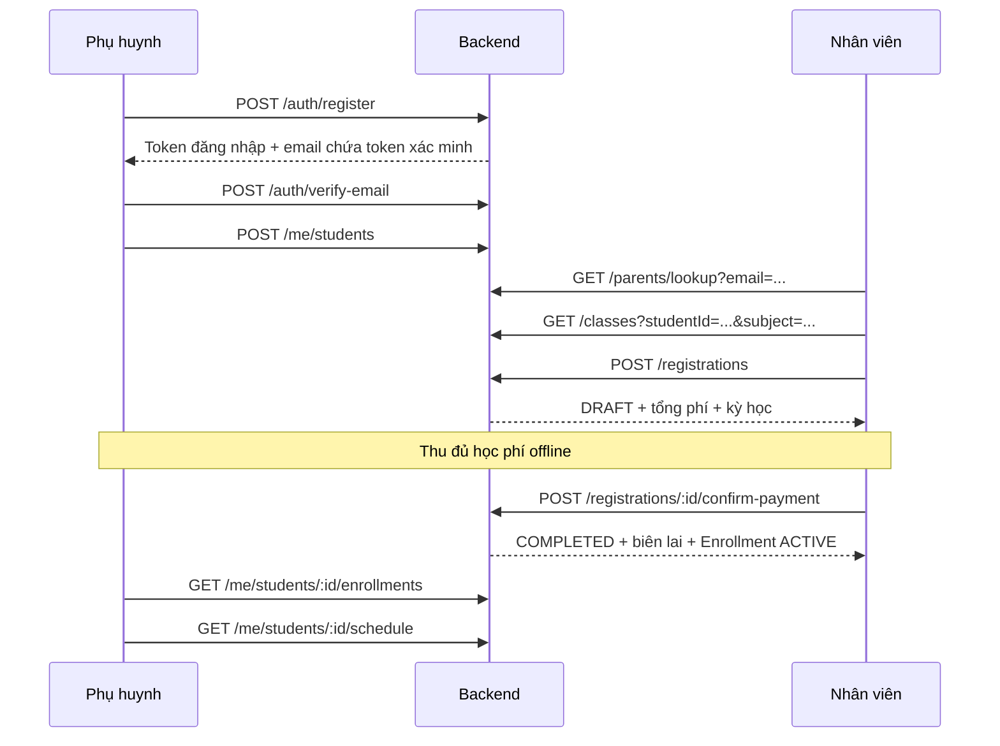

# API và hướng dẫn tích hợp luồng đăng ký học cho phụ huynh

Tài liệu đối chiếu với controller, DTO và service hiện có ngày 02/10/2026. Phạm vi: backend và cách frontend web/mobile gọi API cho một trung tâm, khối 6–9, tiền VND.

## 1. Tổng quan luồng



Các đường dẫn trong sơ đồ có prefix `/api/v1`. Trước luồng này, quản lý cần tạo chương trình, lớp, lịch tuần và mở đăng ký lớp.

## 2. Quy ước gọi API

- Base URL: `<BACKEND_ORIGIN>/api/v1`.
- Request JSON: `Content-Type: application/json`.
- API cần đăng nhập: `Authorization: Bearer <accessToken>`.
- Dùng token của đúng người thực hiện: phụ huynh, STAFF hoặc MANAGER.
- Thành công: `{ "success": true, "data": ... }`. Frontend đọc kết quả nghiệp vụ từ `data`.
- Thất bại: `{ "success": false, "error": { "code": "...", "message": "...", "requestId": "..." } }`; có thể kèm `error.details`.
- Ngày nghiệp vụ gửi dạng `YYYY-MM-DD`; giờ học dạng `HH:mm`, theo `Asia/Ho_Chi_Minh`.
- `weekday`: thứ Hai = 1, thứ Ba = 2, ... Chủ nhật = 7.
- Danh sách chương trình/lớp nhận `page` (mặc định 1), `limit` (mặc định 20, tối đa 100); `data` hiện là mảng, chưa có tổng số trang.
- Các ID trong ví dụ là placeholder; thay bằng ID backend trả về.
- Ngày ví dụ `2026-10-05` là thứ Hai. Khi sử dụng về sau phải thay bằng ngày từ hôm nay trở đi và đúng thứ học của lớp.

## 3. Quản lý chuẩn bị lớp

Các thao tác ghi trong phần này yêu cầu role `MANAGER`.

### 3.1. Tạo chương trình theo khối/môn

`POST /programs`

```json
{ "name": "Toán khối 8", "subject": "Toán", "grade": 8 }
```

Lưu `data.id` thành `programId`. Khối từ 6 đến 9. `subject` hiện là chuỗi tự do; nên thống nhất cách viết để lọc lớp chính xác.

`GET /programs?page=1&limit=20` lấy danh sách chương trình. API đọc này cho phép STAFF, MANAGER, TEACHER và CURRICULUM_DESIGNER; không cho PARENT.

### 3.2. Tạo lớp ở trạng thái chưa mở

`POST /classes`

```json
{
  "programId": "<programId>",
  "name": "Toán 8 - Tối thứ Hai và thứ Tư",
  "capacity": 20,
  "monthlyFee": 800000,
  "isOpen": false
}
```

Lưu `data.id` thành `classId`. Có thể thêm `teacherId` của giáo viên đang hoạt động. `capacity` từ 1–1000, `monthlyFee` không âm. Không tạo lớp với `isOpen: true`, vì lớp cần lịch trước khi mở.

### 3.3. Cấu hình lịch tuần

`POST /classes/<classId>/schedules`

```json
{
  "schedules": [
    { "weekday": 1, "startTime": "18:00", "endTime": "20:00" },
    { "weekday": 3, "startTime": "18:00", "endTime": "20:00" }
  ]
}
```

API thay thế toàn bộ lịch hiện tại; gửi đầy đủ các khung giờ muốn giữ. Cho phép 1–14 khung, giờ bắt đầu phải trước giờ kết thúc, các khung không chồng nhau. Code hiện chặn sửa nếu lớp có bất kỳ ghi danh nào mang trạng thái khác `ENDED`.

### 3.4. Mở đăng ký

`PATCH /classes/<classId>`

```json
{ "isOpen": true }
```

Cùng API này cập nhật được `name`, `teacherId`, `capacity`, `monthlyFee`, `isOpen`. Gửi `teacherId: null` để bỏ giáo viên. Gửi `isOpen: false` để đóng đăng ký.

## 4. Phụ huynh tạo tài khoản và hồ sơ con

### 4.1. Đăng ký tài khoản

`POST /auth/register` — public, không cần Bearer token.

```json
{
  "email": "parent@example.com",
  "password": "StrongPass123!",
  "displayName": "Nguyễn Văn A",
  "phone": "0901234567"
}
```

`displayName`, `phone` tùy chọn. Email được trim và chuyển chữ thường. Mật khẩu tối thiểu 8 ký tự và tối đa 72 byte UTF-8 theo implementation bcrypt hiện tại.

Backend tạo tài khoản PARENT và trả `data.user`, `data.tokens`:

```json
{
  "accessToken": "<jwt>",
  "refreshToken": "<refresh-token>",
  "tokenType": "Bearer",
  "expiresIn": 900
}
```

Đây là ví dụ phần `data.tokens`; thời hạn thực tế lấy từ response. Frontend lưu phiên và chuyển sang màn hình xác minh. Đăng ký đã trả token nên không bắt buộc đăng nhập lại ngay.

### 4.2. Xác minh email

`POST /auth/verify-email` — public.

```json
{ "token": "<token-trong-email>" }
```

Response `data`: `{ "verified": true }`.

Email hiện chứa **token dạng văn bản, chưa chứa link frontend**. Triển khai màn hình cho phụ huynh dán token vào rồi gửi API. Token có hạn 24 giờ, chỉ lưu hash trong database và bị từ chối sau khi đã sử dụng.

Sau khi thành công, gọi `GET /auth/me` bằng access token hiện có để cập nhật `emailVerifiedAt` trong trạng thái frontend. Nếu không có phiên thì chuyển sang đăng nhập.

Gửi lại email: `POST /auth/resend-verification`, body:

```json
{ "email": "parent@example.com" }
```

Response `data`: `{ "sent": true }` hoặc `{ "sent": false }`. Không diễn giải `sent: true` là chắc chắn email mới đã đến hộp thư: tài khoản đã xác minh cũng trả true. Backend cần `SMTP_URL` và `MAIL_FROM` để gửi email; thiếu cấu hình thì trả false ở bước gửi lại. Đăng ký vẫn có thể tạo tài khoản khi thiếu SMTP, nhưng phụ huynh không nhận được token qua API.

Giới hạn tại controller: đăng ký/đăng nhập 5 lần mỗi 60 giây; xác minh 10 lần; gửi lại 3 lần. Frontend xử lý HTTP 429 và cho thử lại sau.

### 4.3. Đăng nhập, duy trì phiên và đăng xuất

| API | Body / Header | Cách tích hợp |
| --- | --- | --- |
| `POST /auth/login` | `{ "email": "parent@example.com", "password": "StrongPass123!" }` | Public; nhận `data.user` và `data.tokens`; dùng chung cho nhân viên/quản lý |
| `GET /auth/me` | Bearer token | Lấy người dùng, role, status, emailVerifiedAt |
| `POST /auth/refresh` | `{ "refreshToken": "<refresh-token>" }` | Public; thay cả access token và refresh token bằng cặp mới |
| `POST /auth/logout` | Bearer token, không cần body | Thu hồi phiên hiện tại; frontend xóa token |

Frontend chỉ chạy một yêu cầu refresh tại một thời điểm, cho các request khác chờ cùng kết quả. Không dùng lại refresh token cũ vì backend có thể thu hồi phiên. Refresh thất bại thì yêu cầu đăng nhập lại. Đăng nhập được khi chưa xác minh, nhưng thao tác tạo/cập nhật con sẽ bị chặn.

### 4.4. Tạo và quản lý hồ sơ con

`POST /me/students` — PARENT đã xác minh email.

```json
{ "fullName": "Nguyễn An", "grade": 8, "dateOfBirth": "2013-04-20" }
```

`dateOfBirth` tùy chọn. Lưu `data.id` thành `studentId`. Mỗi lần gọi tạo một hồ sơ; một phụ huynh có thể tạo nhiều con.

- `GET /me/students`: trả mảng hồ sơ con của tài khoản hiện tại.
- `PATCH /me/students/<studentId>`: gửi các trường cần sửa: `fullName`, `grade`, `dateOfBirth`; `dateOfBirth: null` xóa ngày sinh.
- Không gửi `parentProfileId` từ frontend; backend tự gán chủ sở hữu.
- Không đổi khối khi con còn ghi danh ACTIVE với kỳ học hiện tại/sắp tới.

Màn hình danh sách con gọi GET khi mở trang và tải lại sau khi tạo/sửa. Nếu chưa xác minh, hiển thị hướng dẫn xác minh trước khi mở form tạo con.

## 5. Nhân viên đăng ký học tại quầy

Chỉ phiên `STAFF` được tạo nháp, hủy nháp, xác nhận thu tiền và đọc đăng ký/biên lai quầy. `MANAGER`, `TEACHER`, `CURRICULUM_DESIGNER` nhận 403 `FORBIDDEN`; `MANAGER` chỉ xem lịch sử qua `GET /registrations` và `GET /payments`.

### 5.1. Tìm phụ huynh và chọn con

`GET /parents/lookup?email=parent%40example.com`

Encode query bằng `URLSearchParams`. Đây là tra cứu email chính xác.

Để gợi ý khi gõ dở email dùng `GET /parents/search?email=ng&limit=10` (chỉ STAFF): `email` 2–255 ký tự, không phân biệt hoa thường, khớp từng phần; `limit` 1–10, mặc định 10; sắp theo email tăng dần. `data` là mảng `{ id, email, displayName, status }` (mảng rỗng khi không có kết quả). Sau khi chọn, gọi lookup bằng email đã chọn để lấy danh sách con.

Response `data` chứa `id`, `email`, `displayName`, `status`, `emailVerifiedAt`, `parentProfile`. Danh sách con đang hoạt động nằm ở `data.parentProfile.students`.

Frontend hiển thị tên/email phụ huynh và danh sách con. Chỉ cho tiếp tục khi phụ huynh ACTIVE, có `emailVerifiedAt` và có con để chọn. Lưu ID hồ sơ con thành `targetStudentId`.

Không tìm thấy tài khoản hoặc chưa có con: hướng dẫn phụ huynh đăng ký/xác minh/tạo hồ sơ trên tài khoản của họ, rồi tra cứu lại. API lookup trả thông tin trạng thái để frontend hiển thị; bước lập đăng ký vẫn kiểm tra lại điều kiện.

### 5.2. Chọn môn và lớp

Lấy chương trình qua `GET /programs`, hiển thị các môn theo khối của con. Lấy lớp:

```http
GET /api/v1/classes?studentId=<studentId>&subject=To%C3%A1n&page=1&limit=20
```

Response là mảng lớp, có `program`, `weeklySchedules`, `monthlyFee`, `capacity`, `isOpen`, `_count.enrollments`. Frontend hiển thị tên lớp, môn/khối, lịch tuần và học phí tháng.

Truyền thêm `startDate=2026-10-05&packageMonths=3` (phải đi cùng nhau, nếu không trả 400 `VALIDATION_ERROR`) để mỗi lớp có thêm `availableSeats` (sức chứa trừ số chỗ **đồng thời tối đa** trong `[startDate, endDate)`), `isEligible`, `ineligibleReason` (mã lỗi giống lúc tạo nháp, ví dụ `CLASS_FULL`) và `ineligibleMessage`. Khi có `studentId` còn kiểm tra khối, trạng thái con/phụ huynh, trùng lớp và trùng giờ. `_count.enrollments` vẫn đếm mọi ghi danh, không dùng để kết luận còn chỗ. Danh sách vẫn là mảng thuần (chưa có `total`) và phân trang bằng `page`/`limit` ≤ 100.

### 5.3. Chọn kỳ học và lập bản nháp

`POST /registrations`

```json
{
  "targetStudentId": "<studentId>",
  "classId": "<classId>",
  "startDate": "2026-10-05",
  "packageMonths": 3
}
```

Chọn 1–12 tháng. Ngày bắt đầu từ hôm nay trở đi, đúng thứ học của lớp. Frontend có thể giới hạn ngày chọn, nhưng backend là nơi quyết định hợp lệ.

Backend lấy email/tên con/khối từ hệ thống và lưu snapshot; frontend không gửi các trường đó. Tổng phí lấy học phí tháng tại thời điểm tạo bản nháp nhân số tháng. Với ví dụ 800.000 × 3, `quotedAmount` là 2.400.000 VND.

Response `data` là đăng ký có `id`, `status: "DRAFT"`, `quotedAmount`, `currency`, `startDate`, `endDate`, cùng `targetStudent`, `class`, `payment`, `enrollment`. Lưu `data.id` thành `registrationId`; hiển thị số tiền backend trả về ở màn hình xác nhận. Các giá trị Prisma Decimal như `quotedAmount` ở bản nháp có thể được serialize thành chuỗi; chuẩn hóa khi định dạng VND.

Ngày hết hạn = ngày bắt đầu cộng số tháng, cắt về cuối tháng nếu thiếu ngày tương ứng. Khoảng học là `[startDate, endDate)`, không bao gồm ngày hết hạn. Ví dụ 05/10/2026 + 3 tháng hết hạn 05/01/2027.

**Bản nháp chưa giữ chỗ và chưa tạo thanh toán/ghi danh.** Có thể gửi header `Idempotency-Key` (≤ 191 ký tự) khi tạo nháp: cùng key và cùng body trả lại đúng nháp cũ (không tạo bản ghi thứ hai); cùng key nhưng body khác trả 409 `IDEMPOTENCY_KEY_CONFLICT`. Key chỉ có hiệu lực trong phạm vi nhân viên đã tạo. Để khôi phục khi mất response mà không có key, gọi `GET /registrations?status=DRAFT&createdBy=me`.

`GET /registrations` (STAFF/MANAGER) hỗ trợ `status`, `createdBy=me`, `classId`, `search` (email phụ huynh, tên con hoặc số biên lai), `fromDate`, `toDate` (ngày tạo, giờ trung tâm UTC+7), `page`, `limit`; trả `{ items, page, limit, total }`. `GET /payments` (STAFF/MANAGER) hỗ trợ `search`, `fromDate`, `toDate` (ngày xác nhận), `page`, `limit`; trả `{ items, page, limit, total, totalAmount }` với `totalAmount` là tổng tiền thật theo bộ lọc (chuỗi Decimal).

### 5.4. Đọc lại hoặc hủy bản nháp

- `GET /registrations/<registrationId>`: lấy lại chi tiết. STAFF/MANAGER được đọc; PARENT chỉ đọc đăng ký thuộc mình theo kiểm tra email của backend.
- `POST /registrations/<registrationId>/cancel`: STAFF hủy DRAFT, không cần body; chuyển sang CANCELLED. Hủy lặp lại trả lại đăng ký CANCELLED; ID không tồn tại trả 404 `REGISTRATION_NOT_FOUND`; đăng ký đã COMPLETED trả 409 `REGISTRATION_NOT_DRAFT`.

Nếu muốn đổi con/lớp/kỳ học, hủy nháp cũ rồi tạo nháp mới. Luồng này chưa có API sửa bản nháp. Không dùng cancel để hủy một đăng ký đã thanh toán.

### 5.5. Xác nhận đã thu đủ học phí offline

Sau khi nhân viên đã nhận đủ tiền, gọi:

```http
POST /api/v1/registrations/<registrationId>/confirm-payment
Authorization: Bearer <staffAccessToken>
Content-Type: application/json
Idempotency-Key: <uuid-cua-lan-xac-nhan>
```

```json
{ "receiptNumber": "RCPT-001" }
```

`receiptNumber` tùy chọn; gửi `{}` để backend tự sinh số biên lai. Không gửi số tiền: backend ghi nhận đúng `quotedAmount` đã lưu. API này ghi nhận tiền đã thu offline, không thực hiện chuyển tiền qua ngân hàng.

Frontend tạo một UUID cho thao tác xác nhận, lưu cùng `registrationId` và giữ nguyên key/body khi retry do timeout hoặc mất mạng. Khóa nút khi đang gửi. Không tạo key mới mỗi lần retry.

Key được gắn với đăng ký, nhân viên và body (`receiptNumber`): cùng key + cùng body trả lại đúng biên lai cũ; cùng key khác body hoặc khác nhân viên trả 409 `IDEMPOTENCY_KEY_CONFLICT`; đăng ký đã COMPLETED hoặc CANCELLED với key mới trả 409 `REGISTRATION_NOT_DRAFT`. Nếu nháp đã qua ngày bắt đầu, backend trả 409 `INVALID_START_DATE`: hủy nháp và tạo nháp mới.

Backend kiểm tra lại tài khoản/con/lớp/lịch/sĩ số (đếm số chỗ đồng thời lớn nhất trong kỳ, nên hai gói liên tiếp không chặn nhau), rồi trong một transaction tạo Payment, Enrollment ACTIVE, cập nhật đăng ký COMPLETED và ghi audit/idempotency. Response là dữ liệu biên lai. Chỉ chuyển UI sang thành công khi nhận kết quả thành công hoặc đọc lại thấy COMPLETED.

Nếu timeout, có thể gọi `GET /registrations/<registrationId>`: COMPLETED thì lấy biên lai; còn DRAFT thì retry xác nhận với key đã lưu. Nếu HTTP lỗi nghiệp vụ như CLASS_FULL, hiển thị lỗi và cho chọn phương án khác, không tự xác nhận lại liên tục.

### 5.6. Xem và in biên lai

`GET /registrations/<registrationId>/receipt`

STAFF/MANAGER hoặc phụ huynh sở hữu đăng ký được đọc. Cấu trúc `data` giống kết quả xác nhận thanh toán:

```json
{
  "registrationId": "<registrationId>",
  "status": "COMPLETED",
  "parentEmail": "parent@example.com",
  "student": { "fullName": "Nguyễn An", "grade": 8 },
  "class": {
    "id": "<classId>",
    "name": "Toán 8 - Tối thứ Hai và thứ Tư",
    "subject": "Toán",
    "grade": 8,
    "schedules": []
  },
  "term": {
    "packageMonths": 3,
    "startDate": "2026-10-05",
    "endDate": "2027-01-05",
    "label": "Sắp học"
  },
  "payment": {
    "id": "<paymentId>",
    "receiptNumber": "RCPT-001",
    "amount": 2400000,
    "currency": "VND",
    "confirmedAt": "2026-10-02T03:00:00.000Z"
  },
  "enrollment": { "id": "<enrollmentId>", "status": "ACTIVE" },
  "quotedAmount": 2400000,
  "currency": "VND"
}
```

Ví dụ rút gọn `class.schedules`; response thực tế chứa lịch tuần của lớp. API trả JSON; frontend tự dựng giao diện in hoặc xuất tài liệu. Chưa có API tải PDF biên lai trong module này.

## 6. Phụ huynh xem kết quả

### 6.1. Lớp và kỳ học của con

`GET /me/students/<studentId>/enrollments`

Trả mảng ghi danh, kèm `class.program`, `class.weeklySchedules`, `registrationOrder.payment`. Dùng `registrationOrderId` để mở API biên lai. Sau khi nhân viên xác nhận, phụ huynh tải lại danh sách này để thấy lớp.

UI xác định nhãn theo trạng thái ghi danh và ngày tại Việt Nam: ACTIVE và chưa đến ngày bắt đầu là “Sắp học”; ACTIVE và trong kỳ là “Đang học”; đã hết kỳ hiển thị “Hết hạn”. Không coi tất cả ACTIVE là đang học hôm nay.

### 6.2. Lịch học

`GET /me/students/<studentId>/schedule`

Trả mảng lịch tuần, mỗi dòng có `enrollmentId`, `classId`, `className`, `subject`, `grade`, `startDate`, `endDate`, `weekday`, `startTime`, `endTime`.

API chưa sinh danh sách từng buổi và chưa nhận khoảng ngày lọc. Frontend muốn hiển thị calendar cần lấy các ngày trong tuần/tháng đang xem, giữ ngày có weekday phù hợp và nằm trong `[startDate, endDate)`, rồi ghép giờ học theo `Asia/Ho_Chi_Minh`.

Code schedule hiện lấy các ghi danh khác PENDING_LINK, có thể bao gồm kỳ đã kết thúc hoặc trạng thái khác ACTIVE. Đối chiếu danh sách enrollments theo `enrollmentId` và lọc trạng thái/kỳ trước khi hiển thị lịch đang học. Nhãn trong biên lai hiện chỉ phân biệt ngày bắt đầu tương lai hay không; không dùng nhãn đó để xác định kỳ đã hết hạn.

## 7. Xử lý lỗi trên giao diện

| Mã lỗi / HTTP | Cách xử lý |
| --- | --- |
| `AUTH_INVALID_EMAIL_TOKEN` | Token sai/đã dùng/hết hạn; cho gửi lại email |
| `AUTH_INVALID_CREDENTIALS` | Hiển thị thông tin đăng nhập không hợp lệ |
| `AUTH_INVALID_REFRESH_TOKEN` / 401 | Xử lý refresh nếu phù hợp; refresh thất bại thì đăng nhập lại |
| `PARENT_NOT_FOUND` | Hướng dẫn tạo tài khoản, kiểm tra lại email |
| `PARENT_EMAIL_UNVERIFIED` | Hướng dẫn xác minh email rồi thử lại |
| `PARENT_DISABLED`, `STUDENT_INACTIVE` | Chặn tiếp tục, hiển thị trạng thái không hoạt động |
| `FORBIDDEN` / 403 | Sai role hoặc không sở hữu hồ sơ/đăng ký |
| `STUDENT_NOT_FOUND`, `CLASS_NOT_FOUND`, `REGISTRATION_NOT_FOUND` | Tải lại dữ liệu, bỏ lựa chọn không còn tồn tại |
| `STUDENT_GRADE_LOCKED` | Không cho đổi khối trong khi còn kỳ học |
| `CLASS_CLOSED`, `CLASS_NEEDS_SCHEDULE`, `CLASS_GRADE_MISMATCH` | Chọn lớp phù hợp hoặc yêu cầu quản lý cấu hình lớp |
| `CLASS_FULL` | Chọn lớp/kỳ khác; bản nháp không giữ chỗ |
| `INVALID_START_DATE` | Chọn lại ngày bắt đầu hợp lệ theo lịch lớp |
| `DUPLICATE_CLASS_REGISTRATION` | Con đã đăng ký lớp trong khoảng kỳ bị trùng |
| `STUDENT_SCHEDULE_CONFLICT` | Chọn lớp có khung giờ khác |
| `INVALID_SCHEDULE_TIME`, `CLASS_SCHEDULE_CONFLICT` | Sửa khung giờ của lớp |
| `CLASS_SCHEDULE_LOCKED` | Lớp đã có ghi danh; không sửa lịch bằng API này |
| `INVALID_TEACHER` | Chọn giáo viên đang hoạt động |
| `IDEMPOTENCY_KEY_REQUIRED` | Bổ sung header cho xác nhận thanh toán |
| `REGISTRATION_NOT_DRAFT` | Đọc lại đăng ký; không tiếp tục xác nhận nháp đã hủy hoặc đã thu tiền |
| `IDEMPOTENCY_KEY_CONFLICT` | Key đã dùng cho body/nhân viên khác; dùng key mới cho thao tác mới |
| `PROGRAM_IN_USE`, `ACCOUNT_NOT_FOUND`, `AUTH_EMAIL_EXISTS` | Chương trình đang có lớp/bài học; tài khoản không thuộc loại này; email đã tồn tại |
| `RECEIPT_NOT_FOUND` | Chưa có biên lai hoặc ID không tồn tại |
| 400 | Kiểm tra dữ liệu form và `error.details` nếu có |
| 409 | Xung đột nghiệp vụ; đọc `error.code` để đưa thông báo phù hợp |
| 429 | Giới hạn tần suất; cho thử lại sau |

Lưu `error.requestId` khi báo lỗi kỹ thuật để backend tra log. Với email đăng ký trùng, xử lý response conflict và hướng dẫn đăng nhập bằng tài khoản đã có.

## 8. Thứ tự implement frontend

1. Tạo API client chung: prefix, Bearer token, unwrap `data`, đọc `error.code`, refresh tuần tự và đăng xuất.
2. Làm màn hình đăng ký → nhập token xác minh → danh sách con → form tạo/sửa con. Dùng `GET /auth/me` để đồng bộ trạng thái xác minh.
3. Làm màn hình MANAGER: tạo chương trình → tạo lớp → lưu lịch tuần → mở đăng ký.
4. Làm wizard STAFF/MANAGER: tìm email → chọn con → môn/lớp → ngày/gói tháng → tạo DRAFT → hiển thị phí từ backend.
5. Làm bước thu tiền: lưu registrationId + idempotency key, xác nhận đủ tiền, xử lý retry, xem/in biên lai.
6. Làm màn hình phụ huynh xem enrollment và calendar; tải lại sau khi ghi danh hoàn tất.

State tối thiểu của wizard: `parent`, `targetStudentId`, `subject`, `classId`, `startDate`, `packageMonths`, `registrationId`, `idempotencyKey`, `receipt`. Khi thay lựa chọn ở bước trước, xóa lựa chọn phụ thuộc; nếu đã có DRAFT, xử lý hủy nháp trước khi tạo đăng ký thay thế.

Một đăng ký tương ứng một con, một lớp, một gói tháng. Đăng ký thêm lớp tạo đơn riêng. Luồng hiện tại không có bước gửi/nhận link liên kết con, thanh toán online, trả góp, hoàn tiền hay gia hạn. Quyền trên UI chỉ phục vụ trải nghiệm; backend vẫn kiểm tra quyền và điều kiện nghiệp vụ.

## 9. Mã nguồn đối chiếu

- `src/modules/auth/auth.controller.ts`, `auth.service.ts`, `dto/`: hợp đồng tài khoản, xác minh, phiên đăng nhập.
- `src/modules/registration-flow/registration-flow.controller.ts`: danh sách route.
- `src/modules/registration-flow/dto/registration-flow.dto.ts`: field, kiểu dữ liệu, validation.
- `src/modules/registration-flow/registration-flow.service.ts`: phân quyền, đăng ký, thanh toán, lịch và biên lai.
- `EDUGRADE_BACKEND_FLOW.md`: tài liệu tổng quan nghiệp vụ.

Tài liệu này mô tả hành vi đang có. Các giới hạn đã nêu (token email dạng văn bản, lọc lớp theo kỳ chưa thực hiện, lịch tuần cần frontend triển khai thành calendar) cần được tính đến khi tích hợp.
