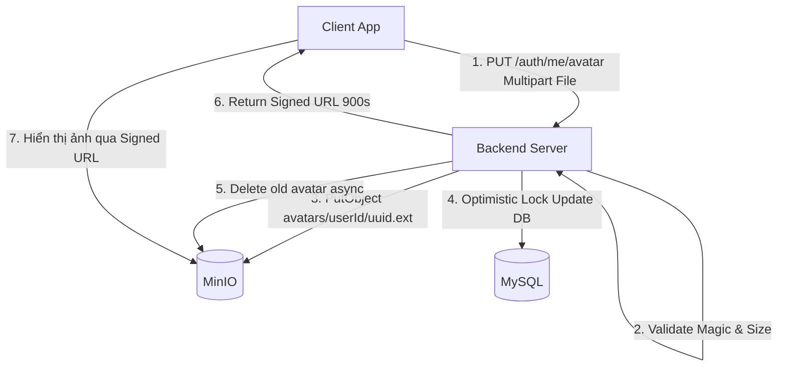
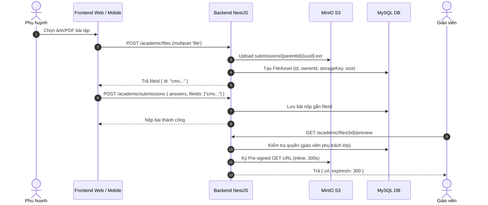

# Hướng dẫn tích hợp API Storage, Bài nộp và Avatar (EduGrade MinIO)

Tài liệu này hướng dẫn chi tiết cho Web Frontend và Mobile App tích hợp các API quản lý file, avatar và bài nộp học tập sử dụng **MinIO Object Storage** trong EduGrade Backend.

---

## 1. Quy ước chung

- **Base URL**: `http://localhost:3002/api/v1` (hoặc domain/IP LAN của server backend).
- **Swagger Docs**: `http://localhost:3002/api/docs/`
- **Authentication**: Gửi header `Authorization: Bearer <accessToken>` cho tất cả các endpoint được bảo vệ.
- **Envelope Response**:
  - **Thành công**: `{ "success": true, "data": ... }`
  - **Thất bại**: `{ "success": false, "error": { "code": "...", "message": "...", "requestId": "..." } }`
- **Cơ chế lưu trữ MinIO**:
  - File/Ảnh được lưu trực tiếp trên MinIO S3 bucket `edugrade` hoàn toàn riêng tư (Private/chặn Anonymous).
  - Database MySQL chỉ lưu `storageKey` và metadata (tên file, MIME type, kích thước).
  - Client truy cập hoặc hiển thị file thông qua **Pre-signed URL có thời hạn** do server ký cấp. Không bao giờ lưu trực tiếp pre-signed URL vào database vì URL sẽ hết hạn.

---

## 2. API Quản lý Avatar Tài khoản (`/api/v1/auth/me/avatar`)

Áp dụng cho mọi role đang đăng nhập (`PARENT`, `TEACHER`, `MANAGER`, `STAFF`, `CURRICULUM_DESIGNER`).



### 2.1. Lấy Pre-signed URL Avatar

- **Endpoint**: `GET /api/v1/auth/me/avatar`
- **Quyền**: Bất kỳ user đã đăng nhập.
- **Thời hạn URL**: 900 giây (15 phút).
- **Response Headers**: MinIO trả về kèm `Content-Disposition: inline` để trình duyệt/mobile hiển thị trực tiếp.

**Response mẫu khi user ĐÃ CÓ avatar:**
```json
{
  "success": true,
  "data": {
    "url": "http://localhost:9000/edugrade/avatars/user_123/671b0f8e-f2db-4adb-8904.png?X-Amz-Algorithm=AWS4-HMAC-SHA256&...",
    "expiresIn": 900
  }
}
```

**Response mẫu khi user CHƯA CÓ avatar:**
```json
{
  "success": true,
  "data": {
    "url": null,
    "expiresIn": null
  }
}
```

### 2.2. Upload / Thay đổi Avatar

- **Endpoint**: `PUT /api/v1/auth/me/avatar`
- **Content-Type**: `multipart/form-data`
- **Quy định file**:
  - Form field name: `file`
  - Định dạng hợp lệ: `.png`, `.jpg`, `.jpeg` (server kiểm tra cả MIME type lẫn magic number chữ ký file).
  - Dung lượng tối đa: **5 MB**.
- **Cơ chế**:
  - Upload object mới lên MinIO với key `avatars/{userId}/{uuid}.{ext}`.
  - Cập nhật database có điều kiện (optimistic lock theo key cũ). Nếu có request đồng thời thay thế, request thua cuộc sẽ bị trả về `409 Conflict` và tự động dọn dẹp file vừa upload.
  - Tự động xóa file avatar cũ trên MinIO ở chế độ nền (background).

**Response (200 OK):**
```json
{
  "success": true,
  "data": {
    "url": "http://localhost:9000/edugrade/avatars/user_123/new-uuid.png?X-Amz-Algorithm=...",
    "expiresIn": 900
  }
}
```

### 2.3. Xóa Avatar

- **Endpoint**: `DELETE /api/v1/auth/me/avatar`
- **Ý nghĩa**: Gỡ bỏ avatar hiện tại, cập nhật `avatarStorageKey = null` và xóa object trên MinIO.
- **Tính chất**: Idempotent (gọi nhiều lần vẫn trả thành công).

**Response (200 OK):**
```json
{
  "success": true,
  "data": {
    "deleted": true
  }
}
```

### 2.4. Cờ `hasAvatar` trong Profile

Khi gọi `GET /api/v1/auth/me` hoặc đăng nhập `POST /api/v1/auth/login`, thông tin user trả về có thêm trường `hasAvatar`:
```json
{
  "id": "user_123",
  "email": "parent@edugrade.local",
  "displayName": "Nguyen Van A",
  "role": "PARENT",
  "hasAvatar": true,
  ...
}
```
> **FE Tip:** Khi `hasAvatar === true`, client mới cần gọi `GET /api/v1/auth/me/avatar` để lấy signed URL hiển thị ảnh đại diện; nếu `hasAvatar === false`, có thể hiển thị avatar mặc định theo chữ cái đầu tên để tiết kiệm request.

---

## 3. API Bài nộp & Tài liệu học tập (`/api/v1/academic`)



### 3.1. Upload File đính kèm bài tập

- **Endpoint**: `POST /api/v1/academic/files`
- **Quyền**: `PARENT`
- **Content-Type**: `multipart/form-data`
- **Quy định file**:
  - Form field name: `file`
  - Định dạng: `.pdf` (`%PDF-`), `.png` (`89 50 4E 47...`), `.jpg`/`.jpeg` (`FF D8 FF...`)
  - Dung lượng tối đa: **10 MB / file**.
- **Key lưu trữ**: `submissions/{parentId}/{uuid}.{ext}` (tách biệt hoàn toàn khỏi avatar).

**Response (201 Created):**
```json
{
  "success": true,
  "data": {
    "id": "cmvq6nh140002ugk8cizuudaz",
    "name": "bai_tap_toan.pdf",
    "mimeType": "application/pdf",
    "size": 1048576
  }
}
```

### 3.2. Nộp bài tập kèm File

- **Endpoint**: `POST /api/v1/academic/submissions`
- **Quyền**: `PARENT`
- **Body**:
```json
{
  "recipientId": "recipient_id_123",
  "answers": [
    { "questionId": "q_1", "answer": "A" }
  ],
  "fileIds": [
    "cmvq6nh140002ugk8cizuudaz"
  ]
}
```
> **Lưu ý bảo mật:** Server kiểm tra nghiêm ngặt quyền sở hữu của `fileIds`. Phụ huynh chỉ được đính kèm file do chính mình upload. Avatar không thuộc bảng `FileAsset` nên sẽ bị từ chối nếu gửi nhầm vào `fileIds`.

### 3.3. Xem trước file bài nộp (Preview)

- **Endpoint**: `GET /api/v1/academic/files/:id/preview`
- **Quyền**:
  - Phụ huynh đã upload file.
  - Hoặc Giáo viên được phân công phụ trách lớp / bài tập đó.
- **Thời hạn URL**: 300 giây (5 phút).
- **Hành vi**:
  - Với ảnh (`image/png`, `image/jpeg`): Header `Content-Disposition: inline` giúp xem trực tiếp trên ứng dụng / web modal.
  - Với file PDF: Trả signed URL hỗ trợ xem inline trên trình đọc PDF của trình duyệt.

**Response (200 OK):**
```json
{
  "success": true,
  "data": {
    "url": "http://localhost:9000/edugrade/submissions/parent_123/uuid.png?X-Amz-Algorithm=...",
    "expiresIn": 300
  }
}
```

### 3.4. Tải xuống file bài nộp (Download)

- **Endpoint**: `GET /api/v1/academic/files/:id/download`
- **Quyền**: Phụ huynh chủ sở hữu hoặc Giáo viên phụ trách.
- **Thời hạn URL**: 60 giây (1 phút).
- **Hành vi**: Header `Content-Disposition: attachment` kích hoạt tải trực tiếp file về máy.

**Response (200 OK):**
```json
{
  "success": true,
  "data": {
    "url": "http://localhost:9000/edugrade/submissions/parent_123/uuid.pdf?response-content-disposition=attachment&...",
    "expiresIn": 60
  }
}
```

---

## 4. Mã lỗi thường gặp (Error Handling)

| HTTP Code | Error Code | Nguyên nhân & Cách xử lý |
| :--- | :--- | :--- |
| **400** | `INVALID_FILE_SIZE` | File rỗng (0 bytes) hoặc vượt quá dung lượng cho phép (Avatar: 5MB, Bài nộp: 10MB). |
| **400** | `INVALID_FILE_TYPE` | Đuôi mở rộng, MIME type hoặc magic byte nội dung không khớp (ví dụ đổi đuôi .exe thành .png). |
| **403** | `FORBIDDEN` | Tài khoản không có quyền thao tác hoặc không phải giáo viên phụ trách lớp để xem bài nộp. |
| **404** | `RESOURCE_NOT_FOUND` | `fileId` không tồn tại trong hệ thống. |
| **409** | `AVATAR_CONFLICT` | Có 2 request thay đổi avatar xảy ra đồng thời. Client nên thử lại request mới nhất. |
| **409** | `INVALID_FILES` | File trong `fileIds` không thuộc quyền sở hữu của phụ huynh đang submit. |
| **503** | `ServiceUnavailableException` | MinIO storage chưa được cấu hình hoặc container MinIO mất kết nối. |

---

## 5. Ví dụ mã tích hợp Frontend (TypeScript / JavaScript)

### 5.1. Upload Avatar từ React / Vue / React Native

```typescript
// 1. Upload Avatar
async function uploadAvatar(file: File, accessToken: string) {
  const formData = new FormData();
  formData.append('file', file);

  const res = await fetch('http://localhost:3002/api/v1/auth/me/avatar', {
    method: 'PUT',
    headers: {
      Authorization: `Bearer ${accessToken}`,
    },
    body: formData,
  });

  const body = await res.json();
  if (!body.success) {
    throw new Error(body.error.message);
  }
  return body.data.url; // Pre-signed URL hiển thị ảnh ngay lập tức
}

// 2. Lấy Pre-signed URL Avatar khi cần load ảnh
async function getAvatarUrl(accessToken: string) {
  const res = await fetch('http://localhost:3002/api/v1/auth/me/avatar', {
    headers: { Authorization: `Bearer ${accessToken}` },
  });
  const body = await res.json();
  return body.data.url; // null nếu chưa có
}
```

### 5.2. Upload file và nộp bài (Parent)

```typescript
async function submitHomework(file: File, recipientId: string, accessToken: string) {
  // Bước 1: Upload file lấy fileId
  const formData = new FormData();
  formData.append('file', file);

  const uploadRes = await fetch('http://localhost:3002/api/v1/academic/files', {
    method: 'POST',
    headers: { Authorization: `Bearer ${accessToken}` },
    body: formData,
  });
  const fileData = await uploadRes.json();
  const fileId = fileData.data.id;

  // Bước 2: Nộp bài kèm fileId
  const submitRes = await fetch('http://localhost:3002/api/v1/academic/submissions', {
    method: 'POST',
    headers: {
      Authorization: `Bearer ${accessToken}`,
      'Content-Type': 'application/json',
    },
    body: JSON.stringify({
      recipientId,
      answers: [],
      fileIds: [fileId],
    }),
  });

  return await submitRes.json();
}
```
