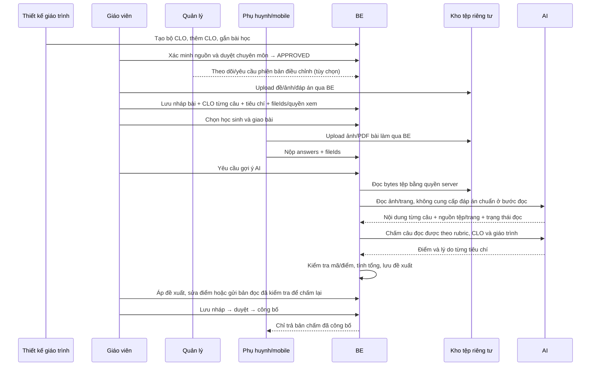

# Rubric, CLO, file/ảnh và chấm AI — luồng chạy, vận hành và demo

Cập nhật: 10/11/2026. Phạm vi triển khai: BE và FE web; giao diện mobile do nhóm khác thực hiện. Không tạo tài khoản học sinh riêng: phụ huynh (`PARENT`) nộp bài cho học sinh thuộc tài khoản của mình.

## 1. Các phần đã nối với nhau

- CLO có luồng hai vai trò: Thiết kế giáo trình tạo → giáo viên xác minh nguồn và duyệt chuyên môn → sử dụng ngay. Quản lý theo dõi và có thể yêu cầu phiên bản điều chỉnh, không duyệt thêm.
- Giáo viên tạo HOMEWORK hoặc TEST; mỗi câu tự luận có nhiều tiêu chí cấu trúc. Rubric toàn bài là tập hợp tiêu chí của các câu, không có thư viện rubric dùng chung cần tạo trước.
- Mỗi tiêu chí có `id`, `title`, `description`, `maxScore`. CLO gắn ở cấp câu hỏi; nhiều câu có thể cùng đo một CLO.
- Đính kèm PDF/JPG/PNG cho toàn bài hoặc câu hỏi, với quyền học sinh được xem hoặc chỉ giáo viên xem.
- Phụ huynh upload rồi gửi `fileIds` khi nộp; có thể gắn một tệp cho nhiều câu.
- AI đọc tệp/trang, ghép bài làm với câu hỏi, rồi AI chấm từng tiêu chí. BE tự cộng điểm và kiểm tra giới hạn.
- Giáo viên xem đề xuất, sửa nội dung đọc sai, chấm lại, chỉnh điểm, lưu nháp và xác nhận gửi điểm.
- Bản chấm lưu snapshot rubric. Điểm đã lưu/công bố không bị thay đổi chỉ vì yêu cầu AI chạy lại.

## 2. Luồng chạy



### Khi soạn bài

1. Chọn lớp và loại bài. TEST phải có buổi học còn hiệu lực và loại kiểm tra (15 phút, một tiết, giữa kỳ, cuối kỳ).
2. Chọn bộ CLO đã được duyệt của khóa. Nếu chọn bộ thì CLO của câu phải thuộc bộ đó.
3. Nhập câu hỏi; tự luận thêm từng tiêu chí; trắc nghiệm khai báo lựa chọn/đáp án.
4. Tệp mới mặc định **chỉ giáo viên xem**. Bỏ đánh dấu này cho đề/tài liệu muốn giao học sinh; giữ cho đáp án.
5. Có thể lưu nháp khi rubric chưa phân bổ đủ điểm hoặc chưa có đáp án. Tên/điểm từng tiêu chí đã thêm vẫn phải hợp lệ.
6. Trước khi giao, BE bắt buộc có barem tự luận hoặc tiêu chí, tổng tiêu chí bằng điểm câu, trắc nghiệm có đáp án hợp lệ, và đủ CLO khi khóa có bộ đã duyệt.
7. Bài đã giao không sửa lại câu/rubric qua API sửa nháp. Muốn đổi đề, tạo bài mới để giữ nhất quán việc chấm.

### Khi nộp

1. Mobile upload từng tệp; chờ tất cả tệp cần dùng tải xong.
2. Gửi đúng một phần tử answer cho **mỗi câu**. Bài chỉ có ảnh/PDF được gửi `answer: ""` cùng fileIds.
3. BE kiểm tra tài khoản phụ huynh sở hữu học sinh, bài đã giao, hạn nộp, kỳ học và số lần nộp.
4. BE kiểm tra fileIds thuộc người nộp; mapping file trong từng answer phải là tập con của fileIds toàn bài.
5. Khóa recipient khi ghi lần nộp để ngăn hai request đồng thời vượt số lần cho phép.

### Khi chấm AI

1. `POST grade-ai` chỉ giáo viên được phân công được gọi. Một bài nộp chỉ có một tác vụ chờ/đang chạy; request lặp dùng lại tác vụ hiện tại.
2. Worker lấy tác vụ, chuyển `QUEUED → PROCESSING`. Lượt chạy bị gián đoạn quá 10 phút được đánh dấu thất bại để giáo viên thử lại.
3. Nếu có tệp, server đọc bytes từ kho riêng tư; không cho AI tự truy cập URL tùy ý.
4. PDF được render từng trang; ảnh được gửi vào endpoint AI đọc ảnh đã cấu hình. Tối đa 5 tệp, 30 MB tổng và 10 trang/ảnh mỗi lượt đọc; mỗi tệp upload tối đa 10 MB.
5. AI trả mỗi câu: nội dung, đọc được hay không, lý do, nguồn tệp/trang. BE từ chối mã câu/trang không tồn tại hoặc nguồn trái mapping.
6. Câu mờ, thiếu, mâu thuẫn chữ/ảnh hoặc không ghép được câu được chuyển sang `manualReviewQuestionIds`; không tự tạo điểm 0.
7. Chỉ gửi câu đọc được sang bước chấm. Bước này có rubric, đáp án, CLO và ngữ cảnh giáo trình. AI chấm tiêu chí; BE kiểm tra đủ/không trùng tiêu chí, điểm hữu hạn và trong giới hạn, rồi tự cộng.
8. Trắc nghiệm được tính theo đáp án chuẩn từ lựa chọn đã xác định. Trắc nghiệm chỉ có trong file cần đọc/kiểm tra trước; không dùng chức năng chấm khách quan từ chuỗi trả lời rỗng.
9. Kết thúc `SUCCEEDED` có thể vẫn chứa các câu cần kiểm tra thủ công. `FAILED` nghĩa chưa có bộ đề xuất hợp lệ cho lượt chạy đó.
10. Đề xuất không tự tạo bản chấm và không tự công bố. Giáo viên chủ động áp dụng, sửa, lưu, gửi.

### Khi giáo viên sửa nội dung đọc sai

Trong thẻ câu hỏi, sửa ô **Nội dung giáo viên đã kiểm tra** rồi chọn **Chấm lại với nội dung đã kiểm tra**. BE tạo lượt đề xuất mới, lưu người xác nhận và các nội dung sửa, giữ bài nộp gốc. Các nội dung sửa từ lượt thành công gần nhất được giữ khi sửa tiếp câu khác. Nếu AI đang chạy, đợi lượt hiện tại kết thúc trước khi gửi bản sửa.

### Khi lưu và công bố

- Màn chấm nhập điểm/nhận xét cho từng tiêu chí; tổng điểm câu tự cộng. BE cũng tự cộng lại từ tiêu chí, không tin tổng do client/AI gửi.
- **Lưu nháp** tạo phiên bản điểm mới. `expectedRevision` phát hiện khi phiên khác đã lưu trước; bản chấm lưu snapshot rubric.
- **Gửi điểm → Xác nhận gửi điểm** thực hiện lưu nếu cần, duyệt, công bố. Nếu mạng lỗi giữa các bước, luồng tiếp tục từ bản đã lưu thay vì tạo lại tùy tiện.
- Điểm theo CLO trên web là tổng điểm các câu cùng CLO / tổng điểm tối đa các câu đó. Đây là tỷ lệ của bài đang chấm, chưa phải kết luận đạt chuẩn toàn khóa.

## 3. Chuẩn bị môi trường demo thật

### BE

```powershell
cd D:\FALL26\WDP301\WDP301-BE-System
pnpm install --frozen-lockfile
docker compose up -d
pnpm exec prisma migrate deploy
pnpm exec prisma generate
pnpm dev
```

Docker Desktop phải chạy trước `docker compose`. Migration mới thêm `assignment_questions.criteria`, `grade_reviews.rubricSnapshot` và bảng `assignment_files`; không chạy reseed trên dữ liệu đang dùng chỉ để demo.

Kiểm tra `.env`: DATABASE_URL, STORAGE_ENDPOINT, STORAGE_PUBLIC_ENDPOINT, STORAGE_BUCKET, STORAGE_ACCESS_KEY, STORAGE_SECRET_KEY. Kho tệp phải ở chế độ riêng tư; browser cần truy cập được public endpoint đã cấu hình để xem link có hạn.

### AI

```dotenv
# Chấm nội dung theo rubric — endpoint Chat Completions hiện có
AI_CHAT_URL=<endpoint>
AI_API_KEY=<key>
AI_MODEL=<model>

# Đọc ảnh/PDF scan — endpoint/model hỗ trợ image_url và JSON output
AI_VISION_CHAT_URL=<multimodal-chat-completions-endpoint>
AI_VISION_API_KEY=<key>
AI_VISION_MODEL=<vision-model>
```

Khởi động lại BE sau khi sửa cấu hình. Cấu hình chấm chữ hiện có không tự chứng minh hỗ trợ đọc ảnh. Thiếu cấu hình vision thì các câu cần đọc tệp được đưa về giáo viên kiểm tra; vẫn dùng được chấm thủ công.

### FE

```powershell
cd D:\FALL26\WDP301\WDP301-FE-System
npm install
npm run dev
```

FE mặc định `http://localhost:3001`, BE `http://localhost:3000/api/v1`, Swagger `http://localhost:3000/api/docs` khi bật Swagger. `BACKEND_API_URL` của FE phải trỏ BE. Đăng nhập tại `/login`.

Tài khoản seed (nếu môi trường đã seed): `designer@edugrade.local`, `teacher@edugrade.local`, `manager@edugrade.local`; mật khẩu theo `SEED_DEFAULT_PASSWORD` của môi trường. Không ghi mật khẩu vào tài liệu hoặc ảnh demo.

Chuẩn bị một lớp đang hoạt động, giáo viên được phân công, học sinh có ghi danh đang hiệu lực/liên kết với phụ huynh, một giáo trình nháp và bộ bài mẫu:

- Đề: “Giải 2x + 3 = 11”, 4 điểm.
- CLO: “Giải được phương trình bậc nhất một ẩn”, nguồn và vị trí trích dẫn thực tế.
- Tiêu chí 1: Phương pháp — 3 điểm; tiêu chí 2: Kết quả — 1 điểm.
- Một ảnh bài giải rõ, một ảnh mờ, một PDF gồm 2 trang bài làm. Không ghi trước rằng AI chắc chắn sẽ cho số điểm cụ thể; đối chiếu với barem và bài gốc.

## 4. Demo UI theo role và path

Thay `{unitId}`, `{programId}`, `{assignmentId}`, `{submissionId}` bằng ID thật lấy từ URL/dữ liệu môi trường.

| Bước | Role | Path web | Thao tác và kết quả mong đợi |
|---|---|---|---|
| 1 | CURRICULUM_DESIGNER / Thiết kế giáo trình | `/manager/curriculum?tab=outcomes` | Chọn khóa có giáo trình mình soạn → Tạo bộ CLO → Thêm CLO → nhập mã, tên, phát biểu đo được, nguồn và vị trí yêu cầu. Lưu bộ nháp. |
| 2 | CURRICULUM_DESIGNER | `/manager/curriculum/{unitId}` | Mở giáo trình nháp → thao tác `⋯` của bài học → **Gắn CLO** → chọn CLO vừa tạo → lưu. |
| 3 | TEACHER / Giáo viên | `/teacher/curriculum?tab=outcomes` | Chọn khóa đang dạy → **Xác minh nguồn** từng CLO → ghi vị trí và nhận xét → **Duyệt chuyên môn**. Bộ chuyển thẳng `DRAFT → APPROVED`, dùng được ngay ở màn tạo bài. |
| 4 (tùy chọn) | MANAGER / Quản lý | `/manager/curriculum?tab=programs&program={programId}&programTab=outcomes` | Theo dõi bộ đã duyệt. Khi cần, **Yêu cầu điều chỉnh** và ghi lý do; bộ hiện tại vẫn `APPROVED`. Designer tạo phiên bản mới để giáo viên duyệt lại. |
| 5 | TEACHER | `/teacher/assignments/new` | Chọn lớp → HOMEWORK hoặc TEST → chọn bộ CLO → nhập đề, điểm câu → **Thêm tiêu chí** → phân bổ 3 + 1 = 4 điểm. Xem **Rubric toàn bài**. |
| 6 | TEACHER | Cùng màn tạo/sửa bài | **Thêm file / ảnh** → chọn đề PDF/ảnh → bỏ “Chỉ giáo viên xem” cho đề; giữ đánh dấu cho đáp án. Chọn **Toàn bài** hoặc **Câu 1**. Xem trước/tải lại tệp để kiểm tra. |
| 7 | TEACHER | Cùng màn tạo/sửa bài | **Nhập câu hỏi từ file** nếu cần đọc đề từ DOCX/PDF/ảnh → xem preview và cảnh báo → áp vào form → kiểm tra thủ công câu, CLO, rubric và điểm → **Lưu nháp**. Nhập đề không tự tạo đáp án/rubric suy đoán. |
| 8 | TEACHER | `/teacher/assignments/{assignmentId}/submissions` | Chọn ghi danh/học sinh đang hiệu lực → **Giao bài**. Bài chuyển PUBLISHED; nội dung/rubric bị khóa. |
| 9 | PARENT / Phụ huynh | Mobile do nhóm khác thực hiện; không có parent path trên FE web | Upload ảnh/PDF rồi nộp theo API ở tài liệu bàn giao. Nếu mobile chưa sẵn sàng, dùng Swagger `/api/docs` với token PARENT để upload và POST submissions. Đây là bước API, không phải màn nộp bài web. |
| 10 | TEACHER | `/teacher/assignments/{assignmentId}/submissions` | Thấy lần nộp mới → mở bài cần chấm. Có thể tìm từ `/teacher/grading` hoặc `/teacher/submissions`. |
| 11 | TEACHER | `/teacher/grading/{submissionId}?assignmentId={assignmentId}` | Xem tệp gốc → **Gợi ý AI** → đợi kết quả → đối chiếu **AI đọc bài**, nguồn “Tệp…, trang…” và điểm từng tiêu chí. |
| 12 | TEACHER | Cùng màn chấm | **Dùng gợi ý AI cho các câu đã đọc** → kiểm tra/sửa điểm tiêu chí. Với ảnh mờ, chấm thủ công hoặc sửa nội dung đã kiểm tra rồi chấm lại. |
| 13 | TEACHER | Cùng màn chấm | **Lưu nháp**, tải lại để xem phiên bản. Sau khi kiểm tra → **Gửi điểm → Xác nhận gửi điểm**. |
| 14 | PARENT | Mobile/API | Đọc danh sách bài nộp và điểm PUBLISHED. Không nhận điểm nháp/đề xuất AI hoặc tệp chỉ giáo viên xem. |

## 5. Demo lỗi cần thực hiện

| Tình huống | Kết quả mong đợi / cách xử lý |
|---|---|
| Phân bổ tiêu chí 3 + 2 cho câu 4 điểm | Form cảnh báo, lưu nháp được; giao bài bị chặn `RUBRIC_TOTAL_MISMATCH`. Sửa tổng về 4. |
| Thiếu rubric hoặc đáp án trước khi giao | `RUBRIC_REQUIRED` / `INVALID_ANSWER_KEY`; quay lại sửa nháp. |
| Chọn CLO khác khóa/bộ chưa duyệt, hoặc còn câu chưa gắn CLO khi giao | `INVALID_OUTCOME_SET` / `OUTCOME_MAPPING_INCOMPLETE`; chọn đúng bộ và gắn đủ câu. |
| Tệp sai đuôi/MIME/chữ ký hoặc >10 MB | Upload bị từ chối; chọn lại PDF/JPG/PNG hợp lệ. |
| Tải nhiều tệp, một tệp lỗi mạng | Các tệp đã thành công vẫn được giữ trên form; chọn lại riêng tệp lỗi. Không bấm nộp/lưu khi còn tải. |
| Dùng fileId của người khác hoặc map file chưa có trong bài nộp | `INVALID_FILES` / `INVALID_FILE_QUESTION`; không được gắn tệp. |
| Phụ huynh mở URL API của đáp án teacherOnly | 403; không được cấp link tải. |
| Link xem tệp hết hạn | Mở/tải lại để lấy link mới; không lưu link có hạn trong hồ sơ lâu dài. |
| Bài quá hạn, hết lượt nộp hoặc không thuộc con mình | `SUBMISSION_CLOSED` / `ATTEMPTS_EXHAUSTED` / 403. |
| PDF có mật khẩu, hỏng, quá 10 trang hoặc ảnh quá mờ | Báo không đọc được/vượt giới hạn/cần kiểm tra. Mở tệp gốc, nhập bản đọc đã kiểm tra hoặc chấm tay; không tự cho 0 vì lỗi đọc. |
| Không cấu hình vision | Có lý do “Chưa cấu hình AI đọc ảnh/PDF”; chuyển về chấm thủ công. |
| AI hết thời gian, sai định dạng, thiếu/trùng tiêu chí, điểm vượt tối đa | Lượt đề xuất thất bại hoặc câu về manual review; điểm đã lưu giữ nguyên. Thử lại hoặc chấm thủ công. |
| Bấm AI nhiều lần | Không tạo nhiều tác vụ đang chạy cho cùng bài; bản sửa gửi khi đang chạy bị `AI_JOB_BUSY`. |
| Hai phiên giáo viên cùng lưu | Phiên sau có revision cũ bị `GRADE_REVISION_CONFLICT`; ghi lại thay đổi và tải lại bản mới. |

## 6. Kiểm thử và giới hạn xác nhận

Kết quả xác nhận: 146 kiểm thử BE trong 18 suite và 6 kiểm thử FE (5 luồng trình duyệt, 1 kiểm tra chuẩn hóa tiêu chí) đạt; TypeScript/lint các tệp thay đổi và build FE/BE đạt. Đã kiểm tra render PDF hai trang thật qua service đọc bài; lời gọi AI trong kiểm thử được giả lập. Các kiểm thử được lưu trong `tests/unit/rubric.spec.ts`, `assessment-rubric.spec.ts`, `submission-reader.spec.ts`, `structured-grading-worker.spec.ts` và bộ kiểm thử học vụ hiện có. FE có bộ UI độc lập:

```powershell
# BE
pnpm exec tsc --noEmit
pnpm exec prisma validate
pnpm exec jest --runInBand tests/unit/rubric.spec.ts tests/unit/submission-reader.spec.ts tests/unit/structured-grading-worker.spec.ts tests/unit/grading-worker.spec.ts tests/unit/academic-storage.spec.ts tests/unit/assessment-session.spec.ts tests/unit/assignment-import-parser.spec.ts tests/unit/ai-grading-skill.spec.ts tests/unit/assessment-rubric.spec.ts tests/unit/assignment-import.service.spec.ts tests/unit/assignment-document-extraction.spec.ts tests/unit/grade-publication.spec.ts

# FE: build trước rồi chạy UI với API fixture riêng ở cổng 3100/3101
npm run build -- --webpack
npx playwright test --config e2e/rubric/playwright.config.ts
```

UI fixture kiểm tra thao tác, hiển thị và payload qua FE/BFF, không chứng minh chất lượng đọc chữ viết tay hay kết nối kho tệp thật. Để nghiệm thu AI thực tế, cần endpoint vision hợp lệ và bộ bài đã có điểm chuẩn của giáo viên; so sánh bản đọc, điểm từng tiêu chí và thời gian/chi phí thực tế. Không đánh giá độ chính xác bằng một bài demo duy nhất.

Ngày 10/11/2026 đã áp toàn bộ migration vào MySQL local `localhost:3307/edugrade_db`, gồm luồng CLO hai trạng thái và rubric/file. Lịch sử ba migration cũ được đối chiếu và ghi nhận theo cấu trúc đã tồn tại; không reset dữ liệu. Đã cấu hình vision local dùng lại khóa DeepSeek hiện có với model deepseek-flash và thử provider thật: PDF một trang có lời giải in rõ được đọc kèm nguồn trang, chấm đúng 4/4 theo rubric 3 + 1. Lượt thử này không ghi database/công bố điểm và chưa xác nhận chất lượng chữ viết tay. Cổng 3000 đang được một container của dự án khác sử dụng; khi chạy BE cần chọn cổng trống và trỏ `BACKEND_API_URL` của FE tương ứng.

## 7. Kết quả rà soát bổ sung

- Điểm đề xuất được ghép bằng `criterionId`, sau đó xếp theo rubric trên UI. AI trả tiêu chí khác thứ tự không làm điểm nhảy sang tên khác; bộ tiêu chí thiếu/trùng/sai giới hạn không được áp dụng.
- Duyệt/công bố lấy khóa bài nộp trước khi đọc phiên bản hiện tại. API từ chối bản chấm cũ bằng `GRADE_REVISION_CONFLICT` kể cả khi client kiểm tra trước đó nhưng phiên khác vừa lưu bản mới.
- Nhập câu hỏi từ tệp giữ phần rubric đã soạn trên câu chưa nhập đề; chỉ hành động thay thế có xác nhận mới bỏ nội dung cũ.
- Giáo viên mới được phân công có thể giữ tệp đã thuộc chính bài nháp. Tệp mới thêm vẫn phải do mình tải lên; không được lấy fileId của người khác từ bài khác.

## 8. CLO được giáo viên duyệt trực tiếp

- Trạng thái bộ CLO chỉ còn `DRAFT` và `APPROVED`; không còn hàng chờ quản lý.
- Endpoint giáo viên `POST /academic/outcome-sets/:id/technical-approve` giữ URL để tương thích nhưng chuyển thẳng sang `APPROVED`; `reviewerId` và `approvedById` đều ghi giáo viên thực hiện.
- Bỏ endpoint quản lý `POST /academic/outcome-sets/:id/approve` và nút duyệt tương ứng.
- Quản lý có thể `POST /academic/outcome-sets/:id/request-changes` để lưu lý do ở `reviewNote`. Không đổi trạng thái hoặc xóa thông tin duyệt; Designer tạo phiên bản mới và giáo viên xác minh lại.
- Migration `20261110000000_teacher_final_clo_approval` chuyển bộ cũ đã thẩm định đầy đủ sang `APPROVED`; bộ thiếu người duyệt, nguồn xác minh hoặc bài học được đưa về nháp để kiểm tra lại. Các bộ đã duyệt trước đây giữ lịch sử cũ.
- Quy trình duyệt giáo trình hiện có vẫn áp dụng cho giáo trình; thay đổi này rút gọn bước duyệt bộ CLO.
