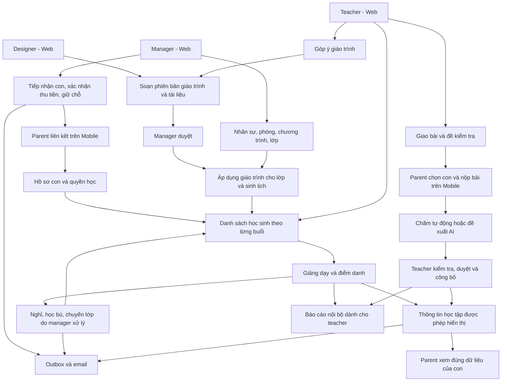
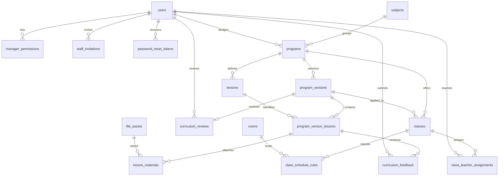
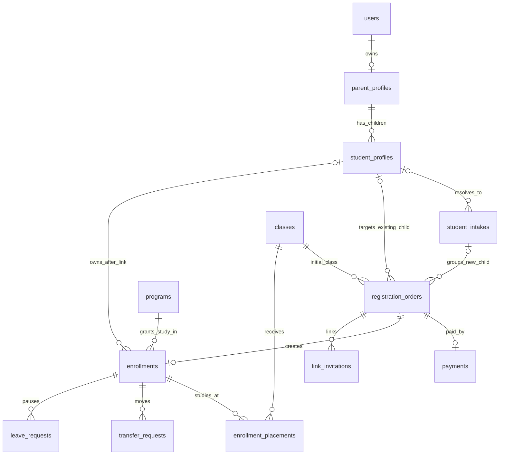
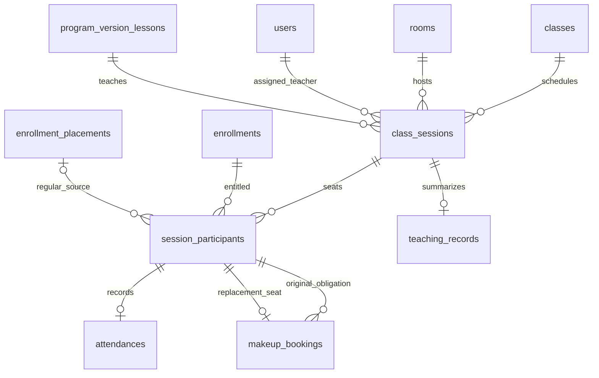
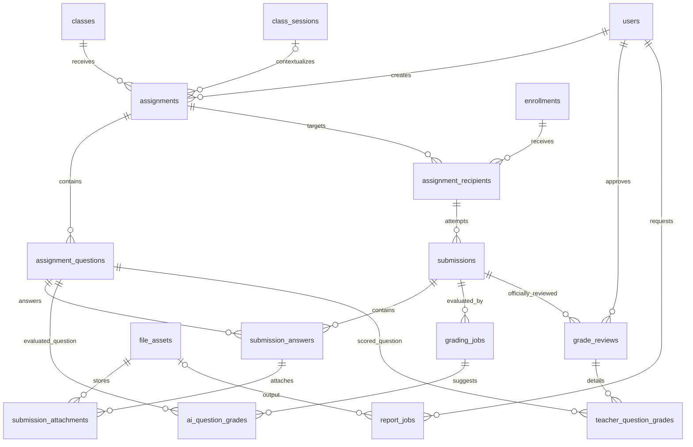
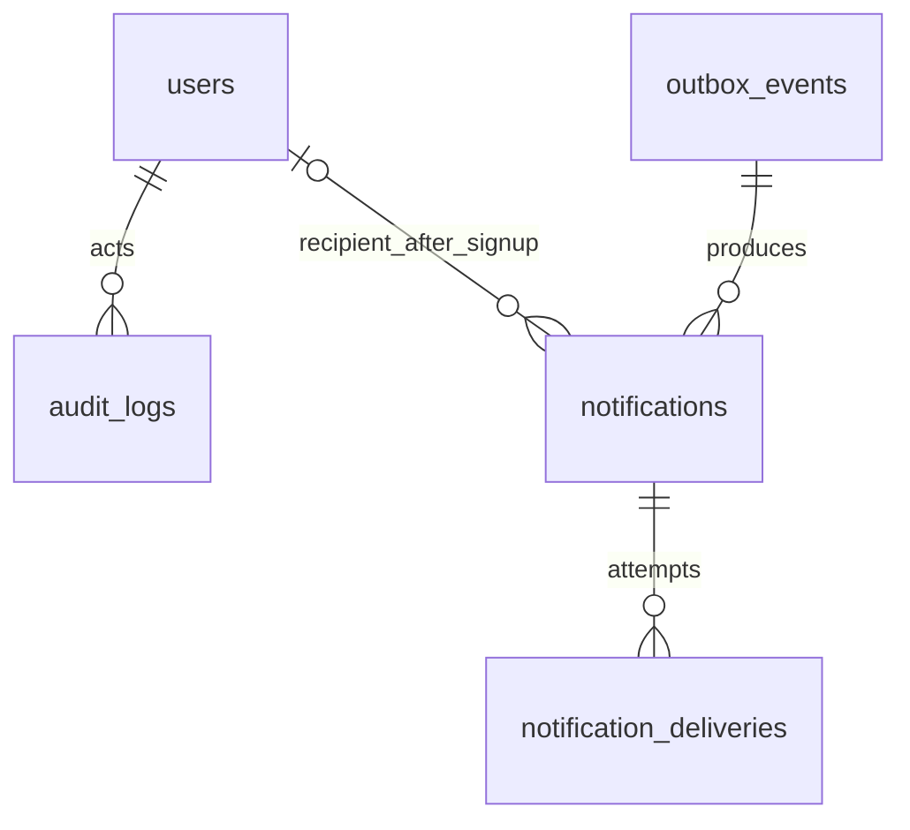

# EduGrade: đánh giá flow, phân rã nghiệp vụ và mô hình dữ liệu

Ngày: 26/09/2026. Trạng thái: **đề xuất thiết kế, chưa phải chức năng đã triển khai**.

Nguồn: đặc tả người dùng cung cấp, các lựa chọn đã trao đổi và schema/source code hiện tại. Các sơ đồ dùng tên bảng đề xuất; tên bảng đang có được ghi rõ ở phần 7. Đây là thiết kế nghiệp vụ và dữ liệu conceptual, chưa phải migration SQL.

## 1. Phạm vi và hiện trạng

- Một trung tâm, có nhiều quản lý; không cần bảng `centers` hoặc kiến trúc nhiều tenant ở phiên bản này.
- Theo lựa chọn đã chốt trong trao đổi: manager, designer và teacher sử dụng **web**; parent sử dụng **mobile**. Các đoạn trong đặc tả ghi teacher/parent cùng dùng cả web và mobile cần chỉnh lại cho thống nhất.
- Có **4 role trong toàn hệ thống**, trong đó **3 role nhân sự trên web**. Học sinh là hồ sơ thuộc phụ huynh, không có tài khoản riêng.
- `MANAGER_CENTER` là tên nghiệp vụ; code hiện dùng `MANAGER`. Đề xuất giữ giá trị hiện tại và hiển thị “Quản lý trung tâm”; nếu đổi enum/API cần một thay đổi tương thích riêng.
- Giữ NestJS, Prisma, MySQL và mô hình một backend chung. Phân quyền theo người dùng và tài nguyên, không dựa vào việc request đến từ web hay mobile.
- Code hiện có auth, users, health. Schema có đăng ký, thanh toán, lớp, chương trình, enrollment, invitation, audit/outbox; **có bảng không đồng nghĩa đã có API nghiệp vụ**.
- Designer soạn giáo án; manager duyệt; teacher nhận tài liệu theo lớp được phân công; tệp lưu object storage riêng tư. Đây là các lựa chọn đã được xác nhận.
- AI chấm bài, báo cáo, email, học bù và quản lý nghỉ học nằm trong đặc tả đầy đủ. Các phần chưa được xác nhận về chính sách được tập hợp ở phần 11.

## 2. Đánh giá flow và những điểm cần sửa

Flow có nền tảng tốt: thanh toán do manager xác nhận, phụ huynh quản lý nhiều con, AI phải qua giáo viên duyệt, email lỗi không làm mất giao dịch. Tuy nhiên, chưa đủ rõ để triển khai toàn hệ thống mà không phát sinh cách hiểu khác nhau.

| Vấn đề | Mức ảnh hưởng | Cải thiện đề xuất |
|---|---|---|
| Designer mới chỉ được liệt kê, chưa có quyền và vòng đời công việc | Cao | Bổ sung soạn giáo trình, quản lý phiên bản, gửi duyệt, sửa theo phản hồi; không được tự phát hành |
| Duyệt giáo án đang bị hiểu là mọi lớp lập tức dùng bản mới | Cao | Duyệt phiên bản giáo trình và áp dụng phiên bản cho lớp là hai thao tác riêng |
| Bài học bị sửa có thể làm thay đổi dữ liệu buổi đã dạy | Cao | Class và ClassSession giữ phiên bản cụ thể; nội dung đã gửi duyệt phải được bảo toàn |
| Chuyển lớp bằng cách sửa `Enrollment.classId` sẽ mất lịch sử | Nghiêm trọng | Tách quyền học đã mua (`Enrollment`) và quá trình học tại lớp (`EnrollmentPlacement`) |
| `made_up` vừa là kết quả bù vừa được dùng như điểm danh vật lý | Nghiêm trọng | Lưu điểm danh thực tế của hai buổi, liên kết bằng MakeupBooking; tính trạng thái made_up của buổi gốc |
| Mẫu số chuyên cần chưa loại buổi tương lai/chưa điểm danh/học bù | Cao | Chỉ tính nghĩa vụ học gốc đã chốt điểm danh; loại excused và buổi hủy; hiển thị dữ liệu còn thiếu |
| “Còn chỗ” chưa phân biệt sĩ số lớp và chỗ của một buổi | Nghiêm trọng | Kiểm tra riêng chỗ đăng ký dài hạn và chỗ trong buổi học bù; giữ chỗ trong transaction |
| Chưa rõ thời điểm bắt đầu gói, gia hạn, bảo lưu, hoàn tiền | Nghiêm trọng | Chọn chính sách trước khi triển khai thu phí thực tế; không suy ra gia hạn từ trạng thái nghỉ học |
| Nhiều đăng ký cho cùng một con mới có thể tạo trùng hồ sơ | Cao | Dùng một hồ sơ tiếp nhận `StudentIntake` chung trước khi liên kết; không ghép con bằng tên |
| Email được tự đặt lúc liên kết nhưng lại phải khớp email invitation | Cao | Email invitation là email được phép nhận quyền; parent tự đặt mật khẩu, không đổi tùy ý email nhận liên kết |
| API register hiện cho tạo parent không cần invitation | Cao | Nếu giữ yêu cầu invitation-only, bổ sung kiểm tra invitation và gộp tạo tài khoản/claim trong transaction |
| Chưa định nghĩa quyền giữa nhiều manager | Cao | Quyền quản lý nhân sự, cấp quyền, học vụ, tài chính và duyệt giáo trình phải phân biệt; không khóa quản lý cuối cùng |
| Chưa có quy tắc nghỉ lễ, lịch trùng, số buổi và chương trình dài/ngắn | Cao | Preview trước khi sinh lịch, kiểm tra giáo viên/phòng, ngừng ở cuối chương trình, xử lý lịch ngoại lệ |
| AI có thể chấm lại trong lúc teacher đang sửa | Cao | Mỗi lượt AI là đề xuất riêng; kết quả giáo viên và lần công bố có revision độc lập |
| Công bố đáp án ngay có thể lộ đề cho học sinh chưa nộp | Cao | Tách công bố điểm cá nhân khỏi công bố đáp án; đáp án chỉ mở khi đóng nhận bài và teacher cho phép |
| Outbox hiện ràng buộc trực tiếp RegistrationOrder | Cao | Khi thêm sự kiện điểm danh/điểm số, cần migration tổng quát hóa outbox, không gắn giả vào một đăng ký |

## 3. Conceptual: hệ thống vận hành như thế nào?

Các khái niệm phải phân biệt:

| Khái niệm | Ý nghĩa | Ví dụ |
|---|---|---|
| Program | Chương trình theo môn và khối | Toán 8 cơ bản |
| ProgramVersion | Một bộ nội dung và thứ tự bài đã được xét duyệt | Toán 8 cơ bản phiên bản 2 |
| Class | Lớp thực tế có giáo viên, phòng, lịch và sĩ số | T8-A, thứ 2 và thứ 4 |
| ClassSession | Một buổi diễn ra tại ngày giờ cụ thể | T8-A, 05/10, 18:00 |
| Enrollment | Quyền học theo chương trình và khoảng thời gian đã mua | Con A học Toán 8 trong 3 tháng |
| EnrollmentPlacement | Khoảng thời gian quyền học đó được thực hiện tại một lớp | T8-A đến 31/10; T8-B từ 01/11 |
| SessionParticipant | Một enrollment có chỗ/nghĩa vụ tham dự một buổi | Học thường hoặc tham dự buổi bù |
| Attendance | Kết quả tham dự thực tế | Có mặt, vắng, được miễn trong thời gian nghỉ |
| MakeupBooking | Liên kết nghĩa vụ buổi gốc với buổi học bù | Bù bài 5 ở lớp T8-B |

## 4. Chức năng chính/phụ và độ ưu tiên

**Chính/phụ** mô tả vai trò đối với sản phẩm. **P0/P1/P2** mô tả thứ tự triển khai, không phải cùng một khái niệm.

- **P0, 5/5:** bắt buộc trước khi vận hành thử luồng cốt lõi; thiếu sẽ mất dữ liệu, sai quyền hoặc không học/thu phí được.
- **P1, 4/5:** nghiệp vụ quan trọng, làm sau nền tảng; các mục có trong đặc tả vẫn bắt buộc để hoàn thành phiên bản đầy đủ.
- **P2, 2–3/5:** tăng tiện ích hoặc tối ưu; có thể hoãn mà không phá luồng cốt lõi.
- Tính năng hỗ trợ như audit, email retry, kiểm tra quyền vẫn có thể là P0.

| Mã | Business cần build | Người dùng | Loại | Ưu tiên | Lý do |
|---|---|---|---|---|---|
| IAM-01 | Đăng nhập, refresh, logout, quên/đổi mật khẩu, khóa tài khoản | Tất cả | Chính | P0 · 5/5 | Điều kiện truy cập và phục hồi tài khoản |
| IAM-02 | Mời/duyệt teacher, designer; mời manager và cấp quyền | Manager | Chính | P0 · 5/5 | Có nhân sự hợp lệ để vận hành |
| IAM-03 | Kiểm tra role, lớp được giao, con thuộc parent | Backend | Hỗ trợ | P0 · 5/5 | Không để lộ dữ liệu học sinh |
| CAT-01 | Môn, khối, chương trình, phòng học | Manager | Chính | P0 · 5/5 | Dữ liệu nền cho lớp và lịch |
| CUR-01 | Soạn bài, upload, tạo phiên bản, gửi duyệt | Designer | Chính | P0 · 5/5 | Cung cấp giáo trình cho teacher |
| CUR-02 | Duyệt/trả lại, áp dụng giáo trình theo lớp | Manager | Chính | P0 · 5/5 | Kiểm soát nội dung và phiên bản |
| CUR-03 | Teacher góp ý, designer xử lý và cập nhật | Teacher, designer | Chính | P1 · 4/5 | Khép kín vòng cải tiến giáo trình |
| CLS-01 | Tạo lớp, lịch cố định, phân công chính và dạy thay | Manager | Chính | P0 · 5/5 | Xác định ai dạy, ở đâu, khi nào |
| CLS-02 | Preview/sinh buổi, chống trùng lịch, nghỉ lễ/đổi buổi của lớp | Manager | Chính | P0 · 5/5 | Tạo lịch thực tế đáng tin cậy |
| REG-01 | Tiếp nhận con mới/con cũ, báo phí, xác nhận tiền, biên lai | Manager | Chính | P0 · 5/5 | Cốt lõi tuyển sinh và thu phí |
| REG-02 | Link lần đầu, thêm con, thêm môn; cấp lại link | Parent, manager | Chính | P0 · 5/5 | Nối tiền đã thu với đúng học sinh |
| ENR-01 | Thời hạn quyền học, giữ chỗ, hết hạn và gia hạn | Manager | Chính | P0 · 5/5 | Không học quá gói hoặc mất chỗ đã thu tiền |
| ATT-01 | Danh sách buổi, điểm danh nháp/chốt/sửa, tỷ lệ đi học | Teacher | Chính | P0 · 5/5 | Ghi nhận hoạt động giảng dạy |
| MOB-01 | Chuyển giữa các con; xem lịch, gói, chuyên cần | Parent | Chính | P0 · 5/5 | Trải nghiệm mobile tối thiểu |
| NTF-01 | Email theo sự kiện, trạng thái gửi, retry và gửi lại | Hệ thống, manager | Hỗ trợ | P0 · 5/5 | Không mất thông tin thanh toán/học vụ |
| AUD-01 | Lịch sử thay đổi và chống thao tác trùng | Backend | Hỗ trợ | P0 · 5/5 | Truy vết tiền, điểm, lịch và quyền |
| EXC-01 | Báo nghỉ, xác nhận nghỉ, xếp/hủy/đổi học bù | Parent, manager | Chính | P1 · 4/5 | Nghiệp vụ vận hành thường xuyên |
| EXC-02 | Chuyển lớp dài hạn, nghỉ có thời hạn, nghỉ môn/nghỉ hẳn | Manager | Chính | P1 · 4/5 | Quản lý vòng đời học sinh |
| ASM-01 | Tạo đề, câu hỏi, đáp án/rubric, giao bài, hạn nộp | Teacher | Chính | P1 · 4/5 | Điều kiện của chấm bài và theo dõi điểm |
| ASM-02 | Nộp bài theo con, lưu lần nộp, đính kèm | Parent/con | Chính | P1 · 4/5 | Thu thập bài làm đúng học sinh |
| GRD-01 | Chấm trắc nghiệm, chấm tay, duyệt và công bố | Teacher | Chính | P1 · 4/5 | Có điểm chính thức kể cả khi AI lỗi |
| GRD-02 | AI đề xuất điểm tự luận, sửa theo từng câu, chấm lại | Teacher | Chính | P1 · 4/5 | Chức năng AI được yêu cầu trong đặc tả |
| RPT-01 | Tổng hợp điểm/chuyên cần, AI nhận xét, Excel/PDF | Teacher | Chính | P1 · 4/5 | Đầu ra báo cáo của đặc tả |
| NTF-02 | Nhắc học phí, nghỉ lễ và thông báo toàn lớp | Manager | Hỗ trợ | P1 · 4/5 | Hoàn thiện truyền thông vận hành |
| UX-01 | Lọc, tìm kiếm, phân trang danh sách | Từng role | Hỗ trợ | P0 · 5/5 | Cần ngay khi tìm con, lớp, buổi và bản chờ duyệt |
| UX-02 | Dashboard phân tích, biểu đồ nâng cao, xuất hàng loạt | Nhân sự | Hỗ trợ | P2 · 3/5 | Có thể thay bằng danh sách và bộ lọc ban đầu |
| OPT-01 | Chat, OCR nâng cao, tự tối ưu xếp lớp, push notification | Mở rộng | Phụ | P2 · 2/5 | Chưa phải điều kiện của luồng đã yêu cầu |

## 5. Business nhỏ và quy tắc cần xây dựng

### 5.1 Nhân sự và quyền

1. Manager có quyền nhân sự mời teacher/designer bằng email; người nhận tự đặt mật khẩu. Hồ sơ mời chờ nhận không được phân công dạy.
2. “Duyệt teacher” đề xuất là bước manager duyệt hồ sơ trước khi kích hoạt. Lời mời được chấp nhận không tự bỏ qua bước này: User được tạo ở trạng thái DISABLED và chỉ chuyển ACTIVE sau khi manager duyệt. Trạng thái xét duyệt lưu tại lời mời để phân biệt chờ duyệt với bị khóa.
3. Manager có quyền cấp quyền mới được mời manager khác. Không cấp được quyền mình không có; không vô hiệu hóa hoặc bỏ quyền quản trị của manager cuối cùng.
4. Khi khóa teacher, ngăn truy cập ngay; liệt kê buổi tương lai và bài đang chờ chấm để manager phân công lại. Không xóa lịch sử đã dạy/chấm.
5. Quyền đề xuất: `STAFF_MANAGE`, `MANAGER_GRANT`, `ACADEMIC_MANAGE`, `PAYMENT_CONFIRM`, `CURRICULUM_APPROVE`. Manager đầu tiên được bootstrap ngoài màn hình đăng ký công khai.

**Hoàn thành khi:** không thể tự nâng role; parent không vào API nhân sự; teacher không tự nhận lớp; thao tác khóa tài khoản không làm mất người thực hiện trong lịch sử.

### 5.2 Giáo trình và tài liệu

1. Manager tạo Program và giao một designer phụ trách. Designer tạo bản nháp gồm mục tiêu, danh sách bài theo thứ tự và tài liệu từng bài.
2. `Lesson` là định danh bài ổn định; `ProgramVersionLesson` là nội dung bài trong một phiên bản giáo trình. Không dùng tiêu đề bài để so khớp học bù.
3. Gửi duyệt đóng băng nội dung và tập tệp. Manager duyệt cả phiên bản giáo trình hoặc trả lại kèm lý do. Bản chỉnh sửa sau đó là phiên bản mới, tham chiếu bản trước; giữ nguyên hồ sơ đã xét duyệt.
4. Đề xuất duyệt theo **bộ giáo trình có phiên bản**, vì hệ thống tự xếp bài theo thứ tự. Một cập nhật nhỏ có thể clone bộ hiện hành và dùng lại file không đổi; không bắt upload lại mọi tệp.
5. Manager chọn phiên bản APPROVED cho lớp. Teacher chỉ thấy nội dung của phiên bản lớp/buổi được giao, không thấy bản nháp của designer.
6. Cập nhật lớp sang bản mới cần preview tác động tới các buổi chưa diễn ra. Buổi đã diễn ra giữ bản cũ; buổi có học bù liên quan cần xử lý lại liên kết trước khi đổi nội dung.
7. Teacher góp ý gắn với bài, phiên bản và lớp. Designer tiếp nhận, giải quyết bằng phiên bản mới hoặc phản hồi lý do; manager duyệt bản sửa trước khi áp dụng.

**Tệp:** object storage private, metadata trong DB; kiểm tra loại/kích thước/chủ sở hữu ở backend. Đề xuất PDF/DOCX/PPTX, tối đa 20 MB/tệp, 10 tệp/bài. Đây là giới hạn ban đầu cần xác nhận. File đã tham chiếu bởi bản gửi duyệt không bị ghi đè; thay file tạo object mới. Upload lỗi không được coi là tài liệu sẵn sàng.

### 5.3 Lớp, giáo viên và sinh lịch

1. Manager chọn ProgramVersion, tên lớp, sức chứa, học phí/tháng, khoảng hoạt động, phòng, giáo viên chính và một hay nhiều quy tắc lịch tuần.
2. Một “lịch cố định” là một tập quy tắc: ví dụ thứ 2 và thứ 4, mỗi ngày có giờ bắt đầu/thời lượng. Không lưu lịch bằng một chuỗi mô tả duy nhất.
3. Preview các ClassSession theo múi giờ trung tâm. Kiểm tra phòng, giáo viên và ngày nghỉ; nếu không đủ buổi cho chương trình, yêu cầu điều chỉnh trước khi xác nhận.
4. Xác nhận sinh lịch có chống lặp. Không tự lặp lại bài đầu khi hết chương trình. Một bài trong MVP được xem là đơn vị một buổi; bài dài phải tách thành các phần có định danh riêng.
5. Giáo viên chính có khoảng hiệu lực. Dạy thay chỉ thay `teacherId` của buổi tương ứng và cấp quyền trong phạm vi buổi; không đổi teacher chính của toàn lớp.
6. Đổi lịch/giáo viên/phòng chỉ áp dụng cho buổi chưa bắt đầu, có kiểm tra xung đột và thông báo. Buổi đã có điểm danh không được xóa rồi tạo lại.

**Hoàn thành khi:** gọi sinh lịch hai lần không tạo trùng; chặn cùng giáo viên/phòng ở hai buổi giao nhau; teacher dạy thay không được xem toàn bộ dữ liệu không liên quan của lớp.

### 5.4 Tiếp nhận, thanh toán và liên kết

1. Chọn con đã có hồ sơ hoặc tạo `StudentIntake` cho con mới. Nếu con mới đăng ký nhiều môn, các RegistrationOrder dùng chung intake này.
2. Chọn lớp, ngày dự kiến bắt đầu và gói 1–12 tháng. Server tính báo phí từ bảng giá hiện hành; lưu snapshot giá trên order. Giá đã xác nhận không đổi theo giá lớp sau này.
3. Manager xác nhận đủ tiền. Một transaction tạo Payment, Enrollment chờ liên kết, placement giữ chỗ, invitation và sự kiện outbox; chặn xác nhận trùng và vượt sĩ số.
4. Sau commit, tạo/gửi biên lai và email. Biên lai có mã duy nhất, dữ liệu in lấy từ giao dịch đã lưu; backend không điều khiển máy in.
5. Parent mới mở link, đặt mật khẩu cho đúng email invitation. Parent đã có tài khoản phải đăng nhập đúng email. Không cho client chọn tùy ý một studentId khác với order/intake.
6. Claim trong transaction: khóa invitation và intake; tạo hoặc dùng lại đúng hồ sơ con; activate Enrollment; đánh dấu invitation USED. Hai đăng ký cùng intake chỉ tạo một StudentProfile.
7. Token hết hạn sau 7 ngày, dùng một lần, DB chỉ lưu hash. Cấp lại token thu hồi token cũ; token hết hạn không tự hủy Payment hay giải phóng chỗ đã thu tiền.

**Cần có màn hình xử lý:** đã thu tiền/chưa liên kết, email lỗi, link hết hạn, email nhập sai. Sửa email trước claim cần manager xác minh và ghi audit, sau đó thu hồi/cấp lại link. Không âm thầm đổi chủ một hồ sơ đã liên kết.

Quản lý hồ sơ con gồm tìm kiếm theo tên/email/SĐT phụ huynh, lọc lớp/chương trình/trạng thái và sửa thông tin có audit. Một email hiện thuộc role nhân sự không tự được chuyển thành parent khi claim; mô hình hiện tại mỗi User chỉ có một role. Chuyển quyền sở hữu con sang một phụ huynh khác cần quy trình xác minh riêng.

### 5.5 Enrollment, thời hạn và gia hạn

1. Enrollment đại diện quyền học theo chương trình trong khoảng ngày hiệu lực. Placement xác định lớp sử dụng quyền đó ở từng giai đoạn; ngày thanh toán, ngày claim và ngày bắt đầu học là ba dữ liệu khác nhau.
2. Mặc định đề xuất: ngày bắt đầu do manager chọn khi báo phí; ngày kết thúc tính theo tháng lịch, không dùng 30 ngày/tháng. Quy tắc cuối tháng phải được viết và test rõ trước khi code thu phí.
3. Gia hạn là RegistrationOrder/Payment/Enrollment mới nối tiếp, dùng lại StudentProfile. Chặn hai gói cùng chương trình bị chồng khoảng học nếu chưa có chính sách cho phép.
4. `PENDING_LINK` giữ chỗ nhưng parent chưa có quyền xem/nộp bài; chỉ sau claim mới kích hoạt sử dụng. Hết hạn gói không xóa điểm và lịch sử đã công bố.
5. Giá lớp khác nhau khi chuyển lớp, bảo lưu, hoàn tiền và điều chỉnh khoản đã thu là chính sách cần chốt. MVP không tự phát sinh thu thêm/hoàn tiền từ thao tác học vụ.

### 5.6 Điểm danh và chuyên cần

1. Hệ thống chuẩn bị SessionParticipant từ placement có hiệu lực và học bù đã đặt. Chỗ chờ liên kết vẫn tính sức chứa nhưng chưa cho điểm danh như học sinh đã kích hoạt.
2. Teacher phụ trách buổi đánh dấu nháp, kiểm tra rồi **chốt**. Trước khi chốt, parent chưa nhận email chính thức; không gửi một email cho mỗi lần bấm sửa.
3. Điểm danh vật lý lưu `UNMARKED`, `PRESENT`, `ABSENT`, `EXCUSED`. `MADE_UP` là trạng thái nghiệp vụ suy ra của buổi gốc khi học bù thành công, không phải một lần có mặt thứ hai trong mẫu số.
4. Sau khi chốt: cập nhật kết quả hiển thị và tạo email trong outbox. Sửa bản đã chốt phải có lý do, revision và thông báo đính chính; teacher chỉ sửa buổi mình còn quyền, manager xử lý trường hợp thay người.
5. Teacher không được sửa EXCUSED do nghỉ dài hạn đã được manager phê duyệt; manager phải điều chỉnh đơn nghỉ trước để tránh hai nguồn dữ liệu mâu thuẫn.

**Công thức đề xuất:** trên các buổi học gốc đã diễn ra và chốt, `chuyên cần = (buổi gốc PRESENT + buổi gốc đã bù thành công) / (buổi gốc PRESENT + buổi gốc ABSENT, kể cả ABSENT đã bù) × 100%`. Loại buổi hủy, EXCUSED và buổi tham dự bù khỏi mẫu số. Chưa chốt điểm danh được báo là thiếu dữ liệu; mẫu số 0 trả “chưa có dữ liệu”, không trả 0% hoặc 100%.

Ví dụ: 10 buổi gốc, 7 có mặt, 2 vắng, 1 excused; đã bù 1 buổi vắng. Kết quả = 8/9 = 88,89%, không phải 8/10 hay 9/10. Buổi bù tương lai hoặc bù nhưng vắng chưa được tính hoàn thành.

### 5.7 Báo nghỉ, đổi một buổi và học bù

1. Parent gửi yêu cầu cho đúng con/enrollment/buổi; manager xác nhận. Yêu cầu nghỉ trước giờ học chưa tự ghi nhận một sự kiện vắng đã xảy ra.
2. Manager tìm buổi thay thế: cùng chương trình, cùng bài ổn định, phù hợp phiên bản, chưa diễn ra, trong thời hạn gói và còn chỗ; không trùng lịch của con.
3. Mặc định an toàn cho MVP: cùng phiên bản giáo trình. Học bù giữa hai phiên bản khác nhau cần quy tắc tương đương riêng, không tự chấp nhận chỉ vì trùng tên bài.
4. Đặt học bù tạo MakeupBooking và target SessionParticipant, giữ chỗ nguyên tử. Một buổi gốc chỉ có một booking còn hiệu lực; có thể lưu nhiều lần đặt đã hủy/không đến.
5. Teacher của buổi thay thế chỉ thấy thông tin học sinh cần cho buổi đó. Khi chốt PRESENT ở buổi bù, booking COMPLETED và buổi gốc hiển thị MADE_UP trong cùng transaction.
6. Vắng buổi bù: booking MISSED, nghĩa vụ gốc vẫn ABSENT; được đặt lại nếu còn điều kiện. Không tạo thêm một lần vắng gốc để giảm tỷ lệ chuyên cần hai lần.
7. Đổi một buổi trước ngày học dùng cùng cơ chế với loại `PLANNED_SWAP`. Không sửa lịch cố định và không yêu cầu con có mặt ở cả hai buổi.

**Sức chứa:** sĩ số dài hạn tính enrollment có placement hiệu lực, kể cả chờ link và tạm nghỉ còn giữ chỗ. Sức chứa từng buổi giới hạn theo lớp/phòng; tính chỗ học thường còn giữ và booking học bù. Chỉ giải phóng chỗ buổi gốc khi đã có quyết định nghỉ/đổi buổi được duyệt, không suy từ một ô điểm danh nháp. Mọi luồng thay đổi chỗ phải dùng cùng cách khóa buổi/lớp để không vượt chỗ khi có request đồng thời.

### 5.8 Chuyển lớp, tạm nghỉ và kết thúc học

1. **Chuyển lớp dài hạn:** chọn ngày hiệu lực, lớp cùng chương trình/phiên bản, còn chỗ và lịch phù hợp. So sánh tiến độ để chỉ ra bài thiếu/lặp; manager phải xử lý kế hoạch bù bài thiếu trước khi xác nhận.
2. Kết thúc placement cũ, mở placement mới; giữ Enrollment và Payment. Không sửa placement/điểm danh quá khứ. Hủy/đổi các booking học bù tương lai bị xung đột trong cùng quy trình xác nhận.
3. **Nghỉ dài hạn:** duyệt khoảng nghỉ trên từng enrollment. Những buổi trong khoảng hiển thị EXCUSED, kể cả buổi sinh bổ sung sau này; danh sách nghỉ là nguồn quy tắc, không chỉ chạy cập nhật một lần.
4. Hết khoảng nghỉ tự trở lại nếu gói vẫn còn hiệu lực. Đề xuất mặc định giữ chỗ và không tự kéo dài gói; đây là chính sách cần trung tâm xác nhận.
5. **Nghỉ một môn:** kết thúc các enrollment hiện tại/tương lai đã mua của chương trình đó theo quyết định manager; giải phóng placement và booking tương lai. Khoản tiền chưa sử dụng phải vào danh sách xử lý tài chính, không bị mất dấu.
6. **Nghỉ hẳn:** áp dụng cho mọi enrollment của đúng StudentProfile; thu hồi invitation chưa dùng của enrollment bị kết thúc, không khóa tài khoản parent hoặc ảnh hưởng các con khác. Quay lại dùng hồ sơ cũ và giao dịch mới.

### 5.9 Giao bài, nộp bài và chấm

1. Teacher tạo Assignment trong lớp/buổi được giao: câu hỏi, điểm tối đa, đáp án, rubric, hạn nộp và chính sách số lần nộp. Tổng điểm phải khớp các câu.
2. Công bố đề đóng băng câu hỏi/đáp án; sửa đề sau công bố phải tạo bản mới có liên kết thay thế và thông báo. Không sửa đáp án âm thầm cho bài đã được chấm.
3. `AssignmentRecipient` chụp danh sách học sinh nhận bài. Học sinh chuyển lớp sau đó vẫn có lịch sử bài đã nhận; người vào lớp mới chỉ nhận bài cũ nếu teacher giao bổ sung.
4. Parent chọn con, backend kiểm tra quyền sở hữu và recipient. Mỗi lần nộp có số thứ tự, thời điểm, nội dung/tệp; giữ bản cũ để đối chiếu. Đề xuất mặc định một lần nộp, teacher có thể mở thêm; quá hạn cần quyết định cho phép rõ ràng.
5. Trắc nghiệm có đáp án cấu trúc dùng bộ chấm xác định. Tự luận tạo GradingJob nền; mỗi lượt AI lưu riêng điểm/gợi ý/lý do từng câu và phiên bản rubric đã dùng.
6. Teacher xem bài gốc và đề xuất, sửa điểm/nhận xét, duyệt rồi công bố. AI không được đặt trạng thái PUBLISHED. AI lỗi vẫn chấm tay được; chấm lại không ghi đè kết quả teacher.
7. Điểm chính thức là GradeReview đã công bố, không phải trực tiếp từ AI. Sửa điểm đã công bố tạo revision mới; giữ kết quả cũ cho tới khi revision mới được công bố.
8. Parent xem điểm đúng con. Đáp án chỉ hiển thị sau khi đóng nhận bài và teacher bật công bố đáp án; rubric/ghi chú nội bộ không tự đi theo API mobile.

**Hiệu năng:** mục tiêu <3 giây áp dụng cho đề trắc nghiệm cấu trúc trong tải được xác định; không cam kết cho ảnh scan/tự luận/queue AI. Đề xuất đo p95 với bộ đề và số người dùng đồng thời của pilot trước khi chốt SLA.

### 5.10 Mobile phụ huynh

1. Đăng nhập, chuyển con, xem lớp/lịch/gói theo enrollment đã liên kết. Không thể dùng studentId của tài khoản khác dù biết ID.
2. Xem lịch thực tế gồm buổi bù, đổi lớp và khoảng nghỉ, không tự tính lại chỉ từ lịch tuần.
3. Nộp bài, xem điểm đã công bố, đáp án đã mở và chuyên cần đã chốt. Không có quyền tự đăng ký, thanh toán, hủy lớp hoặc duyệt nghỉ/học bù.
4. Xem lại lịch sử trong thời gian đã học khi gói kết thúc; không được đọc các buổi mới của lớp sau khi hết quyền học.
5. Không hiển thị giáo án nội bộ, đề xuất AI, danh sách học sinh khác hoặc báo cáo tổng hợp nội bộ. Tài liệu bài tập do teacher giao có quyền riêng theo recipient.

### 5.11 Báo cáo và tiến độ

1. Teacher chọn lớp hoặc học sinh trong phạm vi phân công và khoảng thời gian. Backend kiểm tra phạm vi lúc yêu cầu và lúc tải file.
2. Tính điểm/chuyên cần bằng dữ liệu có cấu trúc; AI chỉ viết nhận xét dựa trên số liệu đó. Không để AI tự tạo số liệu tổng hợp.
3. Chụp dữ liệu và tiêu chí tại lúc tạo ReportJob; lưu thời điểm dữ liệu để giải thích khác biệt khi điểm bị sửa sau này.
4. Xuất Excel/PDF riêng tư. Theo đặc tả, chỉ teacher có quyền phù hợp xem/tải, không tự gửi parent và không mặc định cấp manager quyền tải nội dung.
5. Tiến độ dạy dựa trên bài/buổi đã hoàn thành, tách khỏi chuyên cần và mức độ hiểu bài của từng học sinh; không dùng ba chỉ số này thay thế nhau.

### 5.12 Email, lỗi và audit

1. Thay đổi nghiệp vụ và sự kiện outbox commit cùng nhau. Worker gửi email sau commit; email lỗi không rollback nghiệp vụ.
2. Lưu thông báo, người nhận, sự kiện nguồn và các lần gửi. Retry có giới hạn; manager thấy lỗi và gửi lại được. Dedupe theo sự kiện/người nhận/kênh; không hứa tuyệt đối chỉ một email khi nhà cung cấp trả kết quả không rõ ràng.
3. Nội dung gửi tới email parent trong User. Token chỉ xuất hiện trong email/luồng nhận, không ghi vào log; không gửi điểm chưa công bố.
4. Audit tối thiểu: người làm, hành động, tài nguyên, trước/sau, lý do, thời gian. Cần cả bảng lịch sử nghiệp vụ có quan hệ và audit tổng quát; audit JSON không thay thế placement hay kết quả chấm.

## 6. Vòng đời dữ liệu

| Đối tượng | Trạng thái đề xuất | Chuyển trạng thái và người chịu trách nhiệm |
|---|---|---|
| ProgramVersion | DRAFT → IN_REVIEW → APPROVED / CHANGES_REQUESTED; WITHDRAWN nếu rút; RETIRED nếu ngừng dùng | Designer sửa DRAFT/gửi/rút; manager duyệt/trả lại/ngừng dùng. Nội dung sau gửi duyệt không sửa; làm bản mới |
| RegistrationOrder | DRAFT → PAYMENT_CONFIRMED → LINKED; CANCELLED cho draft | Manager thu tiền; parent claim. Hủy giao dịch đã thu tiền cần quy trình điều chỉnh riêng |
| Enrollment | PENDING_LINK → ACTIVE → ENDED | Claim activate; hết hạn/nghỉ kết thúc. Khoảng tạm nghỉ lưu riêng, không nhầm với kết thúc gói |
| ClassSession | SCHEDULED → IN_PROGRESS → COMPLETED; CANCELLED | Manager xếp/hủy; teacher mở/chốt. Không xóa buổi đã có dữ liệu |
| MakeupBooking | BOOKED → COMPLETED / MISSED / CANCELLED | Manager đặt/hủy; chốt điểm danh buổi thay thế quyết định COMPLETED/MISSED |
| LeaveRequest | PENDING → APPROVED / REJECTED; CANCELLED | Parent/manager tạo; manager quyết định, lưu lý do |
| Assignment | DRAFT → PUBLISHED → CLOSED → ARCHIVED | Teacher; công bố đáp án có mốc riêng |
| GradingJob | QUEUED → PROCESSING → SUCCEEDED / FAILED | Worker; retry là lượt xử lý có dấu vết |
| GradeReview | DRAFT → APPROVED → PUBLISHED → SUPERSEDED | Teacher; revision mới thay bản đã công bố trong transaction |
| NotificationDelivery | PENDING → SENDING → SENT / FAILED | Worker hoặc lệnh gửi lại; không thay đổi trạng thái nghiệp vụ chính |

`APPROVED` của giáo trình không có nghĩa mọi lớp đã dùng. Lớp giữ `programVersionId` được manager chọn. RETIRED chặn áp dụng cho lớp/buổi mới; những buổi đã dạy vẫn giữ tham chiếu và lịch sử. Trường hợp cần thu hồi nội dung đang sử dụng phải có danh sách lớp/buổi bị ảnh hưởng để xử lý, không xóa cascade.

## 7. ERD: quan hệ giữa các bảng

Ký hiệu Mermaid: `||` là đúng một; `o|` là không hoặc một; `o{` là không hoặc nhiều. Một số FK tới User bị lược khỏi hình để dễ đọc, nhưng được liệt kê trong từ điển dữ liệu. Sơ đồ là **schema mục tiêu**, không phải toàn bộ bảng đã tồn tại.

### 7.1 Nhân sự, giáo trình và lớp

| Bảng | Hiện trạng | Trường/khóa quan trọng | Business và quan hệ |
|---|---|---|---|
| `users`, `auth_sessions` | Có | role, status; session.userId | Dùng chung 4 role; khóa user phải ngăn session tiếp tục sử dụng |
| `manager_permissions` | Mới | userId, permission; unique cặp | Quyền cụ thể của manager, không tạo role manager phụ tùy tiện |
| `staff_invitations` | Mới | invitedById, email, role, tokenHash, expiresAt, reviewStatus | Lời mời và duyệt nhân sự; khác invitation liên kết học sinh |
| `password_reset_tokens` | Mới | userId, tokenHash unique, expiresAt, usedAt | Khôi phục mật khẩu bằng token một lần; không dùng invitation liên kết con để đổi mật khẩu |
| `subjects` | Mới | code unique, name, isActive | Chuẩn hóa Toán/Lý/Hóa/Sinh; migrate từ Program.subject hiện là string |
| `programs` | Có, mở rộng | subjectId, grade, assignedDesignerId | Một chương trình thuộc môn/khối; grade 6–9, không cần bảng grade riêng |
| `lessons` | Mới | programId, code; unique cặp | Định danh học thuật ổn định để so khớp bài, không lấy tên làm khóa |
| `program_versions` | Mới | programId, versionNo, basedOnVersionId, createdById, status | Unique programId/versionNo; giữ nội dung lịch sử và chu trình duyệt |
| `program_version_lessons` | Mới | programVersionId, lessonId, sequence, title, objectives, duration | Unique version/sequence và version/lesson; bài dài chia thành lesson phần riêng |
| `curriculum_reviews` | Mới | programVersionId unique, reviewerId, decision, reason, reviewedAt | Một quyết định cho mỗi bản gửi; bản sửa tạo version khác |
| `file_assets` | Mới, dùng chung | storageKey unique, originalName, mimeType, size, checksum, ownerId, status | DB chứa metadata, không chứa file nhị phân hoặc URL public cố định |
| `lesson_materials` | Mới | programVersionLessonId, fileAssetId, label, sortOrder | Bảng nối cho phép dùng lại file bất biến giữa các phiên bản |
| `rooms` | Mới | name, capacity, isActive | Sức chứa phòng tham gia kiểm tra sĩ số thực tế |
| `classes` | Có, mở rộng | programId, programVersionId, startDate, endDate, capacity, monthlyFee | Class và version phải cùng program; phiên bản đã duyệt |
| `class_schedule_rules` | Mới | classId, weekday, localStartTime, duration, roomId, effectiveFrom/To | Một lớp có nhiều dòng lịch tuần và lịch sử hiệu lực |
| `class_teacher_assignments` | Mới | classId, teacherId, effectiveFrom/To, assignedById | Lịch sử giáo viên chính; không chồng khoảng giáo viên chính cùng lớp |
| `calendar_exceptions` | Mới | date/range, classId nullable, type, reason | Nghỉ toàn trung tâm hoặc riêng lớp; tác động lịch sinh và buổi tương lai |
| `curriculum_feedback` | Mới | programVersionLessonId, classId, teacherId, status, resolutionVersionId | Góp ý và bản sửa liên quan, không cấp teacher quyền sửa giáo trình |

### 7.2 Gia đình, tiền và quyền học

| Bảng | Hiện trạng | Trường/khóa quan trọng | Business và quan hệ |
|---|---|---|---|
| `parent_profiles` | Có | userId unique | Một User PARENT có một hồ sơ phụ huynh |
| `student_profiles` | Có | parentProfileId, fullName, grade, status | Một parent nhiều con; không unique theo tên con |
| `student_intakes` | Mới | parentEmail, childSnapshot, resolvedStudentId nullable, createdById | Gộp nhiều đơn cho một con chưa có hồ sơ; claim khóa intake để chống tạo trùng |
| `registration_orders` | Có, mở rộng | studentIntakeId hoặc targetStudentId, classId, quotedAmount, intendedStartDate | Con mới dùng intake, con cũ dùng targetStudentId; classId là lớp ban đầu |
| `payments` | Có | registrationOrderId unique, amount, receiptNumber unique, confirmedByManagerId | Một order nhận một xác nhận đủ tiền; lịch sử tài chính không đổi khi chuyển lớp |
| `link_invitations` | Có | registrationOrderId, tokenHash unique, expectedParentEmail, expiresAt, status | Một order có lịch sử nhiều token cấp lại, chỉ token còn hiệu lực được claim |
| `enrollments` | Có, cần chỉnh mô hình | registrationOrderId unique, studentProfileId nullable, programId, startDate/endDate, status | Quyền học; không dùng một classId có thể ghi đè làm nguồn lịch sử chuyển lớp |
| `enrollment_placements` | Mới | enrollmentId, classId, effectiveFrom/To, createdById | Một enrollment qua nhiều lớp theo thời gian; không chồng khoảng placement |
| `transfer_requests` | Mới | enrollmentId, fromPlacementId, targetClassId, effectiveDate, status, approvedById | Preview/xác nhận chuyển lớp; liên kết tới placement mới khi hoàn thành |
| `leave_requests` | Mới | enrollmentId, sessionId nullable, kind, from/to, status, requestedById, approvedById | SINGLE_ABSENCE cho một buổi; PERIOD_PAUSE cho khoảng nghỉ; nghỉ mọi môn tạo các dòng trong một transaction |

`Enrollment.classId` hiện tại cần chuyển đổi có migration: tạo placement từ dữ liệu hiện có, chuyển các truy vấn sang placement, rồi mới quyết định giữ classId như lớp ban đầu hay bỏ. Không vừa dùng classId vừa dùng placement làm hai nguồn xác định lớp hiện tại. Payment/receipt vẫn giữ snapshot đăng ký cũ.

### 7.3 Buổi học, điểm danh và học bù

| Bảng | Hiện trạng | Trường/khóa quan trọng | Business và quan hệ |
|---|---|---|---|
| `class_sessions` | Mới | classId, programVersionLessonId, teacherId, roomId, startsAt/endsAt, status, generationKey | Buổi thực tế; teacherId hỗ trợ dạy thay, nội dung được chụp bằng FK phiên bản |
| `session_participants` | Mới | sessionId, enrollmentId, placementId nullable, source, seatStatus | Unique session/enrollment; REGULAR từ placement, MAKEUP từ booking; quyền parent suy từ enrollment.studentProfileId |
| `attendances` | Mới | participantId unique, status, markedById, finalizedAt, revision | Một điểm danh thực tế cho một người tham dự; giữ audit khi sửa |
| `makeup_bookings` | Mới | originalParticipantId, replacementParticipantId unique, type, status, bookedById | Nối nghĩa vụ gốc với chỗ bù; nhiều booking lịch sử nhưng tối đa một booking BOOKED/COMPLETED có hiệu lực cho buổi gốc |
| `teaching_records` | Mới | sessionId unique, teacherId, progressStatus, internalNotes, publicSummary | Tách tiến độ dạy khỏi chuyên cần; API parent chỉ trả phần được công bố |

Các ràng buộc nghiệp vụ không thể suy ra chỉ từ ERD: không hai enrollment cùng con/chương trình chồng hiệu lực theo chính sách MVP; parent chỉ được xem điểm danh liên quan con đã link; target học bù không bị ép phải cùng class với enrollment gốc; source/target phải là hai buổi khác nhau, target không được là nghĩa vụ học thường đã có của cùng con. Không cho bù từ một buổi bù để tránh chuỗi tính chuyên cần không rõ nghĩa.

### 7.4 Bài tập, AI, kết quả và báo cáo

| Bảng | Hiện trạng | Trường/khóa quan trọng | Business và quan hệ |
|---|---|---|---|
| `assignments` | Mới | classId, sessionId nullable, creatorId, reviewerTeacherId, status, dueAt, maxAttempts, answersPublishedAt | Đề có vòng đời riêng; manager chuyển người chấm khi teacher đổi, ghi audit |
| `assignment_questions` | Mới | assignmentId, order, type, prompt, maxScore, answerKey, rubric | Đáp án/rubric không nằm trong DTO parent trước mốc cho phép |
| `assignment_recipients` | Mới | assignmentId, enrollmentId; unique cặp | Danh sách nhận bài và quyền nộp/xem; chống giao trùng cùng con qua gói nối tiếp bằng kiểm tra nghiệp vụ |
| `submissions` | Mới | recipientId, attemptNo, submittedByParentId, submittedAt | Unique recipient/attemptNo; mỗi lần nộp độc lập, không ghi đè bài cũ |
| `submission_answers` | Mới | submissionId, questionId, answerPayload; unique cặp | Câu trả lời phải thuộc đúng assignment |
| `submission_attachments` | Mới | submissionAnswerId, fileAssetId | File của câu trả lời; xác minh owner và quyền nộp trước khi gắn |
| `grading_jobs` | Mới | submissionId, runNo, provider/model, inputHash, status, error | Retry/chấm lại có dấu vết; dữ liệu đầu vào ổn định |
| `ai_question_grades` | Mới | gradingJobId, questionId, suggestedScore, rationale | Đề xuất AI, không là nguồn điểm công bố |
| `grade_reviews` | Mới | submissionId, revisionNo, reviewerId, status, totalScore, publishedAt | Unique submission/revisionNo; chỉ một revision công bố hiện hành |
| `teacher_question_grades` | Mới | gradeReviewId, questionId, score, feedback; unique cặp | Điểm chính thức từng câu; tổng điểm tính từ đây |
| `report_jobs` | Mới | requestedById, filters, snapshot, status, fileAssetId nullable | Báo cáo nội bộ; file chỉ tồn tại khi render thành công |

Tài liệu đề có thể được gắn qua bảng nối `assignment_materials(assignmentId, fileAssetId)` khi hỗ trợ đề bằng file. Các câu hỏi vẫn cần có cấu trúc để chấm trắc nghiệm và kiểm tra điểm tối đa; upload một PDF không tự tạo ra đáp án/rubric đáng tin cậy.

### 7.5 Sự kiện, email và lịch sử

| Bảng | Hiện trạng | Thiết kế cần thiết |
|---|---|---|
| `outbox_events` | Có, cần migration | Thêm loại aggregate; bỏ ràng buộc mọi aggregateId đều là registrationOrderId. Giữ dữ liệu cũ và backfill loại; aggregateType/id là tham chiếu logic, không phải FK đa bảng |
| `notifications` | Mới | sourceEventId, recipientUserId nullable, recipientEmailSnapshot, template, payload; unique sự kiện/người nhận/kênh. Parent chưa có tài khoản vẫn nhận link qua email |
| `notification_deliveries` | Mới | notificationId, attemptNo, status, providerMessageId, error, sentAt; unique notification/attemptNo |
| `audit_logs` | Có | Tái sử dụng actorUserId/action/entityType/entityId/before/after; thêm lý do vào nội dung audit có cấu trúc |
| `idempotency_records` | Có, giới hạn hiện tại | Đang FK tới registration_order; dùng cho xác nhận tiền. Không tái sử dụng trực tiếp cho học bù/điểm; các lệnh đó dùng unique và kiểm tra revision, hoặc có migration tổng quát hóa riêng |

## 8. Những liên hệ dữ liệu quyết định thiết kế

1. **Parent → nhiều Student → nhiều Enrollment.** Mọi truy vấn mobile bắt đầu từ user đang đăng nhập, không tin studentId do client đưa là bằng chứng quyền sở hữu.
2. **Order → tối đa một Payment và một Enrollment.** Có thể có nhiều invitation do cấp lại; không có nhiều lần thu đủ tiền cho cùng order.
3. **Program → nhiều Class; Enrollment → nhiều Placement theo thời gian.** Chuyển lớp là đổi placement tương lai, không viết lại lịch sử thu tiền/học tập.
4. **ProgramVersion → nhiều bài phiên bản → nhiều Session.** Buổi cụ thể tham chiếu bản nội dung đã dùng; cập nhật giáo trình không làm đổi bài của buổi đã dạy.
5. **Session ↔ Enrollment qua Participant.** Bảng nối cho phép cả học chính khóa và học bù, thay vì lấy danh sách học sinh chỉ từ classId hiện tại.
6. **Participant → Attendance; hai Participant nối bởi MakeupBooking.** Đây là cơ sở chống đếm học bù hai lần và giữ được bằng chứng buổi nào thực sự tham dự.
7. **Assignment → Recipient → nhiều Submission → nhiều lượt AI và nhiều revision chấm chính thức.** Không gom mọi điểm và lịch sử vào một cột score của Submission.
8. **FileAsset được gắn với tài nguyên có quyền cụ thể.** Có fileId không đồng nghĩa được tải; kiểm tra quyền giáo trình, recipient hoặc report trước khi cấp link.

## 9. Màn hình và ranh giới module cần build

| Module | Màn hình/hành động chính | Phụ thuộc |
|---|---|---|
| Auth & staff | Đăng nhập, lời mời, duyệt nhân sự, danh sách/quyền/khóa user | Users, sessions |
| Catalog & curriculum | Môn, chương trình, editor danh sách bài, file, hàng chờ duyệt, lịch sử phiên bản | Staff, storage |
| Classes & scheduling | Lớp, phòng, lịch tuần, preview buổi, teacher chính/dạy thay | Giáo trình đã duyệt |
| Registration & billing | Hồ sơ tiếp nhận, báo phí, xác nhận tiền, biên lai, link chờ xử lý | Lớp và sức chứa |
| Enrollment | Gói học, thời hạn, placement, chuyển/nghỉ/học lại | Registration, lịch thực tế |
| Attendance & makeups | Lịch teacher, danh sách buổi, điểm danh, yêu cầu nghỉ, chọn buổi bù | Enrollment, session |
| Assessment & grading | Ngân hàng đề trong lớp, giao bài, bài nộp, AI queue, duyệt điểm | Teacher assignment, recipient |
| Parent mobile | Danh sách con, lịch thực tế, gói, chuyên cần, nộp bài, điểm | Claim và các dữ liệu đã công bố |
| Reporting | Bộ lọc lớp/con/thời gian, tạo báo cáo, trạng thái và tải | Điểm chính thức, điểm danh đã chốt |
| Notifications & audit | Danh sách gửi lỗi, gửi lại, lịch sử thao tác | Outbox và domain events |

API nên theo tài nguyên dưới `/api/v1`, có command rõ như `confirm-payment`, `claim`, `submit-review`, `approve`, `publish`, `finalize-attendance`, `book-makeup`, `transfer`. Dùng guard kiểm tra role/quyền và service kiểm tra tài nguyên cụ thể. Danh sách phải phân trang/lọc; file và API parent trả DTO có chọn trường rõ ràng.

| Hành động | Manager | Designer | Teacher | Parent |
|---|---|---|---|---|
| Cấp tài khoản/quyền | Theo permission | Không | Không | Không |
| Soạn giáo trình | Giao nhiệm vụ | Chương trình được giao | Góp ý bản được dùng | Không |
| Duyệt/áp dụng giáo trình | Theo permission | Gửi duyệt | Xem bản lớp/buổi được giao | Không xem tài liệu nội bộ |
| Xếp lịch/teacher/học bù | Theo permission | Không | Xem lịch được giao | Xem lịch con/gửi yêu cầu |
| Xác nhận tiền | PAYMENT_CONFIRM | Không | Không | Xem biên lai/gói của con |
| Điểm danh | Điều chỉnh có lý do | Không | Buổi được giao | Xem con đã chốt |
| Chấm/duyệt/công bố điểm | Phân công lại người chấm | Không | Người chấm có quyền | Nộp/xem con theo recipient |
| Báo cáo AI/Excel/PDF | Không mặc định | Không | Trong phạm vi hợp lệ | Không |

## 10. Thứ tự triển khai và kiểm thử chấp nhận

| Giai đoạn | Kết quả cần đạt | Cổng nghiệm thu |
|---|---|---|
| 1. Nền tảng và học liệu | Quyền nhân sự, catalog, giáo trình có phiên bản, tệp private | Teacher/parent không xem draft; designer không tự duyệt; manager không cấp quyền vượt quyền mình |
| 2. Lớp và lịch | Lớp có phiên bản, phòng, teacher và buổi thực tế | Sinh lặp không trùng; chặn xung đột; đổi teacher một buổi không đổi cả lớp |
| 3. Thu phí đến mobile | Ba trường hợp đăng ký, payment, claim, gói và lịch của con | Xác nhận/claim đồng thời không tạo trùng; email lỗi không mất tiền; cùng intake chỉ một con |
| 4. Dạy và chuyên cần | Điểm danh, chốt, mobile và email | Không lộ lớp/con khác; dữ liệu nháp không gửi parent; công thức chuyên cần đúng |
| 5. Ngoại lệ học vụ | Nghỉ, học bù, chuyển lớp, tạm nghỉ, kết thúc | Không vượt chỗ; bù chỉ tính một lần; chuyển lớp giữ lịch sử; nghỉ một con không ảnh hưởng anh/chị/em |
| 6. Bài tập và điểm | Giao/nộp/chấm tay/trắc nghiệm, AI đề xuất, duyệt/công bố | AI lỗi vẫn chấm được; AI không công bố; không lộ đáp án sớm; sửa điểm có revision |
| 7. Báo cáo và hoàn thiện | AI tổng hợp, Excel/PDF, nhắc học phí, các dashboard cần thiết | File đúng quyền; số liệu đối chiếu được; tệp private và retry không gây công bố trùng |

Các test liên module bắt buộc:

- Hai manager tranh chỗ cuối: chỉ một đăng ký/học bù hợp lệ được giữ chỗ; không dùng check-then-insert ngoài transaction.
- Hai invitation cho cùng intake claim đồng thời: một StudentProfile, hai Enrollment đúng con; không ghép theo họ tên.
- Parent sửa studentId/enrollmentId/submissionId trong request: không đọc hoặc thay đổi dữ liệu của gia đình khác.
- Teacher chỉ được dạy thay một buổi: xem/chấm điểm danh đúng buổi, không mở được cả lịch sử lớp không liên quan.
- Gói chờ link hết 7 ngày: token không claim được; khoản tiền và chỗ không bị tự xóa; cấp lại link hoạt động đúng.
- Chuyển lớp ngày D: buổi trước D vẫn thuộc placement cũ; buổi từ D thuộc placement mới; các booking xung đột được xử lý.
- Khoảng nghỉ đã duyệt rồi sinh thêm buổi: buổi mới trong khoảng vẫn EXCUSED; gói hết hạn trong lúc nghỉ không tự activate lại.
- Học bù thành công rồi sửa điểm danh buổi bù: trạng thái và tỷ lệ buổi gốc được tính lại, có audit và thông báo đính chính.
- Ví dụ 7 present, 2 absent, 1 excused, bù 1: hiển thị 88,89%; chưa điểm danh hoặc mẫu số 0 phải thể hiện thiếu dữ liệu.
- Designer phát hành bản mới: lịch sử buổi đã dạy vẫn dùng nội dung cũ; không tự đổi liên kết học bù.
- AI hoàn thành sau khi teacher đã chấm tay: không ghi đè điểm chính thức. Parent không xem grade DRAFT/APPROVED chưa PUBLISHED.
- Hai lần công bố cùng revision: chỉ một trạng thái công bố và một sự kiện thông báo nghiệp vụ; không nhân đôi điểm.
- Parent xem bài của con sau chuyển lớp/hết gói: xem được lịch sử được phép, không nhận quyền với bài mới của lớp cũ.
- Báo cáo có chỉnh điểm sau lúc tạo: file có mốc snapshot và số liệu nhất quán, không trộn hai thời điểm tính.

## 11. Các chính sách cần trung tâm chốt trước khi code phần tương ứng

Những mục sau là **đề xuất**, chưa phải quyết định đã được người dùng xác nhận. Có thể triển khai các module độc lập trước, nhưng không vận hành thu phí/chấm điểm theo một chính sách còn bỏ trống.

| Quyết định | Mặc định đề xuất | Ảnh hưởng |
|---|---|---|
| Ngày bắt đầu và cách tính tháng | Manager chọn ngày bắt đầu; tháng lịch, quy tắc cuối tháng và ngày cuối bao gồm/không bao gồm phải được chốt bằng ví dụ | Thời hạn gói, roster, nhắc học phí |
| Tạm nghỉ có giữ chỗ/bảo lưu? | Giữ chỗ, EXCUSED, không tự kéo dài gói | Sĩ số và giá trị gói; nếu bảo lưu cần thêm sổ điều chỉnh quyền học |
| Chuyển lớp khác học phí | MVP chỉ chuyển không phát sinh chênh lệch; trường hợp khác cần xử lý tài chính riêng | Không tự sửa số tiền Payment cũ |
| Hoàn/hủy sau thanh toán | Phải có phiếu điều chỉnh/hoàn riêng được phê duyệt; không sửa/xóa Payment đã xác nhận | Ngoài schema Payment chỉ CONFIRMED hiện tại |
| Học bù ngoài thời hạn gói | Mặc định không cho, ngoại lệ cần quyền và lý do rõ ràng | Giữ chỗ và quyền học sau hết hạn |
| Học bù/chuyển lớp khác phiên bản | MVP yêu cầu cùng phiên bản, mở rộng khi có mapping bài tương đương | Độ đúng của nội dung và tiến độ |
| Số lần nộp/trễ hạn | Một lần nộp; teacher mở thêm hoặc gia hạn có dấu vết | Submission, chấm lại, công bố đáp án |
| Điểm dùng khi có nhiều lần nộp | Đề xuất teacher chọn một attempt chính thức cho recipient, không tự lấy cao nhất | Cần `officialSubmissionId` tại recipient, kiểm tra cùng recipient |
| Duyệt theo bộ hay từng bài | Duyệt ProgramVersion gồm nội dung và thứ tự bài; chỉnh nhỏ vẫn tạo revision | Cấu trúc giáo trình và UX duyệt |
| Công bố tóm tắt buổi học | Teacher chốt publicSummary cùng điểm danh; manager không duyệt lại từng thông tin thường nhật | Tránh thêm hàng chờ duyệt thứ hai chưa có trong đặc tả |
| Dữ liệu đưa tới AI | Chỉ bài làm và rubric cần thiết; dùng mã nội bộ, tránh gửi tên/email/SĐT không cần thiết | Tích hợp AI và dữ liệu học sinh |
| Nơi lưu tệp | Object storage tương thích S3; chọn nhà cung cấp khi triển khai | Cấu hình, chi phí, giới hạn và vận hành |

Không cần tạo toàn bộ bảng mới trong một lần. Mỗi giai đoạn chỉ thêm bảng và API để chạy trọn business của giai đoạn đó; ERD ở trên thể hiện đích đến của đặc tả đầy đủ.
