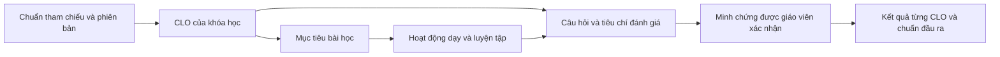

# Thiết kế chuẩn đầu ra và assignment theo CLO cho EduGrade

Ngày khảo sát: 23/10/2026. Cập nhật 24/10/2026: đã triển khai catalog CLO bản nháp, nguồn và API duyệt tại [clo-implementation-guide.md](clo-implementation-guide.md); thiết kế đánh giá mức đạt CLO bên dưới chưa được triển khai đầy đủ. Phạm vi khảo sát ban đầu là mã nguồn, schema và seed trong repository; chưa kiểm tra dữ liệu production hoặc tài liệu giáo viên lưu ngoài hệ thống.

## 1. Kết luận kiểm tra hiện trạng

**Có rubric chấm từng câu, mục tiêu bài học bằng văn bản và quy trình duyệt giáo trình; chưa có hệ thống chuẩn đầu ra có thể truy vết và đo lường.** Không đủ bằng chứng để khẳng định các chương trình hiện tại đạt một chuẩn quốc gia hay chứng chỉ cụ thể.

| Thành phần | Bằng chứng trong repository | Ý nghĩa và khoảng trống |
| --- | --- | --- |
| Chương trình theo môn/khối | `prisma/schema.prisma`, model `Program`: subject, grade | Khối lớp không phải thang năng lực; chưa có standard, targetLevel, CLO |
| Giáo trình có phiên bản | `CurriculumUnit`: version, basedOnId, reviewerTeacherId, technicalReviewedAt | Có quản trị phiên bản và người duyệt; chưa có ma trận đối chiếu yêu cầu cần đạt |
| Duyệt chuyên môn | `src/modules/curriculum-scheduling/curriculum-scheduling.service.ts`, `approveUnit` | Kiểm tra giáo viên duyệt, bài học và thứ tự; không kiểm tra độ bao phủ CLO |
| Mục tiêu bài học | `src/database/seeds/curriculum-content.ts`, phần `## Mục tiêu` | Văn bản minh họa; đầu file xác nhận không phải giáo trình được cung cấp. Chưa có mã mục tiêu, nguồn, ngưỡng đo |
| Assignment | `src/modules/academic/assessment.service.ts`, `validateDefinition` | Kiểm tra loại bài, hạn nộp, đáp án trắc nghiệm, rubric tự luận không rỗng; không xác nhận đề đúng level |
| Rubric | `AssignmentQuestion.rubric: String?`, `maxScore` | Chưa có tiêu chí cấu trúc, mức đạt, trọng số, CLO hay phiên bản rubric riêng |
| AI chấm | `src/modules/academic/grading-worker.service.ts` | AI nhận rubric, đáp án, điểm tối đa và đề xuất điểm; không tự cung cấp chuẩn học thuật |
| Kết quả | `GradeReview.scores`, `totalScore`; `docs/parent-learning-api.md` | Có revision và điểm công bố; trung bình theo môn là mô tả, chưa phải kết quả đạt CLO |
| Người học xem tiêu chí | `assessment.service.ts`, `detail`, `submit` | Rubric chỉ trả cho TEACHER; luồng nộp hiện dùng PARENT. Chưa có giao diện API tiêu chí công khai riêng cho học sinh |

Vì vậy, “bài có rubric” và “giáo trình đã được duyệt” chưa đồng nghĩa với “học sinh đạt chuẩn đầu ra”. Dữ liệu demo Toán, Vật lý, Hóa học, Sinh học khối 6–9 cũng không tự chứng minh sự tương thích với chương trình phổ thông.

## 2. Căn cứ tham khảo và cách sử dụng

Đã đọc/trích xuất tài liệu công khai của các hệ thống tương tự; dưới đây là diễn giải phục vụ thiết kế, không sao chép giáo trình.

| Nguồn | Điều tham khảo | Áp dụng cho EduGrade |
| --- | --- | --- |
| [Moodle Competencies](https://docs.moodle.org/503/en/Competencies), [Learning plans](https://docs.moodle.org/503/en/Learning_plans) | Khung năng lực, kế hoạch học tập, liên kết hoạt động và minh chứng | Tách khung chuẩn, mục tiêu, bài học và bằng chứng đánh giá |
| [Canvas Outcomes](https://community.instructure.com/en/kb/articles/662762-what-are-outcomes), [Create an outcome](https://community.instructure.com/en/kb/articles/660920-how-do-i-create-an-outcome-for-a-course) | Outcome liên kết rubric, ngưỡng mastery và cách tính | Điểm assignment và mức đạt CLO là hai kết quả riêng |
| [Canvas Learning Mastery Gradebook](https://community.instructure.com/en/kb/articles/660867-how-do-i-use-the-learning-mastery-gradebook-to-view-outcome-results-in-a-course-from-the-gradebook) | Theo dõi từng người học theo từng outcome | Báo cáo ma trận học sinh × CLO |
| [IELTS scoring](https://www.ielts.org/take-a-test/your-results/ielts-scoring-in-detail), [British Council assessment](https://takeielts.britishcouncil.org/teach-ielts/test-information/assessment?language=en) | Thang điểm và tiêu chí theo kỹ năng | Hồ sơ IELTS phải dùng rubric và quy đổi IELTS, không dùng thang phần trăm tự đặt |
| [Trang công bố chương trình môn Toán của trường THCS An Đồng](https://thcsandong.haiphong.edu.vn/van-ban-bo-gddt/chuong-trinh-giao-duc-pho-thong-mon-toan-ban-hanh-kem-theo-thong-tu-so-322018tt/vbct/20343/91425) | Có tài liệu chương trình môn Toán kèm Thông tư 32/2018 | Điểm khởi đầu để người phụ trách chuyên môn đối chiếu từng yêu cầu cần đạt |

Giới hạn nguồn phổ thông: đã xác minh trang công bố, chưa trích xuất toàn bộ phụ lục môn học và các cập nhật. PDF chương trình tổng thể trên moet.gov.vn bị timeout khi đọc. Vì thế mẫu CLO bên dưới là **chuẩn nội bộ đề xuất**, chưa được gắn nhãn “đạt CTGDPT 2018”. Trước khi gắn nhãn đó cần lưu bản nguồn áp dụng, mục/trang cụ thể, đối chiếu phiên bản hiện hành và được người phụ trách chuyên môn xác nhận. Các nhãn Vật lý/Hóa học/Sinh học hiện tại cần được đối chiếu phạm vi Khoa học tự nhiên ở THCS, không mặc nhiên coi là ba chương trình chính khóa độc lập.

## 3. Khung EduGrade Outcomes v1

Chuỗi căn cứ bắt buộc:

- **Chuẩn tham chiếu:** yêu cầu bên ngoài hoặc chuẩn nội bộ đã duyệt; có nguồn và phạm vi.
- **CLO (Course Learning Outcome):** sau khóa học, người học làm được việc gì, trong điều kiện nào, ở mức nào.
- **Mục tiêu bài học:** bước nhỏ góp phần vào CLO; một bài có thể phục vụ nhiều CLO.
- **Rubric:** các tiêu chí quan sát được và mô tả mức chất lượng của một sản phẩm/bài làm.
- **Blueprint:** ma trận cho biết bài/câu/tiêu chí nào đo CLO nào, với bao nhiêu điểm và loại minh chứng.

Mẫu phát biểu: “Sau [phạm vi học], học sinh có thể [hành động quan sát được] đối với [nội dung], trong [điều kiện], đạt [tiêu chí đo].” Tránh chỉ viết “hiểu”, “nắm vững” mà không có hành vi kiểm chứng.

Mỗi CLO cần: code, version, statement, subject/grade, phạm vi nội dung, điều kiện đầu vào, targetLevel, nguồn + mục/trang, required, phương thức đánh giá, ngưỡng đạt, số minh chứng tối thiểu, người duyệt. CLO nội bộ ghi nguồn `INTERNAL` và cơ sở chuyên môn; không bịa mã chuẩn bên ngoài.

## 4. Bộ CLO mẫu có thể dùng để pilot

Phạm vi: **chuyên đề phương trình bậc nhất một ẩn**, phù hợp để giáo viên cân nhắc cho nhóm Toán THCS; không đại diện toàn bộ chuẩn đầu ra cả năm Toán. Đầu vào: phép tính số hữu tỉ, biến đổi biểu thức đơn giản. Bài chẩn đoán đầu khóa dùng để lập kế hoạch phụ đạo, không tính đạt chuẩn.

| Mã | Đầu ra đo được | Điều kiện và minh chứng | Ngưỡng đề xuất |
| --- | --- | --- | --- |
| EQ-CLO1 | Phân biệt phương trình bậc nhất một ẩn và xác định hệ số a, b với a khác 0 | Phân loại 5 biểu thức mới, không dùng gợi ý | Đúng ít nhất 4/5 trong mỗi lần đo |
| EQ-CLO2 | Giải phương trình và giải thích các phép biến đổi tương đương | Bài viết cá nhân có các bước giải; đề có biến thể chưa luyện nguyên mẫu | Ít nhất 70% điểm tiêu chí giải và lập luận |
| EQ-CLO3 | Lập phương trình từ tình huống thực tế rồi diễn giải nghiệm | Tình huống giá tiền/số lượng; ghi ẩn, đơn vị, điều kiện, phương trình, kết luận | Ít nhất 70% điểm tiêu chí mô hình hóa và diễn giải |
| EQ-CLO4 | Kiểm tra nghiệm và xác định/sửa lỗi trong lời giải cho trước | Thay nghiệm và sửa một lời giải sai có giải thích | Ít nhất 70% điểm tiêu chí kiểm chứng và sửa lỗi |

Mỗi CLO cần **hai lần đo độc lập trên hai assignment khác nhau**, ít nhất một lần là bài xác nhận có giám sát. Cả hai lần đều đạt ngưỡng; lần mới nhất là bài xác nhận. Một bài nộp lại không tạo thêm lần đo độc lập. Toàn bộ bốn CLO của pilot là bắt buộc.

Các tỷ lệ 70%, 4/5 và yêu cầu hai minh chứng là quyết định thiết kế nội bộ, không phải quy định của Moodle, Canvas, Bộ GDĐT hoặc IELTS. Cần pilot và hiệu chỉnh bằng bài làm thật trước khi áp dụng rộng.

Gợi ý mở rộng, phải cụ thể hóa theo từng chuyên đề: Vật lý — chọn đại lượng, đo, xử lý số liệu, giải thích hiện tượng; Hóa học — biểu diễn chất/phản ứng trong phạm vi đã học, giải thích và vận dụng; Sinh học — nhận diện cấu trúc, giải thích chức năng, đọc dữ liệu và vận dụng. Không dùng cùng một câu CLO chung cho mọi khối.

## 5. Giáo trình, đề kiểm tra và rubric mẫu

| Buổi | Nội dung | CLO | Hoạt động/bằng chứng |
| --- | --- | --- | --- |
| 1 | Chẩn đoán, dạng phương trình, hệ số | 1 | Phân loại và giải thích lựa chọn |
| 2 | Biến đổi tương đương và giải | 2 | Bài luyện có phản hồi |
| 3 | Kiểm tra nghiệm, tìm lỗi | 4 | So sánh hai lời giải |
| 4 | Mô hình hóa tình huống | 3 | Lập phương trình và diễn giải |
| 5 | Kiểm tra A, phân tích lỗi | 1–4 | Lần đo độc lập đầu tiên |
| 6 | Phụ đạo theo CLO, bài xác nhận B | 1–4 | Đề mới, có giám sát; phản hồi sau bài |

Blueprint cho mỗi đề A/B (20 điểm; A và B khác câu nhưng tương đương phạm vi/độ khó):

| Cụm câu/tiêu chí | Điểm tối đa | CLO |
| --- | ---: | --- |
| Q1: phân loại 5 biểu thức, mỗi biểu thức 1 điểm | 5 | 1 |
| Q2a: biến đổi và giải phương trình | 3 | 2 |
| Q2b: giải thích bước biến đổi | 2 | 2 |
| Q3a: chọn ẩn/điều kiện, lập phương trình | 3 | 3 |
| Q3b: diễn giải kết quả trong tình huống | 2 | 3 |
| Q4a: thay nghiệm và kết luận | 2 | 4 |
| Q4b: tìm lỗi, sửa và giải thích | 3 | 4 |

Q3 cung cấp nghiệm sau phần lập phương trình để đo mô hình hóa/diễn giải mà không chấm trùng năng lực giải của CLO2. Mỗi đơn vị điểm chỉ gắn một CLO ở MVP. Nếu một câu đo nhiều CLO, tách tiêu chí có điểm riêng như bảng trên; không lấy toàn bộ điểm câu cộng cho từng CLO.

Rubric công khai cho Q3a, thang 0–3:

| Mức | Mô tả quan sát được |
| ---: | --- |
| 0 | Bài đã được đánh giá nhưng không thể hiện được ẩn hoặc quan hệ phù hợp |
| 1 | Chọn được ẩn nhưng quan hệ/phương trình còn sai trọng tâm |
| 2 | Chọn ẩn và lập đúng phương trình; thiếu điều kiện hoặc đơn vị có liên quan |
| 3 | Chọn ẩn rõ, điều kiện/đơn vị phù hợp, lập đúng phương trình và giải thích được quan hệ |

Q3b, thang 0–2: 0 = kết luận sai/không có; 1 = diễn giải đúng đại lượng nhưng thiếu đơn vị hoặc chưa đối chiếu điều kiện; 2 = kết luận đúng đại lượng, đơn vị và tính phù hợp. Từng tiêu chí còn lại cũng phải có descriptor cụ thể trước khi phát hành; không dùng một rubric chung “đúng/khá/tốt” cho mọi câu.

Học sinh/phụ huynh được xem CLO, rubric công khai, điểm tối đa và điều kiện đạt ngay khi giao bài. Đáp án, lời giải mẫu và ghi chú chấm nội bộ là trường riêng, chỉ công bố theo chính sách đáp án hiện có.

## 6. Cách kết luận đạt chuẩn

Với mỗi assignment j và CLO c:

`evidencePercent(c,j) = 100 × tổng điểm tiêu chí thuộc c / tổng điểm tối đa các tiêu chí thuộc c`.

Chỉ lấy revision PUBLISHED mới nhất của lượt làm được xác nhận là minh chứng hợp lệ. Điểm AI nháp không được tính. Khi chấm lại, revision mới thay revision cũ; không cộng cả hai. Khi thi lại, lượt mới thay bằng chứng của cùng cơ hội đánh giá sau khi giáo viên xác nhận; không chọn điểm cao nhất ngầm định. Đang chờ chấm lại phải hiển thị rõ kết quả cũ và trạng thái chờ cập nhật.

Trạng thái CLO:

- `NOT_ASSESSED`: chưa có minh chứng hợp lệ; không quy thành 0.
- `INSUFFICIENT_EVIDENCE`: chưa đủ hai assignment độc lập hoặc thiếu bài xác nhận.
- `NOT_YET_MET`: đủ minh chứng nhưng một trong hai lần được chọn chưa đạt ngưỡng.
- `MET`: hai lần độc lập mới nhất trong phạm vi khóa đều đạt ngưỡng và lần cuối là bài xác nhận có giám sát.

Kết quả khóa = `MET` khi tất cả CLO bắt buộc đạt. Điểm trung bình, chuyên cần và tỷ lệ nộp bài được hiển thị riêng, không bù cho CLO chưa đạt. Không nộp bài là thiếu minh chứng; nếu quy chế tính điểm bài đó bằng 0 thì vẫn giữ phân biệt này trong báo cáo CLO.

Ví dụ: A có CLO1=4/5, CLO2=4/5, CLO3=3/5, CLO4=4/5; B có 5/5, 4/5, 4/5, 4/5. Tổng điểm A=75%, B=85%, nhưng CLO3 chưa đạt vì lần A chỉ 60%. Học sinh nhận bài phụ đạo và bài xác nhận C cho CLO3; nếu C≥70%, hai lần mới nhất B/C đạt thì CLO3 đạt. Bài C phải là nhiệm vụ mới được duyệt tương đương, không chỉ sửa đáp án A sau khi đã xem lời giải.

## 7. Ví dụ IELTS Academic mục tiêu 5.0

Đây là hồ sơ mở rộng để minh họa yêu cầu của người dùng, không phải môn đang có trong seed. Chuẩn tham chiếu là IELTS, rubric band descriptor chính thức theo phiên bản, không lấy phần trăm của pilot Toán quy thành band.

| CLO | Minh chứng | Chuẩn mục tiêu |
| --- | --- | --- |
| IELTS-L | Bài Listening đủ cấu trúc và điều kiện thời gian | Band 5.0 theo bảng quy đổi của bộ đề |
| IELTS-R | Bài Academic Reading đủ cấu trúc | Band 5.0 theo bảng quy đổi phù hợp Academic |
| IELTS-W | Cả Writing Task 1 và Task 2 | Band 5.0, theo bốn tiêu chí chính thức và trọng số task |
| IELTS-S | Bài Speaking đủ ba phần, giáo viên đánh giá | Band 5.0 theo bốn tiêu chí chính thức |

IELTS công bố mốc trung bình tham khảo band 5: Listening 16/40, Academic Reading 15/40, General Training Reading 23/40; ngưỡng thực tế có thể thay đổi theo phiên bản đề. Writing chấm bốn tiêu chí về đáp ứng đề, tổ chức ý, từ vựng và ngữ pháp; Speaking chấm độ trôi chảy/mạch lạc, từ vựng, ngữ pháp, phát âm. Xem [nguồn IELTS](https://www.ielts.org/take-a-test/your-results/ielts-scoring-in-detail).

Chính sách khóa đề xuất: mỗi kỹ năng đạt ít nhất 5.0 trong hai mock độc lập được giáo viên xác nhận. Đây là yêu cầu nội bộ chặt hơn chỉ đặt mục tiêu overall 5.0; phải công bố rõ. Báo cáo ghi “đạt mục tiêu nội bộ qua mock test”, không ghi “đã có chứng chỉ IELTS”. Không tự suy ra band bằng AI hoặc ánh xạ CEFR một-một. Bộ chấm IELTS là strategy riêng, không dùng công thức mastery phần trăm tại mục 6.

## 8. Thiết kế dữ liệu bổ sung

| Thực thể đề xuất | Dữ liệu chính và ràng buộc |
| --- | --- |
| StandardFrameworkVersion | code, version, issuer, sourceUrl, sourceLocator, retrievedAt, phạm vi, trạng thái xác minh; nguồn nội bộ được đánh dấu riêng |
| OutcomeSetVersion | programId, frameworkVersionId, version, entryRequirements, targetLevel, assessmentPolicy, approval; bất biến sau duyệt |
| LearningOutcome | outcomeSetVersionId, code, statement, scope, required, threshold, minEvidence; unique(setVersion, code) |
| OutcomeSourceMapping | outcomeId, sourceLocator, nội dung đối chiếu và reviewer; hỗ trợ nhiều nguồn cho một CLO |
| CurriculumOutcomeBinding | curriculumUnitId, outcomeSetVersionId; không suy phiên bản từ tên chương trình |
| LessonOutcome | lessonId, outcomeId, mức đóng góp INTRODUCE/PRACTICE/ASSESS |
| AssessmentBlueprint | assignmentId, outcomeSetVersionId, purpose FORMATIVE/SUMMATIVE/DIAGNOSTIC, verificationMode, approval; snapshot lúc publish |
| RubricVersion / RubricCriterion | publicDescriptor, privateMarkingGuide, mức điểm, maxScore, outcomeId; mỗi criterion đo một CLO ở MVP |
| QuestionCriterion | questionId, criterionVersionId; tổng maxScore tiêu chí phải bằng maxScore câu |
| CriterionScore | gradeReviewId, criterionId, score, feedback, evidenceLocator; unique(gradeReviewId, criterionId) |
| OutcomeEvidence | studentId, enrollmentId, courseOfferingId, outcomeVersionId, assignmentId, submissionId, gradeReviewId, status, verifiedBy; không nhân đôi khi đổi lớp |
| AttainmentSnapshot | studentId, courseOfferingId, outcomeSetVersionId, policyVersion, calculatedAt, evidenceIds, kết quả; có thể tái tính và audit |

`courseOfferingId` là định danh lần học cùng một bộ chuẩn, cần bổ sung vì Class/Enrollment hiện chưa đủ thể hiện phạm vi tổng hợp qua chuyển lớp. Bằng chứng cũ chỉ được chuyển khi cùng bộ chuẩn hoặc có ánh xạ tương đương được duyệt. Không gộp mọi năm học hay mọi lớp có cùng tên môn.

Giữ `rubric` cũ cho dữ liệu legacy. Dùng Decimal hoặc điểm nguyên theo đơn vị nhỏ nhất cho điểm mới; so ngưỡng trước khi làm tròn. Không tự tách rubric văn bản cũ thành tiêu chí chính thức bằng AI.

## 9. Luồng nghiệp vụ và API đề xuất

1. Designer chọn nguồn, tạo bộ CLO và curriculum mapping. Teacher được phân công duyệt tính phù hợp chuyên môn; Manager phê duyệt phát hành sau bước này.
2. Trước duyệt giáo trình: mọi CLO bắt buộc phải có bài dạy, hoạt động luyện và kế hoạch đánh giá; không cho qua chỉ vì đủ số buổi.
3. Teacher soạn assignment, chọn bộ chuẩn, gắn từng câu/tiêu chí với CLO và mô tả rubric. Bài luyện chỉ cần phủ các CLO mục tiêu của bài; bộ đánh giá cuối khóa phải phủ toàn bộ CLO bắt buộc.
4. Publish kiểm tra phiên bản được duyệt, cùng phạm vi chương trình, ma trận điểm, rubric và điều kiện minh chứng. Snapshot chuẩn/rubric/blueprint trong cùng transaction; khóa sửa sau publish.
5. Học sinh/phụ huynh xem mục tiêu và tiêu chí. Hiện tại dùng PARENT theo quyền sở hữu học sinh; thêm tài khoản STUDENT là phạm vi triển khai riêng.
6. Chấm điểm từng tiêu chí, giáo viên xác nhận, publish GradeReview; hệ thống tính lại CLO idempotently và lưu provenance. AI chỉ gợi ý theo đúng rubric snapshot.
7. Báo cáo thiếu CLO nào thì giao bài phụ đạo cho CLO đó; kết quả mới giữ lịch sử bằng chứng và chính sách áp dụng.

Các route mới dự kiến (chưa tồn tại):

| API | Mục đích/quyền |
| --- | --- |
| `POST /programs/:id/outcome-sets` | Designer tạo draft |
| `POST /outcome-sets/:id/technical-review` | Teacher được chỉ định nhận xét/xác nhận |
| `POST /outcome-sets/:id/approve` | Manager duyệt sau chuyên môn |
| `PUT /lessons/:id/outcomes` | Designer mapping trong draft |
| `PUT /academic/assignments/:id/blueprint` | Teacher phụ trách lớp cập nhật draft |
| `GET /academic/assignments/:id/learning-targets` | Người nhận bài qua PARENT/teacher; chỉ trả tiêu chí công khai |
| `GET /students/:id/outcome-attainment` | Parent đúng con hoặc nhân sự có phạm vi; bắt buộc courseOfferingId |
| `GET /classes/:id/outcome-coverage` | Teacher/manager có quyền xem lớp |

Thông báo validation dự kiến: `OUTCOME_SET_NOT_APPROVED`, `OUTCOME_SCOPE_MISMATCH`, `REQUIRED_OUTCOME_UNCOVERED`, `CRITERION_SCORE_MISMATCH`, `PUBLIC_RUBRIC_REQUIRED`. Thiếu minh chứng là trạng thái học tập, không phải lỗi HTTP khi xem báo cáo.

## 10. Phạm vi triển khai và nghiệm thu

**MVP:** pilot một chuyên đề Toán; nguồn nội bộ minh bạch; CLO versioning, mapping bài học, rubric cấu trúc, blueprint, criterion scores và báo cáo bốn trạng thái. Chưa làm tự động cào toàn bộ giáo trình, tự suy chuẩn hoặc chứng nhận IELTS.

Migration bổ sung, không sửa điểm/bài cũ. Dữ liệu cũ mang trạng thái `UNMAPPED_LEGACY`; chỉ nhập vào tính CLO sau đối chiếu và xác nhận thủ công có audit. Không tự tạo bằng chứng đạt chuẩn từ totalScore cũ. Feature flag bật theo chương trình đã chuẩn bị dữ liệu; giao bài legacy vẫn hoạt động.

Điều kiện nghiệm thu:

- Chặn publish khi bộ chuẩn sai phạm vi/chưa duyệt hoặc tổng điểm tiêu chí không khớp câu.
- Chặn duyệt kế hoạch đầu ra nếu CLO bắt buộc không có hoạt động và bài đo dự kiến.
- Parent đúng con xem được rubric công khai nhưng không nhận đáp án/ghi chú nội bộ trước mốc cho phép; parent khác bị từ chối.
- Hai CLO yếu không bị điểm CLO khác bù; ví dụ ở mục 6 cho kết quả đúng.
- Chưa nộp/chưa chấm hiển thị thiếu minh chứng; điểm AI không làm đổi trạng thái đạt.
- Chấm lại, thi lại, job chạy lại không nhân đôi bằng chứng; grade bị thu hồi loại khỏi tính toán và tạo snapshot mới.
- Sửa phiên bản rubric/chuẩn không làm thay kết quả khóa cũ; chuyển lớp giữ đúng phạm vi và lịch sử.
- Trước mở rộng, giáo viên chấm độc lập cùng một tập bài mẫu, đối chiếu điểm bất đồng và chỉnh descriptor; lưu biên bản duyệt ngưỡng và đề tương đương.

Kết quả bàn giao của đợt này là tài liệu thiết kế và khảo sát. Cần triển khai migration, service, DTO, API và các kiểm thử trên để hệ thống thực sự vận hành theo CLO.
